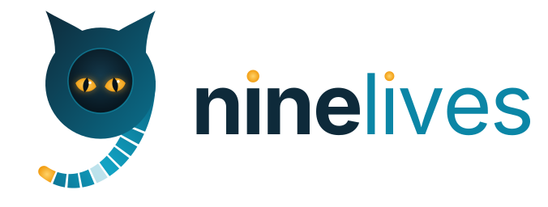

  <picture>
    <source media="(prefers-color-scheme: dark)" srcset="docs/brand/horizontal-dark.svg">
    
  </picture>

# NineLives

  
  
  

A distributed operating system built on the [Felix](https://github.com/GetFelix/felix) log.

> **Status:** design stage. Nothing boots yet. The choices for the first three
> milestones are made and recorded in [docs/decisions](docs/decisions/). The
> plan, the questions still open and what each milestone needs from felixd are
> in [docs/design.md](docs/design.md), and the work is tracked in
> [milestones](https://github.com/GetFelix/ninelives/milestones).

## What it is

NineLives treats a cluster as one machine. Every change to the system is a
durable, ordered record in a Felix log: what should run, where it runs, what
each program received and what it produced. A program's state can be rebuilt
from that log on any machine, so when a machine dies its programs carry on
somewhere else. That is where the name comes from.

The pieces:

- **A bootable image** for each machine: a pinned stock Linux kernel, our own
  init as PID 1, a read-only root and atomic upgrades that can roll back
  (A/B partitions are the current proposal).
- **[felixd](https://github.com/GetFelix/felixd)**, the node agent that runs
  workloads from the log. It has its own repo; the image ships its
  releases, pinned by hash and checked against felixd's signature.
- **Felix brokers** on some of the machines.
- **System programs on the log:** the scheduler, the name service and the
  `fx` shell.

The kernel would handle drivers, memory and local processes. NineLives is for
what a single machine's kernel can't do across machines: processes that
outlive a machine, pipes and files that are durable streams, and a history you
can replay.

Existing programs are meant to run unmodified through felixd's native tier,
which is not built yet; until then workloads are WebAssembly. Failures are
reported, never hidden behind a hang. The reasoning, from what held Plan 9 back, is in
[Lessons from Plan 9](docs/design.md#lessons-from-plan-9), with a second
look at one machine as a failure domain in
[Lessons from Barrelfish](docs/design.md#lessons-from-barrelfish).

## Layout

| Directory | What it holds |
|---|---|
| `boot/` | Bootloader configuration, UEFI and secure-boot signing |
| `kernel/` | The pinned Linux version and the config fragments we change |
| `init/` | Our init (PID 1), in Rust: mounts, reaping, starting the role's services, shutdown |
| `rootfs/` | The image definition: read-only root, data partition, A/B partitions (proposed) |
| `system/` | Programs that run on the log: scheduler, name service, `fx` shell |
| `tools/` | The `fx` CLI, image build wrappers, flashing, the qemu runner |
| `images/` | Build targets (qemu x86_64 and aarch64, later clouds and Raspberry Pi) and `components.toml`, the pinned Felix and felixd releases |
| `docs/` | The design, [decision records](docs/decisions/), [component designs](docs/components/) and the [felixd contract](docs/felixd-contract.md) |

Images are built with [mkosi](https://github.com/systemd/mkosi), in CI.

## Website

[ninelives.getfelix.dev](https://ninelives.getfelix.dev) is built from [`site/`](site/). See its README.

## Building

Nothing builds yet. The first milestone produces an image that boots in qemu,
and the third boots three of them into a cluster that survives losing one.
Images build on Linux only, in CI.

How work moves from decision to design to code, and the standards code is
held to, are in [CONTRIBUTING.md](CONTRIBUTING.md).

## The logo

A cat whose head and tail make a 9. The tail is the tail of the log: nine
records, one of them lost after a machine died, and the newest glowing amber
like the eyes. The files and how to regenerate them are in
[docs/brand](docs/brand/).

## License

MIT for everything in this repository. Built images also contain Linux and
other GPL software, and Felix (AGPL-3.0), which keep their own licenses; see
[docs/design.md](docs/design.md#licensing).
