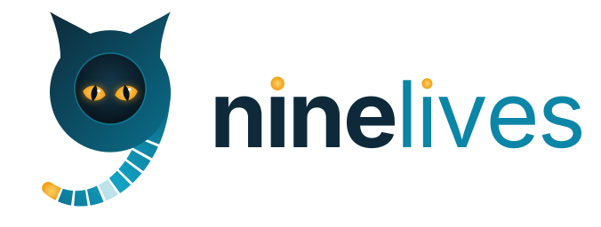

  <picture>
    <source media="(prefers-color-scheme: dark)" srcset="docs/brand/horizontal-dark.svg">
    
  </picture>

# NineLives

A distributed operating system built on the [Felix](https://github.com/GetFelix/felix) log.

> **Status:** design stage. Nothing boots yet, and most choices, including the
> kernel, are still open. The plan is in
> [docs/design.md](docs/design.md) and the work is tracked in
> [milestones](https://github.com/GetFelix/ninelives/milestones).

## What it is

NineLives treats a cluster as one machine. Every change to the system is a
durable, ordered record in a Felix log: what should run, where it runs, what
each program received and what it produced. A program's state can be rebuilt
from that log on any machine, so when a machine dies its programs carry on
somewhere else. That is where the name comes from.

The pieces:

- **A bootable image** for each machine: a pinned kernel, a read-only root
  and atomic upgrades that can roll back. A/B partitions are the current
  proposal; the kernel is an
  [open question](https://github.com/GetFelix/ninelives/discussions/22).
- **[felixd](https://github.com/GetFelix/felixd)**, the node agent that runs
  workloads from the log. It has its own repo; this one ships it.
- **Felix brokers** on some of the machines.
- **System programs on the log:** the scheduler, the name service and the
  `fx` shell.

The kernel would handle drivers, memory and local processes. NineLives is for
what a single machine's kernel can't do across machines: processes that
outlive a machine, pipes and files that are durable streams, and a history you
can replay.

Existing programs run unmodified from the start, and failures are reported,
never hidden behind a hang. The reasoning, from what held Plan 9 back, is in
[Lessons from Plan 9](docs/design.md#lessons-from-plan-9).

## Layout

| Directory | What it holds |
|---|---|
| `boot/` | Bootloader configuration (systemd-boot is proposed), UEFI and secure-boot signing |
| `kernel/` | Kernel config fragments and a pinned version, if stock Linux is chosen. |
| `felixd/` | The node agent, as a git submodule pinned to a felixd commit |
| `init/` | Early boot: mounts, network, first-boot cluster join, starting felixd |
| `rootfs/` | The image definition: read-only root, A/B partitions (proposed) |
| `system/` | Programs that run on the log: scheduler, name service, `fx` shell |
| `tools/` | The `fx` CLI, image build wrappers, flashing, the qemu runner |
| `images/` | Build targets: qemu x86_64 and aarch64, cloud images, Raspberry Pi |
| `docs/` | Design, boot sequence, threat model |

The proposal is to build images with [mkosi](https://github.com/systemd/mkosi).

## Website

[ninelives.getfelix.dev](https://ninelives.getfelix.dev) is built from [`site/`](site/). See its README.

## Building

Clone with `git clone --recurse-submodules`, or run
`git submodule update --init` in an existing clone.

Nothing builds yet. The first milestone produces an image that boots in qemu, and the
third boots three of them into a cluster that survives losing one.

## The logo

A cat whose head and tail make a 9. The tail is the tail of the log: nine
records, one of them lost after a machine died, and the newest glowing amber
like the eyes. The files and how to regenerate them are in
[docs/brand](docs/brand/).

## License

MIT for everything in this repository. If the kernel is Linux, built images
will also contain it and other GPL software, which keep their own licenses; see
[docs/design.md](docs/design.md#licensing).
