# NineLives brand

<p align="center">
  <picture>
    <source media="(prefers-color-scheme: dark)" srcset="mark-animated-dark.svg">
    
  </picture>
</p>

## The mark

- **The 9.** The head is the bowl of the numeral and the tail is its stem. It also nods to Plan 9.
- **Nine records.** The tail is nine segments: records appended to a log.
- **The lost one.** One record is faint, for a machine that died while the workload carried on. In the
  animated mark it comes back.
- **The glowing tip.** The newest record is amber, the same light as the eyes: the tail of the log.
- **Eyes in the dark.** The eyes glow out of a dark counter on any background, so the mark still reads at 16 px.

## Files

| File | Use |
|---|---|
| `horizontal-light.svg`, `horizontal-dark.svg` | Mark and wordmark side by side. README headers, site headers. |
| `stacked-light.svg`, `stacked-dark.svg` | Mark above the wordmark. Square spaces, slides, stickers. |
| `mark-light.svg`, `mark-dark.svg` | The mark alone. Avatars, favicons, app icons. |
| `mark-animated-light.svg`, `mark-animated-dark.svg` | The mark with the blink, the pulse down the tail and the lost record returning. Stops under reduced motion. |
| `social-preview.png` | 1280×640 image for GitHub's social preview (Settings, General, Social preview) and link cards. Everything sits at least 40 px inside the edges. `social-preview.svg` is its source. |
| `*.png` | Transparent PNG exports of the same, for places that don't take SVG. |

`light` files are for light backgrounds and `dark` files for dark ones. In a GitHub README, pick by
theme with `<picture>` and `prefers-color-scheme`, as the repository README does.

## Illustrations

Drawings for posts, docs and the site follow [illustrations.md](illustrations.md): the cat as the
workload, machines as rounded boxes, the log as a row of tail segments, and colours from the site's
theme. [`illustration-reference.svg`](illustration-reference.svg) is the drawing to copy from.

## Colors

| | |
|---|---|
| Deep teal | `#0e2a3a` |
| Felix teal | `#12a3c4` |
| Light teal | `#5fd3ef` |
| Eye amber | `#f5a623` |
| Night | `#0b1a24` |

The wordmark is [Inter](https://rsms.me/inter/) (SIL Open Font License), converted to outlines, so no
font is needed to display it. "nine" is bold and "lives" regular, and the dots on the i's are amber.

## Regenerating

The SVGs are generated by `scripts/brand/`. It needs Python 3 with `fontTools` and Inter 4.1, which
is not committed:

```bash
cd scripts/brand
curl -sLO https://github.com/rsms/inter/releases/download/v4.1/Inter-4.1.zip
unzip -q Inter-4.1.zip 'extras/otf/*' -d font && rm Inter-4.1.zip
python3 build.py && python3 anim.py && python3 social.py
```

The PNGs are exports of the SVGs at 512 px (mark) and about 1500 px wide (lockups).
