# Illustrations

How NineLives draws pictures for posts, docs and the site. The rules are the same as
[getfelix.dev](https://getfelix.dev)'s illustrations, so the two read as one family, with NineLives'
own cast and colours.



[`illustration-reference.svg`](illustration-reference.svg) is the drawing to copy from. It uses
every piece of the cast below.

## Cast

| Thing | How it's drawn |
|---|---|
| The workload | The cat: the 9 from the mark, a head and a hanging tail. It is always the thing that survives. Keep it small and simple; the eyes carry the expression (open, happy, asleep). |
| A machine | A plain rounded box with two short lines in the top corner and a small label inside, bottom left. |
| A dead machine | The same box, faded and dashed, with its lines and label faded too. Never a red X. |
| The log | Records are tail segments in a horizontal row, oldest on the left. The newest is amber. A lost record is faint, as in the mark. |
| Motion | A curved arrow. Failover is the cat stepping or curling onto another machine. |

## Construction

- Flat vector. 2 px strokes with round caps and joins. No shadows, no gradients. The mark is the
  only exception.
- The three teals are the structure: deep teal `#0e2a3a`, Felix teal `#12a3c4` and light teal
  `#5fd3ef`. Amber `#f5a623` is the only accent, and only for the one thing that matters most in
  that drawing. Usually that is the newest record. When the cat itself is the point, its eyes take
  the amber instead, and nothing else does.
- Faint means gone. Use it for dead machines and lost records, not for emphasis or decoration.
  Something that doesn't exist yet is an empty outline, not faint.
- Amber is never the only cue. Pair it with a label or a position, because amber on the light
  background is low contrast.
- Labels are small, lowercase and in the site's mono font (IBM Plex Mono, 13 px at the drawing's
  size). Use as few as the drawing needs. The explanation goes in the caption, not in the image.
- Figures are 3:2 (`viewBox="0 0 720 480"`). Social cards are 1200x630.
- Every figure has real alt text that says what is drawn and what it shows.
- Animate only when the motion is the idea: a calm loop, no flashing, and stopped under
  `prefers-reduced-motion`. A still drawing is the default.
- An animated drawing is built with `Loop` in `scripts/brand/illus.py`: every moving part is one
  keyframe track on a shared loop, animating only `transform` and `opacity`. Under
  `prefers-reduced-motion` it holds one chosen frame rather than stopping wherever the shapes
  happen to sit. The 404 page's drawing (`lost_page`, written to `site/static/img/404.svg`) is the
  example.

Do and don't:

| Do | Don't |
|---|---|
| Fade and dash a dead machine. | Put a red X or a skull on it. |
| One amber thing per drawing. | Amber headings, amber arrows and an amber record together. |
| A short mono label: `node b`, `log`. | A sentence inside the picture. |
| Show failover as the cat moving along a curved arrow. | Show it with lightning bolts or explosions. |
| Colours from the `--ill-*` variables. | A hard-coded `fill="#0e2a3a"` that disappears on the dark theme. |
| A transparent background. | A white or navy rectangle behind the drawing. |

## Theme-aware SVG

The site has three themes (light, dark and solarized). An SVG drawn with fixed colours looks right
in one of them, so drawings take their colours from CSS custom properties that
`site/static/css/site.css` sets for each theme:

| Variable | Use | Light | Dark and solarized |
|---|---|---|---|
| `--ill-ink` | Outlines, arrows, the cat's outline | deep teal | light teal |
| `--ill-line` | Machine outlines, records | `#0b86a6` (Felix teal darkened, as the wordmark does) | Felix teal |
| `--ill-soft` | Machine fill | light teal at 22% | Felix teal at 16% |
| `--ill-cat` | The cat | deep teal | light teal |
| `--ill-eye` | The cat's eyes | light teal | deep teal |
| `--ill-accent` | The one amber thing | amber | amber |
| `--ill-accent-text` | Amber labels | the site's `--amber-text` | the site's `--amber-text` |
| `--ill-label` | Labels | the site's `--muted` | the site's `--muted` |

A variable only reaches an SVG that is part of the page, so figures are inlined, never loaded with
``. The `figure` component does the inlining for you.

Each drawing carries one `<style>` block with `nl-` prefixed classes (`nl-k`, `nl-m`, `nl-r`,
`nl-new`, `nl-cat` and so on). Each class reads an `--ill-*` variable and falls back to a light or
dark value under `prefers-color-scheme`, so the same file also renders on its own, for example on
GitHub. Don't write colours on the shapes themselves.

The drawings are generated by `scripts/brand/illus.py`, which holds the stylesheet and the cast
(`cat`, `machine`, `records`, `arrow`). Add a new drawing as a function there and run:

```bash
python3 scripts/brand/illus.py
```

## Using a figure in a post

Posts stay plain Markdown. Add a figure on its own line with the `figure` component from
`site/templates/components.html` (Zola 0.23 components replace shortcodes):

```markdown
{{ <figure src="/img/blog/linux-or-our-own-kernel/1-three-vms.svg" alt="Three machines over one log. The middle one is faded and dashed. The cat steps onto the third." caption="Kill one of three VMs and the workload moves with every record intact." /> }}
```

- `src` is the path the site serves, under `site/static/`. An `.svg` is inlined with `alt` as its
  `aria-label`. Anything else becomes an ``.
- `alt` is required.
- `caption` is optional and shows under the figure.

Post images live in `site/static/img/blog/<post-slug>/`, named `<n>-<what-it-shows>.svg` in the
order they appear, for example `2-two-stacks.svg`. Social cards for a post go in the same folder as
`card.png`, 1200x630. The reference drawing is served from `site/static/brand/`.

## Listing thumbnails

A post's first figure doubles as its thumbnail on the blog list. Set it in the front matter:

```toml
[extra]
card = "/img/blog/<post-slug>/1-name.svg"
```

The `card` component inlines the SVG next to the post (decorative, so the link is `aria-hidden`
and the title link is the one screen readers get). Leave `card` out and the post lists without an
image. Keep drawings free of `<title>` so nothing is read twice.

## Checking a drawing

`zola build` in `site/` must pass. Then check each theme's colours against its background:
outlines and labels should stay readable in light, dark and solarized, and nothing should vanish
into the page. Building the site and reading the resolved `--ill-*` values for each theme block in
`public/css/site.css` is enough; no browser needed.
