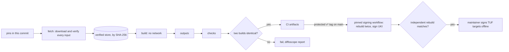

# Image build

The tool and the base are fixed by [0003](../decisions/0003-mkosi-image-build.md)
(mkosi, in CI, reproducible), [0004](../decisions/0004-components-from-pinned-releases.md)
(Felix and felixd from pinned releases), [0006](../decisions/0006-debian-base.md)
(minimal Debian 13 from snapshot.debian.org) and
[0007](../decisions/0007-kernel-from-upstream-source.md) (the kernel from
verified upstream source). This page says how the build meets them. The first
slice of the image, [#1](https://github.com/GetFelix/ninelives/issues/1), is
built: the x86_64 qemu `production` image, fetched, built offline, checked and
booted in CI (see [What the first slice builds](#what-the-first-slice-builds)). This
page is the design, and much of it is later: parts for M3 and later (signing,
rollback, updates), cloud images (M5) and the first published image say so
where they appear, and a part of M0's scope that the slice does not do yet
carries a *Not built yet* note with its issue. Signing and
secure boot [#9](https://github.com/GetFelix/ninelives/issues/9), cloud
images [#13](https://github.com/GetFelix/ninelives/issues/13), component
bumps [#52](https://github.com/GetFelix/ninelives/issues/52) and pinning the
pipeline [#65](https://github.com/GetFelix/ninelives/issues/65).

The build is one of the main ways into a cluster: whatever it ships runs on
every machine. So the design starts from the attacker in the
[threat model](../threat-model.md#supply-chain) who controls one upstream
(X5) or one piece of the pipeline (X6), and asks at each step what stops
their bytes reaching a machine.

## What it does

From one commit of this repository, the build fetches every input by a pin
committed in the repository, verifies each one by hash and, where the
upstream signs, by signature, then builds offline: the kernel from source,
NineLives' own programs, and a root of named Debian packages, Felix and
felixd. It writes the root as a read-only filesystem with a dm-verity hash
tree, puts the kernel, its command line and the root hash into one unified
kernel image (UKI), and lays these out on a GPT disk. It checks the result
against the rules below and fails on any violation. CI runs the whole build
twice, the second time on a clean runner with no cache, and fails unless the
outputs are identical (*not built yet:* the first slice builds once,
[#94](https://github.com/GetFelix/ninelives/issues/94)). That proves the build is deterministic. From the first
published image, an independent rebuild on other hardware must also match
before the maintainer signs the release's update metadata offline. One
pinned signing workflow, and only it, gets the UKI signed (from M3), and the
release publishes the image with its SBOM, provenance and source.

## What the first slice builds

The `image` job in `.github/workflows/ci.yml`, x86_64 qemu, `production` only:
the fetch phase and the offline build described below, the root as erofs with
dm-verity, the UKI with its command line, the GPT disk, and every check in
[Checks](#checks) except the three it names there. The outputs are the `.raw`,
`.root.erofs`, `.root.verity`, `.roothash`, `.efi`, `.inventory.json`,
`.files.json` and `SHA256SUMS`, plus `.origins.json`. The `boot` job then
boots the `.raw` (see [Boot test](#boot-test)). The slice does not build
aarch64, so nothing boots it either
([#99](https://github.com/GetFelix/ninelives/issues/99)), a second
build to compare ([#94](https://github.com/GetFelix/ninelives/issues/94)), or the
SBOM, source or provenance outputs
([#100](https://github.com/GetFelix/ninelives/issues/100)).

### Boot test

The `boot` job runs after `image` in the same workflow run and boots the
`image-qemu-x86_64` artifact of that run. A failed build uploads under another
name, so a failed image is never booted. `tools/boot.sh` runs
`scripts/boot-run.sh` in the bootstrap container, which gets `/dev/kvm` when the
runner has it and no other privilege. The script starts `qemu-system-x86_64` with UEFI firmware,
no display, the serial port written to a log file and a hard timeout. It uses
KVM if the runner has `/dev/kvm` (180 s) and falls back to emulation
otherwise (900 s). The `.raw` is the virtio disk.

- **Pass:** the init's ready line (`"machine":"up"`) appears on the serial
  console, qemu is still running 3 s later, and nothing on the console is a
  kernel panic, an oops, a dm-verity error or an init record whose machine
  state is not `up` after the ready line.
- **Fail:** any of those, the UEFI shell (the firmware found nothing to boot),
  the timeout, or a missing ready line.
- **Corruption.** The job boots two copies of the image, one with a byte
  flipped in block 0 of the root partition and one in block 0 of the hash tree.
  Both are read on every boot. Each must log a `data block` (root) or
  `metadata block` (hash tree) `is corrupted` line from dm-verity, then exactly
  `Kernel panic - not syncing: dm-verity device corrupted`, then qemu must exit
  (it runs with `-no-reboot`, so a guest reset ends it). Any other panic, a
  failed root mount or an oops fails the case, as does the ready line. Without
  `panic_on_corruption` the kernel would return `EIO` and panic on the mount
  instead, which this does not accept.

The serial logs and the verdicts are uploaded as `boot-serial-logs` on every
outcome. `tools/boot.sh` runs the same three boots on a Linux host with docker
or podman. qemu and the firmware are the `boot` set of `images/debian.lock`:
fetched, hash-checked and installed by the same mechanism as the build tools,
never from the runner's apt. The firmware is Debian's `ovmf`, the 4 MiB
`OVMF_CODE_4M.fd`. The bootstrap step that installs `python3` and `gpgv` into
the container is pinned by the same lock ([Bootstrap](#bootstrap)). The
unpinned part is the runner's kernel, KVM and container runtime ([#65](https://github.com/GetFelix/ninelives/issues/65)).
The `boot` job is part of `CI ok`.

## What it does not do

- **No package manager, compiler, shell or interpreter in a production
  image** (S1). They are used to build the image and are not in it.
- **No mutable root.** Nothing on the machine changes the root, the hash
  tree or the UKI. Only an M3 image swap replaces them, and that is
  [#8](https://github.com/GetFelix/ninelives/issues/8)'s design.
- **No per-machine content.** Every machine of one release and architecture
  gets the same bytes. Identity, credentials, the join token and the data
  partition's contents come later, on the machine (S19, S20). A built image
  contains no secret, key or token.
- **No data partition filesystem.** The image reserves the partition. How it
  is formatted, grown and encrypted is
  [#4](https://github.com/GetFelix/ninelives/issues/4)'s and
  [#60](https://github.com/GetFelix/ninelives/issues/60)'s (S16).
- **No initrd.** The kernel is built without initrd support
  (`CONFIG_BLK_DEV_INITRD=n`, [kernel design](kernel.md)), sets up dm-verity
  and mounts the root itself (see [Boot](#boot-without-an-initrd)). An
  initrd is a second root that needs its own checks.
- **No builds outside CI** for anything published (0003). A developer can run
  the same build on Linux to debug it; nothing they build is signed.
- **No retry until the two builds match.** A mismatch fails the run. Retrying
  would hide a nondeterministic input, and an attacker who can steer one can
  make the build ship whichever result they like.
- **No signing key in CI.** CI can ask for a UKI signature only from one
  pinned signing workflow, run for a protected tag ([Signing](#signing)). What
  machines install is decided by update metadata signed offline.
- **No rollback protection before M3.** Until then nothing stops an older
  image from booting. From M3 an older signed image still boots, but cannot
  unseal the machine's credentials and is never installed by the updater
  ([Rollback](#rollback)).

## Interfaces

### Partition layout

One GPT disk per architecture. Partition type GUIDs follow the
[Discoverable Partitions Specification](https://uapi-group.org/specifications/specs/discoverable_partitions_specification/)
where it has one, so standard tools recognise them; the init finds
partitions only by GPT name, on the root's disk (init design, boot step 4).

| # | GPT name | Type | Size | Contents | Written by | Mounted |
|---|---|---|---|---|---|---|
| 1 | `esp` | EFI system partition, vfat | 256 MiB, fixed | The UKI at the removable-media path (`\EFI\BOOT\BOOTX64.EFI`, `BOOTAA64.EFI`). Nothing else: no `loader/`, no `.extra.d/`, no addon, credential or system extension (see [The ESP is input to the stub](#the-esp-is-input-to-the-stub)). From M3, one UKI per slot, as #8 lays out. | The build; from M3 the updater | Never. Firmware reads it. |
| 2 | `ninelives-root-a` | root (per architecture), erofs | The root's size, budgeted | Every file the machine runs | The build | `/`, read-only, through dm-verity |
| 3 | `ninelives-verity-a` | root verity (per architecture) | Set by the root's size | The dm-verity hash tree over partition 2 | The build | Never; the kernel reads it |
| 4, 5 | `ninelives-root-b`, `ninelives-verity-b` | as 2 and 3 | as 2 and 3 | Empty until M3 | The M3 updater | Proposed: reserved now so the layout does not change at M3. #8 decides. |
| 6 | `ninelives-config` | NineLives config, no filesystem | 1 MiB, fixed | Zeros in the image. Provisioning writes the join config here before first boot; on a cloud it stays empty and the join reads cloud metadata. | Provisioning, before first boot | Never as a filesystem ([open question](#open-questions)) |
| 7 | `ninelives-data` | Linux data | The image's minimum; grown on the machine | Unformatted in the image | #4's program on the machine | `data_mount`, `nosuid,nodev,noexec,prjquota`, by the init |

What is mutable where, at run time:

| Place | Mutable? | By whom |
|---|---|---|
| ESP, root, verity partitions | No. The root is erofs, which the kernel cannot write at all, and dm-verity refuses any changed block. | The M3 updater replaces an inactive slot |
| Config partition | No, on the machine | Written once before first boot |
| Data partition | Yes, the one writable disk | Services, in their own directories (init design) |
| `/run`, `/tmp` | Yes, tmpfs, `nosuid,nodev,noexec`, lost at reboot. The init mounts both: `/run` as a fixed early mount, `/tmp` from the `[[mount]]` entry in `init.toml` ([init design](init.md#boot-as-root)). The root only provides the empty mount points. | Services |

**Why erofs.** A read-only filesystem the kernel has no write path for, so a
remount cannot make it writable even before dm-verity is signed.
`mkfs.erofs` writes the same bytes for the same tree and timestamp. The root
is written uncompressed and without extended attributes, because the kernel
is built without erofs compression or xattr support (`EROFS_FS_ZIP=n`,
`EROFS_FS_XATTR=n`, [kernel design](kernel.md)): every erofs CVE so far was
in the compressed paths. The cost is a larger root partition, which the size
budget carries. squashfs is the
alternative with the same properties and an older parser; erofs is proposed
because its kernel code is maintained for exactly this use. erofs is the
choice and it needs no decision record of its own: the root is rebuilt from
pins every time, so the format is not a compatibility promise.

**Why the config partition is raw.** The join config is written by whoever
provisions the machine, so on a machine taken from its owner (X7) it is
attacker input. Mounting a filesystem from it would put the kernel's vfat or
ext4 parser on that input while the init is still root. A fixed-size,
length-prefixed blob read by the join (an unprivileged service) keeps it out
of the kernel and out of PID 1 (T21). The format is the join's design
([#5](https://github.com/GetFelix/ninelives/issues/5)); the image only
provides the partition.

### Boot without an initrd

The UKI holds the kernel (built with `CONFIG_EFI_STUB` and `CONFIG_DM_INIT`,
microcode built in with `CONFIG_EXTRA_FIRMWARE`), the systemd EFI stub that
loads it, `os-release`, an `.sbat` section ([Rollback](#rollback)) and the
command line. The build writes the line and checks it byte for byte. For the
qemu x86_64 target it is, on one line:

```text
init=/usr/lib/ninelives/init console=ttyS0,115200 ro rootfstype=erofs root=/dev/dm-0
dm-mod.waitfor=/dev/vda2,/dev/vda3
dm-mod.create="root,,,ro,0 <sectors> verity 1 /dev/vda2 /dev/vda3 4096 4096 <blocks> 0 sha256 <roothash> <salt> 1 panic_on_corruption"
panic=10 oops=panic page_alloc.shuffle=1 pti=on
sysctl.kernel.kptr_restrict=2 sysctl.kernel.yama.ptrace_scope=3
sysctl.net.core.bpf_jit_enable=1 sysctl.net.core.bpf_jit_harden=2
sysctl.vm.memfd_noexec=2 sysctl.fs.suid_dumpable=0
sysctl.fs.protected_symlinks=1 sysctl.fs.protected_hardlinks=1
sysctl.fs.protected_fifos=2 sysctl.fs.protected_regular=2
sysctl.kernel.perf_event_paranoid=2
```

The words from `panic=10` on are the kernel policy's, in the order of the
kernel's `policy.toml` ([kernel design](kernel.md#the-command-line)); `pti=on`
is x86_64 only. aarch64 uses `console=ttyAMA0` and drops `pti=on`. The build
fails if the line is missing a policy word or holds a word the kernel design
forbids (`mitigations=off`, `lockdown=`, `lsm=` and the rest of its list).
Everything the init design puts on the command line (`init=`, `panic=`,
`oops=`) is here.

The kernel creates the verity device from `dm-mod.create`, mounts it as the
root, and starts the init. A block that does not match the hash tree panics
the kernel, and `panic=10` reboots it, so a changed root is never read.

**Naming the root device.** Since about Linux 6.5, dm-init resolves the
devices in `dm-mod.create` through `early_lookup_bdev`, so `PARTLABEL=` and
`PARTUUID=` should work there
([dm-init](https://docs.kernel.org/admin-guide/device-mapper/dm-init.html)).
The line names the root and its hash tree by `PARTLABEL=` (or `PARTUUID=`,
both fixed by the build), so one UKI serves every target of an architecture.
A `/dev` path is the fallback, and a poor one: `/dev/nvme0n1` depends on
enumeration order, and some clouds present the boot disk as SCSI `sda`.
That `dm-mod.waitfor` and these names work on the pinned kernel is checked in
[#3](https://github.com/GetFelix/ninelives/issues/3) before M0 closes. A
wrong name is a liveness failure, not an integrity one: whatever the named
device holds must still match the root hash, or the kernel panics.

The root hash on the command line is inside the UKI, so from M3 one signature
on the UKI covers the kernel, the command line, the root hash and through it
every byte of the root. The kernel's own verity signature option
(`root_hash_sig_key_desc`) would add a second key for the same guarantee, and
needs a keyring that only an initrd could load, so it is not used.

**On corruption.** Before M3 there is one slot. A corrupt block panics the
kernel, the machine reboots, reads the same block and panics again: a reboot
loop, with each panic on the serial console. The alert is the cluster's: the
machine stops reporting to the log, and felixd's missing-node report names
it. Replacing the machine is the fix. From M3 a corrupt slot must not loop.
ChromeOS marks the running kernel slot bad on a verity error so firmware
falls back to the other slot
([dm-verity-chromeos.c](https://android.googlesource.com/kernel/tegra/+/android-tegra-dragon-3.18-nougat-mr2/drivers/md/dm-verity-chromeos.c));
that patch is not upstream. The proposal for #8: the table drops
`panic_on_corruption` for the default, where a bad block reads as `EIO`
and is never returned; dm-verity sends a uevent naming the block; the updater,
on that event, marks the running slot bad in the boot state and reboots into
the other slot. If the corruption kills PID 1 or the updater first, the
kernel panics, and boot counting abandons a slot that has not reported
healthy within three tries. A slot that fails only after reporting healthy,
with the updater unable to act, still loops; #8 has to close that case.

#### The ESP is input to the stub

The systemd EFI stub is boot code from Debian's `systemd-boot-efi` package,
pinned by version like every package. It runs in firmware, before the kernel,
so it is in the trusted base. It brings no systemd into the root. It is
chosen over a kernel with a built-in command line (`CONFIG_CMDLINE_FORCE`)
because that would make the kernel's bytes depend on the root hash, so every
root change would rebuild the kernel, and because the stub measures what it
loads into the TPM, which [Rollback](#rollback) and S16 need.

The ESP is not covered by any signature, so on a machine taken from its owner
(X7) everything on it except the signed UKI is attacker input to the stub.
The stub looks there for addons (PE files that can add command line words or
a devicetree), credentials and system extensions. Credentials and system
extensions are handed to the kernel as initrd archives, which a kernel
without initrd support never reads. Addons are the risk. With Secure Boot on,
an addon must pass the firmware's signature check, and the image key never
signs one; the stub also ignores a command line passed by firmware. Before
M3 nothing is checked, which is the accepted pre-M3 state (T46).

What this page requires of the pinned stub, checked in
[#9](https://github.com/GetFelix/ninelives/issues/9) against the pinned
version: it loads no addon, credential or system extension, either by
configuration or because nothing on the ESP passes its checks; and with
Secure Boot on it ignores firmware load options. If the pinned stub cannot be
made to load nothing, that is an [open question](#open-questions), with a
minimal stub that only loads the UKI's own sections as the fallback.

Two checks back it:

- **At build**, the ESP holds exactly the expected files (the UKI, and from
  M3 one per slot) and nothing else.
- **At boot**, the stub measures any addon, credential or command line
  override into PCR 12, and system extensions into PCR 13. With none loaded
  both stay at their initial value. From M3 the policy that unseals the
  machine's credentials requires that value ([Rollback](#rollback)), so a
  boot that loaded anything from the ESP gets no credentials. Before M3, PID 1
  compares `/proc/cmdline` with the words it expects, taking the device and
  root hash words as given, and refuses to start on any other word. That
  check is the init's to own ([open question](#open-questions)).

### Inputs

Every input, how it is pinned, and what verifies it. A pin is a file in this
repository; changing one is a reviewed pull request
([Component bumps](#how-a-bump-flows-through-review)).

| Input | Pin | Verified by | On failure |
|---|---|---|---|
| **Debian packages**, for the root and for the build's tools | `images/debian.lock`: the snapshot timestamp, the architecture, and every package's name, version and SHA-256, for the root and the tools tree separately | The snapshot's `InRelease` is checked with `gpgv` against the Debian archive keys in `images/keys/debian/`, by fingerprint, never against the runner's keyring. The `Packages` index is checked against the hashes in `InRelease`, and each `.deb` against both the index and the lock. Valid-Until is off (0006); the timestamp is what makes the set fixed. | Build fails |
| **Debian source packages** (S12) | The same lock, by source package | `.dsc` hashes from the signed `Sources` index *Not built yet:* source packages are not fetched ([#100](https://github.com/GetFelix/ninelives/issues/100)). | Release fails |
| **Kernel source** | `kernel/VERSION`: the version, the `.tar.xz` URL on cdn.kernel.org and its SHA-256 | The SHA-256 first, then the `.tar.sign` signature over the decompressed tarball with `gpgv` against `kernel/keys/`. The signing key's fingerprint must be in the pinned list (0007). Both checks, because a hash alone trusts the reviewer and a signature alone accepts any release the maintainers signed. The bump job also compares the tarball with `git archive` of the signed stable tag ([Tarballs against tags](#tarballs-against-tags)). The kernel job does this; the image job takes its artifact. | Build fails |
| **Microcode** (x86_64) | Debian's `intel-microcode` and `amd64-microcode`, in the lock | As Debian packages. Built into the kernel with `CONFIG_EXTRA_FIRMWARE`, never installed in the root ([kernel design](kernel.md)). *Not built yet:* the qemu kernel is built without microcode; it arrives with the real-hardware targets. | Build fails |
| **Felix and felixd** | `images/components.toml` | As 0004: SHA-256, and for felixd the Sigstore bundle on `SHA256SUMS` against the identity and issuer in the manifest, verified offline against a Sigstore trusted root pinned in `images/keys/sigstore/`. Felix has no signature ([felix#2796](https://github.com/GetFelix/felix/issues/2796)) and is checked by hash only. *Not built yet:* the first slice checks the SHA-256 only, not felixd's Sigstore bundle ([#93](https://github.com/GetFelix/ninelives/issues/93)). | Build fails |
| **NineLives' own programs** (init, join, the firewall loader) | This commit, `Cargo.lock`, and the Rust toolchain by exact version in `rust-toolchain.toml` | Cargo checks each crate's checksum against `Cargo.lock`. The toolchain archives are checked against SHA-256s committed in `images/tools.toml`, because rustup does not enforce its signatures. *Not built yet:* the toolchain archives are not checked against SHA-256s; CI runs `rustup toolchain install` ([#95](https://github.com/GetFelix/ninelives/issues/95)). | Build fails |
| **mkosi** | `images/tools.toml`: an exact release, its source archive URL and SHA-256 | SHA-256. mkosi needs only Python's standard library, so it runs from the archive with nothing resolved from PyPI. The version is chosen in #1. | Build fails |
| **Bootstrap container** | `images/tools.toml`: the official Debian 13 slim container image by digest, plus the `bootstrap` set of `images/debian.lock` (python3, `gpgv`, xz-utils, ca-certificates and their dependencies) | The container runtime checks the digest. `scripts/bootstrap.sh` checks each bootstrap `.deb` against the lock's SHA-256 with `sha256sum` before `dpkg` unpacks it, and the lock is then regenerated against the signed archive, which catches drift but not a tampered lock ([Bootstrap](#bootstrap)). | Build fails |
| **Build tools** (`mkfs.erofs`, `veritysetup`, `ukify`, `sbsign`, Clang (the kernel's compiler, [kernel design](kernel.md)), the Sigstore verifier, diffoscope) | mkosi's tools tree, built from the same Debian snapshot and listed in the lock; the Sigstore verifier, if not in Debian 13, by SHA-256 in `images/tools.toml` | As Debian packages *Built so far:* `mkfs.erofs`, `veritysetup`, `ukify`, `systemd-repart` and their dependencies from Debian, in the lock. *Not built yet:* `sbsign`, Clang in the image job, the Sigstore verifier and diffoscope; the tools are installed straight from the verified store, not through mkosi's tools tree. | Build fails |
| **CI runner** | The `ubuntu-24.04` label, never `ubuntu-latest`. The image version GitHub reports is recorded in the provenance. | Nothing can verify a hosted runner. The bootstrap container and tools tree keep it to its kernel, its container runtime and the network. *Not built yet:* the runner image version is not recorded in provenance (no provenance yet, [#100](https://github.com/GetFelix/ninelives/issues/100)). | See [Open questions](#open-questions) |
| **GitHub Actions** | Each by full commit SHA, with the tag in a comment | The workflow checks in [Actions hygiene](#actions-hygiene) (S21, #65) | PR fails |

#### Two phases: fetch, then build offline



The fetch phase downloads every input and verifies it as above. Debian
inputs are kept as a partial mirror with the snapshot's own paths, signed
`InRelease` and indexes included, so apt inside mkosi verifies the chain again
from the same signatures. The build phase runs with no network (a network
namespace with only loopback), so the only bytes it can use are ones the fetch
phase verified. A build step that tries to download fails, which is how a
missed pin shows up.

CI keeps the verified store as an artifact (0006), so a later rebuild does not
depend on snapshot.debian.org, kernel.org or GitHub releases staying up.
*Not built yet:* the job fetches everything on every run and keeps no store
([#102](https://github.com/GetFelix/ninelives/issues/102)).

#### Bootstrap

Something has to verify the first signature, and that something is not
covered by it. Here that set is python3 (which runs mkosi and the fetch
script), `gpgv` (which checks `InRelease` and the kernel signature) and apt
(which resolves and unpacks the tools tree). Taken from the runner, they
would be whatever GitHub's image ships that week. So the fetch phase and
mkosi run inside the bootstrap container, pinned by digest, and the runner
supplies only its kernel, container runtime and network. The alternative is
mkosi's `ToolsTree=` with `ToolsTreeSnapshot=` pinned to the lock's
snapshot, which still bootstraps from the runner's python3 and apt; #1
picks one. #1 took the container, because it removes the runner's userland
entirely.

The container is Debian's official 13 slim image, by digest. It has bash,
dpkg, `sha256sum` and apt's download helper, and nothing else the fetch phase
needs. `scripts/bootstrap.sh` adds the rest, with no network resolution:

1. It reads the `bootstrap` set of `images/debian.lock`: the closure of the
   roots in `images/tools.toml` (python3, `gpgv`, xz-utils, ca-certificates),
   by name, version and SHA-256.
2. It downloads each `.deb` that the container does not already have from
   the pinned snapshot over plain http, and compares its SHA-256 with the
   lock using `sha256sum`. One mismatch stops the run before `dpkg` sees
   any of them.
3. `dpkg -i` runs on all of them. A Pre-Depends is checked when the
   dependent is unpacked, so python3 is refused until python3-minimal is
   configured, while dpkg carries on with the rest. The script calls dpkg
   again with what is left, as long as that set keeps shrinking, and fails
   when a call gets nowhere. It then checks that each package is installed
   at the locked version.

A package the container already has is left as it is: the digest vouches for
it. The bootstrap hashes are a reviewed pin, like the rest of the lock: nothing
checks them before the packages run. The fetch phase then regenerates the lock
from the signed `InRelease` files and fails on any difference. That runs on
the python3 and `gpgv` just installed, so it cannot vouch for itself. It
catches honest drift between the lock and the archive, not a tampered lock or
a tampered package that the lock names. The build phase still fails if the bootstrap upgraded a package
the container had, purges what it added beyond the locked tools, reinstalls
the tools from the verified store and checks that the installed set is the
container's plus the locked tools.

The trust root left is the base image's digest. The official `debian` image
is built from tarballs made by
[debuerreotype](https://github.com/debuerreotype/debuerreotype), whose stated
aim is reproducible rootfs builds from point-in-time snapshots of
snapshot.debian.org, in
[docker-debian-artifacts](https://github.com/debuerreotype/docker-debian-artifacts).
That makes the digest an input that can be rebuilt and compared, not one to
take on faith. This build does not do that rebuild itself. Building our own bootstrap container from the snapshot would
add a second image to pin and would itself need a container to run in, so it
would move the root without removing it.

The container has no git. The commit and its timestamp come from CI's
workflow context, or from the git of the host that runs `tools/image.sh`, and
reach the build as `COMMIT` and `SOURCE_DATE_EPOCH`.

#### Tarballs against tags

The xz backdoor (CVE-2024-3094) was only in the release tarballs, not in git,
and a backdoored tarball builds reproducibly
([Freund](https://www.openwall.com/lists/oss-security/2024/03/29/4)). Two
builds and an independent rebuild would all have matched. Where an upstream
publishes both, the bump job compares the tarball with the signed git tag and
fails on any difference it cannot explain: the kernel tarball against
`git archive` of the stable tag, and Felix's and felixd's source archives
against their tags. Debian's packages are out of reach this way; for them
NineLives relies on Debian's own reproducible builds and keeps the exposure
small: every network-facing binary (Felix, felixd, the time and DHCP
clients) has its `DT_NEEDED` libraries listed in `images/executables.toml`,
and a new one fails the build. xz reached sshd through a library sshd did not
need.

### Building the root

1. mkosi installs exactly the packages in `images/packages.toml` from the
   mirror, unprivileged, in a user namespace. *Not built yet:* the first slice
   runs mkosi as root inside a privileged container, because the checks also
   mount the root ([#96](https://github.com/GetFelix/ninelives/issues/96)).
   Debian's maintainer scripts run here, inside the build sandbox. That is code from Debian running on the
   runner, accepted with Debian (T36); the checks below catch what it leaves
   behind.
2. Felix's and felixd's archives are unpacked from the verified store. Only
   the members their release documents are taken (for felixd, the
   [contract](../felixd-contract.md#the-release)), and the unpack refuses
   links, device nodes, absolute paths and `..`. Each binary is installed
   at a fixed path, owner 0:0, mode 0555.
3. NineLives' programs, the init's config (`/usr/lib/ninelives/init.toml`),
   its compiled seccomp filters ([Service profiles](#service-profiles)),
   `/etc/passwd` and `/etc/group` from `images/users.toml`, and the files in
   `rootfs/` are added. *Built so far:* the init, `passwd`, `group`,
   `os-release` and `nsswitch.conf`. The init has no config or filters yet
   ([#48](https://github.com/GetFelix/ninelives/issues/48)), and `rootfs/`
   has no files to copy.
4. Every package that is installed has to be in `images/packages.toml` or in
   `rootfs/removals.toml`, which gives each removal a reason; a package in
   neither fails the build, so a new dependency is never dropped silently.
   Packages Debian marks essential but the image does not need (the shells,
   `perl-base`, `dpkg`, `apt`, `login`, `passwd` and the like) are removed.
   The inventory and each file's origin are recorded first, from the
   verified `.deb` files themselves: the SHA-256 of every member of each
   package's data archive. dpkg's database is then deleted. Its recorded
   checksums are MD5 and are not used.
5. The tree is normalised: owner 0:0 for everything, no write bits, no
   extended attributes, timestamps clamped to `SOURCE_DATE_EPOCH`.
6. `mkfs.erofs` writes the root uncompressed, with extended attributes off,
   `veritysetup format` writes the hash tree with a salt derived from the
   commit, the UKI is assembled, and `systemd-repart` writes the GPT with
   partition UUIDs derived from a fixed seed in the config.

Variants: one config builds `production`, `development` (adds a serial console
shell as an unprivileged service, S1) and `test` (adds the init design's
inspector and fault hooks). Each has its own name in the file name and in
`os-release` (`VARIANT_ID`), so S22's "production refuses a development
image" has something to read. Only `production` is published. *Not built
yet:* the slice builds `production` only
([#98](https://github.com/GetFelix/ninelives/issues/98)).

### Reproducibility

*Built so far:* `SOURCE_DATE_EPOCH` from the commit, fixed UUID and verity seeds, a salt derived from the commit, and a check that every file's time is `SOURCE_DATE_EPOCH`. *Not built yet:* any comparison of two builds ([#94](https://github.com/GetFelix/ninelives/issues/94)), so nothing proves the outputs are deterministic yet; the init is built with `--locked` and a path remap but not `--offline`, and its toolchain is not pinned by hash ([#95](https://github.com/GetFelix/ninelives/issues/95)).

S5 asks for the same bytes from the same commit, on a clean runner, with a
different build path and time.

**Time.** `SOURCE_DATE_EPOCH` is the commit time of the commit being built
(`git log -1 --format=%ct`). mkosi passes it to every tool. Every timestamp in
every output, filesystem, archive, SBOM and UKI is that value or derived from
it. The build fails if any file's modification time in the root differs from
it.

**Everything else that varies.** The kernel build sets
`KBUILD_BUILD_TIMESTAMP`, `KBUILD_BUILD_USER`, `KBUILD_BUILD_HOST` and
`-ffile-prefix-map`. With no loadable modules there is no per-build module
signing key. randstruct is off, as in the
[kernel design](kernel.md): for a public image its layout is public anyway,
because anyone can read it out of the published kernel. Any other build-time
randomness in a hardening option is fixed or the option is off, and each is
listed with the other hardening exceptions in `kernel/` (S2). Rust builds use
`--remap-path-prefix`, `--locked` and `--offline`. UUIDs, the verity salt and
any other value a tool would pick at random come from fixed seeds in the
config or from the commit.

**How two builds are compared.** *Not built yet ([#94](https://github.com/GetFelix/ninelives/issues/94)); this section is the design.* On a pull request, CI runs build A on one
runner, using caches (the kernel build is cached by version, config and
toolchain lock). The release workflow uses no cache in either build: a
poisoned Actions cache can backdoor a build that still carries valid
provenance ([Khan](https://adnanthekhan.com/2024/05/06/the-monsters-in-your-build-cache-github-actions-cache-poisoning/)). Build B
runs on a fresh runner with no cache of any kind, fetches every input itself
rather than reusing A's store, and varies what should not matter: a different
build path, user name, umask, time zone, locale and CPU count. Each build
writes `SHA256SUMS` over its outputs. The comparison job checks the two files
are identical. On a mismatch it runs diffoscope on the differing outputs,
uploads the report and fails. Partitions are also hashed one by one, so a
report starts from the partition that differs.

**What is compared**, and must be identical: the raw disk image, each
partition image, the unsigned UKI, the root hash, the inventory, the file
manifest and the SBOM. Cloud formats (M5) are compared the same way.

**What may differ:** only things that describe the run rather than the image:
build logs, timings, and the provenance attestation, which records which
runner and which workflow run produced the bytes. Signatures are added after
the comparison and are not part of it (S5). A cloud format that embeds a
creation time or a random identifier (a VHD footer has both) gets them from
`SOURCE_DATE_EPOCH` and a fixed value; if a format cannot, the fields that may
differ are listed here by offset, and the comparison masks only those.

A signed UKI is not detached: Secure Boot needs the Authenticode signature
embedded in the PE file, which S5 allows. The signer signs the Authenticode
digest of the compared, unsigned UKI, and that digest excludes the signature.
Anyone who rebuilds checks that the published signed UKI's Authenticode
digest equals their unsigned UKI's. Stripping the signature is not relied
on to give back the exact bytes.

**What two builds prove.** Two builds on GitHub share GitHub, the runner
image, the snapshot and the tools. They prove the build is deterministic, not
that it is honest: a compromise common to both builds the same bad bytes
twice and passes (T39). What catches a compromised builder is an independent
rebuild on other hardware, outside GitHub, that fetches every input itself
from the pins and must produce the same `SHA256SUMS`. From the first
published image the maintainer signs a release's update metadata only after
that rebuild matches ([Signing](#signing)), which is what S23 asks of
components, applied to the image. Who runs it is an
[open question](#open-questions).

**Provenance.** SLSA Build L3 needs a build platform that keeps runs apart and
keeps the provenance key away from build steps
([SLSA levels](https://slsa.dev/spec/v1.1/levels)). GitHub artifact
attestations from a reusable workflow reach it, and are what the release
uses. slsa-github-generator is not used: it has been unmaintained since
February 2025. Provenance says where bytes came from. It is not why a machine
trusts them.

### Checks

Each check runs on what boots: the erofs image hashed into dm-verity and the
UKI, read back by the checker, not the staging directory they were made from.
A tool between the two that changed an owner or a mode would otherwise pass.
Each check fails the build on any violation. Each allowlist lives in
`images/`, and every entry gives the requirement or component it serves.

| Check | Rule | Requirement |
|---|---|---|
| No setuid or setgid | No inode has `S_ISUID` or `S_ISGID`, files and directories alike. No exceptions. | S24 |
| No file capabilities | No inode has any extended attribute: no `security.capability`, no ACL, no `security.*`, `trusted.*` or `user.*`. The root is written with extended attributes off, and the check confirms none got through. | S24 |
| No root-owned writable files | Every inode is owned by 0:0 and has no write bit for anyone. Nothing on a read-only root needs one, and a write bit would matter the day something remounted it. Mount points (`/proc`, `/sys`, `/dev`, `/run`, `/tmp`, `data_mount`) are 0555; their run-time mode comes from the mount. | S3, S24 |
| No world-writable files | Implied by the previous rule, checked on its own so the failure names it. | S3 |
| No special files or stray links | No device nodes, FIFOs or sockets (devtmpfs provides `/dev`). A symlink may point outside the root only if it is listed, with the reason (`/etc/resolv.conf` to `/run/resolv/resolv.conf`); a link from the root into writable storage lets a writer redirect a path the root vouches for. | S3 |
| Only allowed users and groups | `/etc/passwd` and `/etc/group` hold exactly the entries in `images/users.toml`, with fixed numbers that match every `uid` and `gid` in the init's config (`init check` compares them). uid 0 has one entry, `root`, which exists only to name the owner of the files. No entry has a password, a shell other than `/usr/sbin/nologin`, or a home directory that exists. `/etc/shadow` and `/etc/gshadow` hold only locked entries. | S6, S24 |
| No shells or interpreters | Every regular file with an execute bit, every ELF file and every shared library is in `images/executables.toml`, with its package or component. A file starting with `#!` is never allowed. The production list holds no shell or interpreter: no `sh`, `bash`, `dash`, `busybox`, `perl`, `python`, `awk`, `lua`, `tclsh` or the like, and a second check refuses those names whatever list they are added to. The development variant's list adds one shell, named, for the serial console. The dynamic loader is listed: it cannot load code from the `noexec` data partition, because the kernel refuses executable mappings of files there. | S1 |
| ELF hygiene | No ELF has an executable stack or a segment that is both writable and executable. | S2 |
| Package allowlist | The installed set equals `images/packages.toml` exactly: a package pulled in by a dependency and not listed fails, and so does a listed one that is missing. Each version and hash equals the lock. No package manager, compiler or SSH server is installed, whatever the list says. | S1, S4 |
| Every file has an origin | Every file in the root is accounted for: by a member of a verified `.deb` with the same SHA-256, by a component's archive, by `rootfs/` in this commit, or by a short list of files the build generates (`/etc/passwd`, `/etc/group`, `init.toml`, the seccomp filters, `ld.so.cache`, the CA bundle, the inventory). Anything else fails. | S4 |
| Components match the manifest | Each Felix and felixd binary in the root has the hash of the member in the verified archive. | S4 |
| No secrets | No file holds a private key, a token in a known format, or a test credential the S8 test plants. | S8 |
| Kernel command line | The UKI's command line equals the expected string for its target, its root hash is the root partition's in this image, it holds every word the kernel's `policy.toml` requires, and none it forbids. | S13, S17 |
| ESP contents | The ESP holds exactly the expected UKI files and nothing else, and its FAT has 512-byte sectors like the disk. Firmware ignores a FAT with other sectors, so the machine would boot nothing. | S13 |
| Shared libraries of network daemons | Each network-facing binary's `DT_NEEDED` set equals its entry in `images/executables.toml`. | S4 |
| Verity | `veritysetup verify` passes for the root against its hash tree and the root hash in the UKI. | S13 |
| Kernel config | kernel-hardening-checker passes with the listed exceptions, and `CONFIG_MODULES` is off (0007). | S2 |
| Init config | `init check` passes on the image's `init.toml`. | init design |
| Actions hygiene | The workflow checks in [Actions hygiene](#actions-hygiene). | S21 |
| Size budget | Each output is within `images/budget.toml`: the root partition, the UKI, the ESP's contents and the raw image. The budget is set from the first M0 build with a margin, the build warns at 90%, and raising it is a reviewed change that says why. Every pull request reports the size change (*not built yet:* the job summary shows the sizes and the check fails over budget, but nothing compares with the target branch, [#103](https://github.com/GetFelix/ninelives/issues/103)). | S1 |

The first slice runs every check above except three. Kernel config and
`init check` are tracked in
[#97](https://github.com/GetFelix/ninelives/issues/97), and Actions hygiene in
[#65](https://github.com/GetFelix/ninelives/issues/65). The pull request check
that a pin change touches nothing else (I12) is
[#101](https://github.com/GetFelix/ninelives/issues/101). The size budget in
`images/budget.toml` was set from the first build plus 20%. The ESP check also
requires the UKI to hold exactly the sections the build writes and the kernel
of the same run, and the partition check requires the design's sizes and an
all-zero config partition.

Each check has a test that seeds one violation into a small fixture image and
watches the check fail ([Test plan](#test-plan)).

### Service profiles

*Not built yet:* there are no service profiles until the init has a config ([#48](https://github.com/GetFelix/ninelives/issues/48)).

How profiles are written, reviewed and tested is the
[init design](init.md)'s. The build's part: each service's reviewed policy
file in `rootfs/` is compiled to BPF deterministically, and the compiled file
is what `init.toml` names. The init never compiles a filter.

### Signing

Signing starts in M3 (S13, #9). Before M3 no image is signed and none is
published (threat model, [Boot integrity](../threat-model.md#boot-integrity)).

**Two trust paths.** Firmware decides what boots; the updater decides what is
installed. They use different keys, held differently.

- The **image key**, a Secure Boot `db` key, signs the UKI's Authenticode
  digest. That one signature covers the kernel, its command line and the
  verity root hash, so the whole root. The firmware's key database holds
  only NineLives keys (S13), so nothing signed by another vendor boots.
- The **PCR policy key** signs the UKI's expected PCR 11 values. It is used
  offline at the targets ceremony, after the independent rebuild matches,
  and CI never holds it. A UKI signed by the pipeline alone boots but cannot
  unseal credentials ([Rollback](#rollback)).
- **Update metadata** follows TUF
  ([specification](https://theupdateframework.github.io/specification/latest/)).
  Machines trust a NineLives-owned TUF root, not "signed by this GitHub
  repository". The root role has a threshold (proposed: 2 of 3 hardware
  keys, kept offline). The targets key is separate from the root keys and
  also offline. The targets role, which lists each release's digests and the
  minimum version, is signed by the maintainer only after the independent
  rebuild matches ([Reproducibility](#reproducibility)). The snapshot and
  timestamp keys are online, held in the release job's protected
  environment, with short expiry (proposed: snapshot 7 days, timestamp 1
  day), so a frozen mirror is noticed; they cannot add a target.
  The metadata format and expiries are #8's and
  [#66](https://github.com/GetFelix/ninelives/issues/66)'s.
- The **provenance attestation** is signed keylessly through Sigstore by the
  signing workflow's identity. It says which workflow built which digests. A
  machine never trusts it.

A UKI signed through a subverted pipeline can therefore boot only where
someone writes it to disk by hand. No updater installs it, because it is not
in offline-signed targets, and it cannot unseal credentials, because its PCR
11 values were not signed at the ceremony.

**Where the keys live.** Outside CI, generated in and never exported from
hardware. Custody follows [0008](../decisions/0008-ca-keys-and-machine-certificates.md)'s
model of offline roots and ceremonies; 0008 leaves the image key itself to
[#9](https://github.com/GetFelix/ninelives/issues/9) and
[#16](https://github.com/GetFelix/ninelives/issues/16). Rotation and
revocation are written down with #9 (S13).

**How CI gets a UKI signature.**

1. A release is a tag `v*` on `main`, under a tag ruleset that only
   maintainers can create and nobody can move or delete.
2. The signing workflow is a reusable workflow in a separate repository with
   its own branch protection. The release workflow in this repository calls
   it by full commit SHA. It checks out the tag, runs both builds itself with
   no cache, checks they are identical, and only then asks for a signature.
   It accepts no artifacts from the caller, so a changed caller cannot hand
   it other bytes.
3. Before building, it checks that the tag's commit is an ancestor of `main`
   (`git merge-base --is-ancestor`), so a tag on an unmerged branch signs
   nothing.
4. It runs in a GitHub environment that accepts only that tag pattern and
   needs a maintainer's approval. With one maintainer account that approval
   is an audit record, not a second party: whoever holds the account also
   approves.
5. The signer accepts a request only with an OIDC token whose
   `job_workflow_ref` names the signing workflow at a SHA on its allowlist,
   and whose `repository`, `ref` and `environment` claims name this
   repository, a `v*` tag and that environment. A change to any workflow in
   this repository changes none of those claims' meaning, and a change to the
   signing workflow is a new SHA the signer does not accept until its
   allowlist is updated. That update is reviewed, but the account that tags
   can also edit the allowlist, so it is not a second party.
6. Every signature is recorded in Rekor, Sigstore's public transparency log,
   and a monitor ([rekor-monitor](https://github.com/sigstore/rekor-monitor))
   watches for entries under NineLives' identities and alerts on any that do
   not match a release. Without a monitor, the log shows misuse to nobody
   ([Sigstore security model](https://docs.sigstore.dev/about/security/)).
7. Build jobs and pull request workflows have no `id-token` permission and no
   secrets.

The main-ancestor check only stops a tag on a commit that was never merged.
None of these steps stops whoever controls the maintainer account. The
backstop is outside CI: targets are signed offline only after an independent
rebuild matches, so a UKI the pipeline signs is neither installed nor able to
unseal credentials without that ceremony.

What this does not stop: whoever controls the maintainer account merging and
tagging a malicious commit (T42, open in
[#71](https://github.com/GetFelix/ninelives/issues/71)). The offline targets
signature after an independent rebuild narrows it to a malicious commit the
maintainer then also signs.

### Rollback

Firmware boots any UKI the image key ever signed. Nothing in firmware knows a
version. So "no rollback" is not met before M3 and, from M3, is met in layers,
none of which stops an old image from booting by itself:

| Layer | What it does | Lands |
|---|---|---|
| **TPM-sealed credentials** | The data partition key (S16) and the machine's cluster key are sealed to the TPM under a policy that authorises PCR 11 values signed offline by the PCR policy key, requires PCR 12 and 13 at their initial value ([The ESP](#the-esp-is-input-to-the-stub)), and compares a TPM NV index holding the machine's minimum version with the image's version. systemd-measure and `SignExpectedPcr=` produce only the PCR part (a PolicyPCR under PolicyAuthorize); the NV comparison is its own PolicyNV, combined with it through PolicyAuthorize or PolicyOR. The exact construction is prototyped at M3. The NV index's write policy (PolicySigned or PolicyAuthorize) accepts only a raise signed offline for that exact value, so no process on the machine can raise it alone, and raising it to a bogus maximum to brick the machine needs the offline key. An older image boots, but once the minimum version rises or the policy key rotates it cannot unseal, so it has no cluster identity and no data. Unsealing needs TPM drivers built into the kernel ([kernel design](kernel.md)). | M3, with S16 ([#60](https://github.com/GetFelix/ninelives/issues/60)) |
| **Updater floor** | The updater refuses any image below the minimum version. The floor is in the offline-signed targets metadata and in the TPM NV index, which only rises, and only by an offline-signed raise. | M3 (#8, #66) |
| **SBAT generations** | The UKI's `.sbat` section carries a NineLives generation, bumped when a release fixes a hole that must not be booted again. It is enforced only where a shim or stub checks SBAT; NineLives' chain has no shim, so today it is metadata for that day. | M3, enforcement open |
| **`dbx`** | A specific vulnerable UKI's Authenticode hash is added to the firmware's forbidden list, so it does not boot at all. `dbx` space is small, so this is for serious holes only. | M3 (#9) |

Until M3 no layer exists, and an older image boots with everything.

### Actions hygiene

The tj-actions compromise (CVE-2025-30066) moved existing version tags to a
commit that dumped runner secrets into public logs in thousands of
repositories ([GHSA-mrrh-fwg8-r2c3](https://github.com/advisories/GHSA-mrrh-fwg8-r2c3)).
So CI checks every workflow, and fails on:

- an Action or reusable workflow not pinned by full commit SHA;
- any `pull_request_target` trigger;
- a workflow without top-level `permissions: {}` (jobs ask for what they
  need);
- `actions/checkout` without `persist-credentials: false`;
- a publishing or signing job that can run on anything but a protected `v*`
  tag;
- a `curl | bash`, or any download without a SHA-256 (S21, #65).

### Outputs

Per architecture and variant, named
`ninelives-<version>-<variant>-<arch>`:

| Output | What | From |
|---|---|---|
| `.raw` | The GPT disk image above, sparse | M0 |
| `.root.erofs`, `.root.verity`, `.roothash` | The root, its hash tree and root hash, for the M3 updater to write into a slot | M0 (used from M3) |
| `.efi` | The unsigned UKI per architecture; after a release, also `.signed.efi` and the signed expected PCR 11 values | M0; signed from M3 |
| Cloud formats | Converted from `.raw` with pinned tools: qemu needs none, then per cloud as M5 adds them (#13) | M5 |
| `.inventory.json` | Every package (name, version, architecture, source package, `.deb` SHA-256, license), every component from `components.toml`, the kernel (version, tarball SHA-256, config SHA-256), mkosi and the toolchain | M0 (*the slice has no license field yet,* [#100](https://github.com/GetFelix/ninelives/issues/100)) |
| `.files.json` | Every path in the root with type, mode, owner, size and SHA-256, sorted. Pull requests diff it. | M0 |
| `.spdx.json` | SPDX SBOM built from the inventory, deterministic (its namespace is derived from the image's digest) | First published image (S12) |
| Provenance | A SLSA build provenance attestation over every output's digest, a GitHub artifact attestation from the signing workflow | First published image (S12) |
| Source | The kernel tarball and config, every Debian source package, and the tagged source of Felix and felixd | First published image (S12) |
| `SHA256SUMS` | Over everything above but the provenance | M0 |

The release workflow fails if any of the S12 outputs is missing.

### How a bump flows through review

*Not built yet:* the bump jobs and CI's diff comments ([#52](https://github.com/GetFelix/ninelives/issues/52), [#57](https://github.com/GetFelix/ninelives/issues/57)). Today a bump is a hand-edited pin file, `scripts/image_lock.py generate` for the lock, and the pin-only check is [#101](https://github.com/GetFelix/ninelives/issues/101).

Every pin moves the same way: a pull request that changes only pin files
(`images/components.toml`, `images/debian.lock`, `images/tools.toml`,
`kernel/version.toml`, `kernel/keys/`, `images/keys/`) and the pages that
describe what they pin, such as felixd's contract. A pull request that
changes a pin and anything else fails a check, so a pin change is never one
line in a large diff.

1. **Opened by a job.** The bump job (#52) opens a component bump when Felix
   or felixd releases. Before opening it, the job verifies the new release's
   signature and, for a component whose upstream builds reproducibly
   (felixd), rebuilds it from the tag and compares (S23). The advisory job
   ([#57](https://github.com/GetFelix/ninelives/issues/57)) opens a snapshot
   bump when Debian fixes a package in the image, and a kernel bump when
   kernel.org releases a fix for the pinned series (S9). Each regenerates its
   lock with a script, and CI regenerates it again and fails if the committed
   lock differs, so a hand-edited lock cannot add a package resolution would
   not.
2. **CI shows what changes.** On top of the normal build, checks and boot, CI
   comments the diff of the inventory (packages and versions added, removed
   or changed), the diff of `.files.json` with new executables, users and
   symlinks called out, the size change, and for the kernel the
   `.config` diff.
3. **A reviewer checks it.** That the diff matches the upstream's release
   notes and advisories; that no package or executable appears without a
   reason; that a component's contract still holds; and, for Felix while it
   is unsigned, that the hash matches the release page, which is all that
   stands behind it (T35).
4. **Merged on green.** `CI ok` passes only if every check, both builds and
   the boot passed.

A new trusted key (a kernel maintainer's, a Debian archive key, a Sigstore
root update) is its own pull request, with the fingerprint checked against at
least two independent sources, named in the pull request.

## Invariants

Each is written so a test can check it.

- **I1** Two builds of the same commit, one with caches and one on a clean
  runner with no cache, produce byte-identical compared outputs.
- **I2** The build phase has no network. Every byte it reads that did not
  come from this commit came from the verified store and matches its pin.
- **I3** Every file in the root has an origin: a member of a verified `.deb`
  with the same SHA-256, a component archive member it matches, a file in
  `rootfs/` at this commit, or a named generated file.
- **I4** No inode in the root has a setuid or setgid bit, an extended
  attribute, a write bit, an owner other than 0:0, or a type other than file,
  directory or listed symlink.
- **I5** `/etc/passwd` and `/etc/group` equal `images/users.toml`, uid 0
  appears once, and every uid and gid in `init.toml` is one of them.
- **I6** The executables and shared libraries in a production root equal
  `images/executables.toml`, which contains no shell or interpreter.
- **I7** The installed packages equal `images/packages.toml`, at the
  versions and hashes in the lock.
- **I8** The UKI's command line equals the expected string for its target,
  holds every word the kernel policy requires and none it forbids, and its
  root hash is the hash of the root partition in the same image. The ESP
  holds only the expected UKI files.
- **I9** Every output is within its size budget.
- **I10** No job can obtain a UKI signature except the pinned signing
  workflow, at an allowlisted SHA, for a protected `v*` tag whose commit is
  an ancestor of `main`. No workflow uses `pull_request_target`, an unpinned
  Action, or a checkout that keeps credentials.
- **I11** A signed UKI's Authenticode digest equals the digest of the
  unsigned UKI both builds produced.
- **I12** A pull request that changes a pin file changes nothing else but
  the pages that describe the pin.
- **I13** A published release has every S12 output.
- **I14** The release workflow restores no cache.
- **I15** From M3, a machine whose minimum version is above an image's cannot
  unseal its credentials under that image, and its updater refuses to
  install it.

## Failure modes

| Failure | What happens | Why that is acceptable |
|---|---|---|
| A hash or signature does not verify | Fetch fails, nothing is built | Fail closed is the point (S4) |
| An upstream rotates a signing key (a kernel maintainer, Debian, Sigstore) | Builds of new pins fail until a reviewed pull request adds the key | A new key is exactly what an attacker would bring; it gets its own review |
| snapshot.debian.org, kernel.org or GitHub releases are down | Pull request builds use CI's kept store for pins already fetched; a new pin waits | Availability of the build, not of machines |
| The two builds differ | Fails, with a diffoscope report; never retried to green | A nondeterministic input is a way to steer the output |
| A Debian maintainer script creates a user, a setuid file or a capability | The checks fail | They exist to catch what package scripts leave |
| A dependency pulls in a new package | The package allowlist fails | Every package needs a stated reason (S1) |
| A build tool bug writes a wrong image twice | The checks read the result, not the tree; the boot test catches what boots wrong | Checks on the output, not on the tool's intent |
| The root grows past its budget | Fails; raising the budget is a reviewed change | Growth is a review decision, not an accident |
| A compromised runner, cache or tool builds bad bytes in both builds | Not caught by I1 (T39). The independent rebuild differs, so targets are not signed and no machine installs it. | Before the first published image nothing ships; after it, the independent rebuild is the check |
| A backdoor in an upstream tarball that builds reproducibly | Caught only where the tarball is compared with its git tag | Debian packages are out of reach; keeping network daemons' libraries few limits where one can land |
| A corrupt block in the root | Before M3: panic and a reboot loop, the panic on the console, and the cluster reports the machine missing. From M3: the slot is marked bad and the machine falls back ([Boot](#boot-without-an-initrd)) | One machine is lost, never a wrong byte read |
| The signer is down at release time | The release waits | There is no fallback key in CI, on purpose |
| The image key is stolen | Signed malicious images boot where someone writes them to disk, until the key is revoked in `dbx`. No updater installs them without offline-signed targets, and they cannot unseal credentials, because the PCR policy key is offline and was not stolen with it. The Rekor monitor shows the signatures. | Rotation and revocation are written down with #9 (S13) |
| An older signed image is written to a machine | It boots. From M3 it cannot unseal credentials once the minimum version has risen, and the updater never installs it; before M3 nothing stops it | Firmware has no version; [Rollback](#rollback) is layered for that reason |
| A file added to the ESP | Before M3, the stub may load it. From M3 an unsigned addon fails the firmware check, and anything measured into PCR 12 or 13 blocks unsealing | Pre-M3 has no boot integrity (T46) |
| The runner's disk fills or a job times out | The run fails | Nothing partial is kept or published |

## Security

**What it runs as.** CI jobs on GitHub-hosted runners. mkosi builds
unprivileged, in user namespaces (*not built yet:* the slice runs it as root in
a privileged container, [#96](https://github.com/GetFelix/ninelives/issues/96)),
and the build phase has no network. Build
jobs hold a read-only token and no secrets. Only the pinned signing workflow
can reach the signer.

**What it trusts, and why.** The Debian archive keys, the kernel.org stable
maintainers' keys and the Sigstore trusted root, each pinned in the
repository; the bootstrap container by digest; GitHub as host, runner and
OIDC issuer, checked from the first published image by an independent
rebuild; the maintainer's offline TUF and targets keys; Debian's packages and the
upstream kernel's accepted commits (threat model, [What we
trust](../threat-model.md#what-we-trust)). Felix's release is trusted on a
reviewer's word until it is signed and reproducible
([felix#2796](https://github.com/GetFelix/felix/issues/2796),
[felix#2799](https://github.com/GetFelix/felix/issues/2799)).

**Requirements it meets:** S1 (allowlists, no shells), S3 (read-only erofs
root, write bits, layout), S4 (every input verified), S5 (two builds),
S8 (no secrets in the image), S12 (outputs), S13 (verity from M0, the signed
UKI from M3, rollback only in the layers [Rollback](#rollback) lists, from
M3), S17 (command line check), S21 (pinned tools and Actions, permissions),
S22 in part (the variant marker), S23 (bump flow), S24 (no setuid, no file
capabilities, no root-owned writable file).

**Threats it answers:** T34 to T45 in the supply chain table, and T46, T47,
T49 and T53 in the boot table, as far as the image's part goes. T48 (an older
signed image) is answered only in part: from M3 that image boots without
credentials and is never installed, and only a `dbx` entry stops it booting.
It does not answer T42 (a malicious change merged by a maintainer account).
The common-mode case of T39 is answered by the independent rebuild from the
first published image.

## Test plan

| Test | Where | Proves |
|---|---|---|
| Build twice, the second clean with varied path, user, umask, time zone, locale and CPU count; compare `SHA256SUMS` | *Not built yet,* [#94](https://github.com/GetFelix/ninelives/issues/94). CI, every pull request | I1 |
| The build phase run with a step that tries to download: it fails | CI fixture. The slice checks that a download fails inside a fresh network namespace, and the build itself fails if the network is reachable in its phase; a fixture that runs a whole build step that downloads is not built | I2 |
| One fixture image per check, each seeded with one violation (a setuid file, a setgid directory, a `security.capability` attribute, a write bit, a file owned by uid 1, a FIFO, a link into `/var/lib`, an extra passwd entry, a `#!` script, a `dash` binary, an unlisted package, an orphan file, a planted test token, an oversized root, a changed command line): each check fails, and the clean fixture passes | *Built as unit tests on in-memory trees, one per check, not as fixture images; the clean tree passes.* CI, every pull request | I3 to I9 |
| `veritysetup verify` on the built image | CI | I8 |
| Boot the image in qemu, x86_64 and aarch64: the init reports ready on the serial console | x86_64 is the `boot` job ([Boot test](#boot-test)). *Not built yet:* aarch64 ([#99](https://github.com/GetFelix/ninelives/issues/99)). CI, every pull request | the image boots |
| In qemu: a write to the root fails with `EROFS`; a binary copied to the data partition does not run; `ld.so` on it fails | *Not built yet,* [#98](https://github.com/GetFelix/ninelives/issues/98). CI (test variant) | S3 |
| Flip one byte in a copy's root partition, in a block a boot reads, and boot: the kernel panics on that read and the VM reboots; the same for the hash tree | The `boot` job does both ([Boot test](#boot-test)); each must show a dm-verity error and a panic, then a reboot. CI | dm-verity |
| From M3, the same with two slots: the machine falls back to the other slot and does not loop | CI, from M3 (#8) | slot fallback |
| A workflow policy check on fixtures: an Action pinned by tag, a `pull_request_target` trigger, missing top-level `permissions: {}`, a checkout without `persist-credentials: false`, a signing job reachable from a branch, a release job that restores a cache, an unhashed download: each fails | *Not built yet,* [#65](https://github.com/GetFelix/ninelives/issues/65). CI, every pull request (#65) | I10, I14, S21 |
| The signer refuses a token from a different workflow SHA, from a branch, and for a tag whose commit is not on `main` | Signer test, from M3 | I10 |
| A fixture ESP with an extra file fails the ESP check; in OVMF with Secure Boot on, an unsigned addon in `.extra.d/` is not loaded and PCR 12 stays at its initial value | CI, from M3 (#9) | I8, stub requirement |
| A pull request that changes a pin file and another file fails the pin check | *Not built yet,* [#101](https://github.com/GetFelix/ninelives/issues/101). CI fixture | I12 |
| Release dry run on a test tag: every S12 output present, the signed UKI's digest equals the unsigned one's | *Not built yet,* first published image. Release workflow | I11, I13 |
| With secure boot on and only NineLives keys enrolled (OVMF): a modified UKI, a modified root, a stock signed shim and a UKI whose hash is in `dbx` do not boot | CI, from M3 (#9) | S13 |
| With swtpm: an older signed image boots after the minimum version rose and cannot unseal the data key or the cluster key; the updater refuses to install it | CI, from M3 (#8, #60) | I15, S13 |
| A weekly rebuild of the last release from its tag, compared to the published bytes | *Not built yet,* first published image. Scheduled | I1 over time, and that the kept store is enough |

## Open questions

| Question | Proposal | Decides | Needed by |
|---|---|---|---|
| Do `PARTLABEL=` or `PARTUUID=` and `dm-mod.waitfor` work in `dm-mod.create` on the pinned kernel? | Verify in #3; if not, fall back to `/dev` paths per target, which some clouds do not keep stable | Kernel (#3) | M0 |
| Can the pinned systemd stub be made to load no addon, credential or system extension from the ESP, and ignore firmware load options? | Verify in #9; if not, a minimal stub that loads only the UKI's own sections | #9 | M3 |
| PID 1 checks `/proc/cmdline` against the expected words before M3 | Add it to the init design's boot steps | Init design | M1 |
| Whether the image key is signed offline at the targets ceremony instead of by a CI signer | Keep a CI signer for the UKI, since the offline targets decide what is installed; revisit if the CI signer is ever misused | #9 | M3 |
| The exact TPM policy: PolicyPCR under PolicyAuthorize combined with the PolicyNV floor, the NV index, and how an offline-signed raise reaches each machine in a cluster | Prototype at M3; the updater applies the signed raise after the new image reports healthy | #8, #60 | M3 |
| Whether the B slot is reserved from M0 | Reserve it, so M3 does not change the layout | A/B design (#8) | M3, but cheapest now |
| The config partition's format, and how the join reads it without root (the init could hand the join that one partition's device node before the drop) | A raw, length-prefixed, size-capped blob | Join (#5) with the init design | M1 |
| Where the image key lives | 0008's custody model, as a separate key | #9, #16 | M3 |
| Development images: unsigned, or signed with a development key production firmware never enrolls | A separate development key | #9 | M3 |
| GitHub-hosted runners cannot be pinned to an exact image build, which S21 asks for | Record the version in provenance and accept it with the bootstrap container; the independent rebuild checks the result | NineLives maintainers | First published image |
| Who runs the independent rebuild (T39) | The maintainer, on their own hardware, before signing targets, fetching every input from the pins; a second rebuilder later | Threat model | First published image |
| aarch64: native arm runners or cross-compiled on x86_64, given both builds must match | Native runners for both builds where available; one method per architecture, never mixed | #1 | M0 |
| Felix's AGPL source for S12: `components.toml` pins no source archive | Add a source archive and its SHA-256 per component | NineLives maintainers | First published image |
