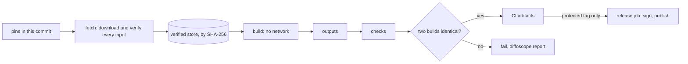

# Image build

The tool and the base are fixed by [0003](../decisions/0003-mkosi-image-build.md)
(mkosi, in CI, reproducible), [0004](../decisions/0004-components-from-pinned-releases.md)
(Felix and felixd from pinned releases), [0006](../decisions/0006-debian-base.md)
(minimal Debian 13 from snapshot.debian.org) and
[0007](../decisions/0007-kernel-from-upstream-source.md) (the kernel from
verified upstream source). This page says how the build meets them. Nothing
here is built yet: the image is [#1](https://github.com/GetFelix/ninelives/issues/1),
the CI boot [#2](https://github.com/GetFelix/ninelives/issues/2), signing and
secure boot [#9](https://github.com/GetFelix/ninelives/issues/9), cloud
images [#13](https://github.com/GetFelix/ninelives/issues/13), component
bumps [#52](https://github.com/GetFelix/ninelives/issues/52) and pinning the
pipeline [#65](https://github.com/GetFelix/ninelives/issues/65).

The build is one of the main ways into a cluster: whatever it ships runs on
every machine. So the design starts from the attacker in the
[threat model](../threat-model.md#supply-chain) who controls one upstream
(X5) or one piece of the pipeline (X6), and asks at each step what stops
their bytes reaching a machine.

## What it does

From one commit of this repository, the build fetches every input by a pin
committed in the repository, verifies each one by hash and, where the
upstream signs, by signature, then builds offline: the kernel from source,
NineLives' own programs, and a root of named Debian packages, Felix and
felixd. It writes the root as a read-only filesystem with a dm-verity hash
tree, puts the kernel, its command line and the root hash into one unified
kernel image (UKI), and lays these out on a GPT disk. It checks the result
against the rules below and fails on any violation. CI runs the whole build
twice, the second time on a clean runner with no cache, and fails unless the
outputs are identical. A release job, and only that job, gets the UKI signed
(from M3) and publishes the image with its SBOM, provenance and source.

## What it does not do

- **No package manager, compiler, shell or interpreter in a production
  image** (S1). They are used to build the image and are not in it.
- **No mutable root.** Nothing on the machine changes the root, the hash
  tree or the UKI. Only an M3 image swap replaces them, and that is
  [#8](https://github.com/GetFelix/ninelives/issues/8)'s design.
- **No per-machine content.** Every machine of one release and architecture
  gets the same bytes. Identity, credentials, the join token and the data
  partition's contents come later, on the machine (S19, S20). A built image
  contains no secret, key or token.
- **No data partition filesystem.** The image reserves the partition. How it
  is formatted, grown and encrypted is
  [#4](https://github.com/GetFelix/ninelives/issues/4)'s and
  [#60](https://github.com/GetFelix/ninelives/issues/60)'s (S16).
- **No initrd.** The kernel sets up dm-verity and mounts the root itself (see
  [Boot](#boot-without-an-initrd)). An initrd is a second root that
  needs its own checks.
- **No builds outside CI** for anything published (0003). A developer can run
  the same build on Linux to debug it; nothing they build is signed.
- **No retry until the two builds match.** A mismatch fails the run. Retrying
  would hide a nondeterministic input, and an attacker who can steer one can
  make the build ship whichever result they like.
- **No signing key in CI.** CI can ask for a signature only from the release
  job, through a protected environment ([Signing](#signing)).

## Interfaces

### Partition layout

One GPT disk per architecture. Partition type GUIDs follow the
[Discoverable Partitions Specification](https://uapi-group.org/specifications/specs/discoverable_partitions_specification/)
where it has one, so standard tools recognise them; the init finds
partitions only by GPT name, on the root's disk (init design, boot step 4).

| # | GPT name | Type | Size | Contents | Written by | Mounted |
|---|---|---|---|---|---|---|
| 1 | `esp` | EFI system partition, vfat | 256 MiB, fixed | The UKI at the removable-media path (`\EFI\BOOT\BOOTX64.EFI`, `BOOTAA64.EFI`). Nothing else. | The build; from M3 the updater | Never. Firmware reads it. |
| 2 | `ninelives-root-a` | root (per architecture), erofs | The root's size, budgeted | Every file the machine runs | The build | `/`, read-only, through dm-verity |
| 3 | `ninelives-verity-a` | root verity (per architecture) | Set by the root's size | The dm-verity hash tree over partition 2 | The build | Never; the kernel reads it |
| 4, 5 | `ninelives-root-b`, `ninelives-verity-b` | as 2 and 3 | as 2 and 3 | Empty until M3 | The M3 updater | Proposed: reserved now so the layout does not change at M3. #8 decides. |
| 6 | `ninelives-config` | NineLives config, no filesystem | 1 MiB, fixed | Zeros in the image. Provisioning writes the join config here before first boot; on a cloud it stays empty and the join reads cloud metadata. | Provisioning, before first boot | Never as a filesystem ([open question](#open-questions)) |
| 7 | `ninelives-data` | Linux data | The image's minimum; grown on the machine | Unformatted in the image | #4's program on the machine | `data_mount`, `nosuid,nodev,noexec,prjquota`, by the init |

What is mutable where, at run time:

| Place | Mutable? | By whom |
|---|---|---|
| ESP, root, verity partitions | No. The root is erofs, which the kernel cannot write at all, and dm-verity refuses any changed block. | The M3 updater replaces an inactive slot |
| Config partition | No, on the machine | Written once before first boot |
| Data partition | Yes, the one writable disk | Services, in their own directories (init design) |
| `/run`, `/tmp` | Yes, tmpfs, `noexec`, lost at reboot | The init and services |

**Why erofs.** A read-only filesystem the kernel has no write path for, so a
remount cannot make it writable even before dm-verity is signed. It compresses,
`mkfs.erofs` writes the same bytes for the same tree and timestamp, and
storing extended attributes can be switched off at build. squashfs is the
alternative with the same properties and an older parser; erofs is proposed
because its kernel code is maintained for exactly this use. Picking the root
filesystem is a format choice, so it may want a decision record
([open question](#open-questions)).

**Why the config partition is raw.** The join config is written by whoever
provisions the machine, so on a machine taken from its owner (X7) it is
attacker input. Mounting a filesystem from it would put the kernel's vfat or
ext4 parser on that input while the init is still root. A fixed-size,
length-prefixed blob read by the join (an unprivileged service) keeps it out
of the kernel and out of PID 1 (T21). The format is the join's design
([#5](https://github.com/GetFelix/ninelives/issues/5)); the image only
provides the partition.

### Boot without an initrd

The UKI holds the kernel (built with `CONFIG_EFI_STUB` and `CONFIG_DM_INIT`),
the systemd EFI stub that loads it, `os-release`, and this command line, which
the build writes and checks byte for byte:

```text
init=/usr/lib/ninelives/init ro rootfstype=erofs root=/dev/dm-0
dm-mod.waitfor=PARTUUID=<root-a>,PARTUUID=<verity-a>
dm-mod.create="root,,,ro,0 <sectors> verity 1 PARTUUID=<root-a> PARTUUID=<verity-a> 4096 4096 <blocks> 0 sha256 <roothash> <salt> 1 panic_on_corruption"
panic=10 oops=panic
```

The kernel creates the verity device from `dm-mod.create`, mounts it as the
root, and starts the init. A block that does not match the hash tree panics
the kernel, and `panic=10` reboots it, so a changed root is never read.
Everything the init design puts on the command line (`init=`, `panic=`,
`oops=`) is here, and so is anything S17 adds; `mitigations=off` and any
`lockdown=` weaker than the config's are refused by the build check.

The root hash on the command line is inside the UKI, so from M3 one signature
on the UKI covers the kernel, the command line, the root hash and through it
every byte of the root. The kernel's own verity signature option
(`root_hash_sig_key_desc`) would add a second key for the same guarantee and
is not used.

The systemd EFI stub is boot code from Debian's `systemd-boot-efi` package. It
runs in firmware, before the kernel, so it is in the trusted base and is
pinned like every package. It brings no systemd into the root. It is chosen
over a kernel with a built-in command line (`CONFIG_CMDLINE_FORCE`) because
that would make the kernel's bytes depend on the root hash, so every root
change would rebuild the kernel, and because the stub measures what it loads
into the TPM, which S16's sealed key needs.

Whether the pinned LTS kernel accepts `PARTUUID=` inside `dm-mod.create` and
`dm-mod.waitfor` is checked in #3. If it does not, the fallback is device
numbers, which the qemu targets fix, and per-target command lines.

### Inputs

Every input, how it is pinned, and what verifies it. A pin is a file in this
repository; changing one is a reviewed pull request
([Component bumps](#how-a-bump-flows-through-review)).

| Input | Pin | Verified by | On failure |
|---|---|---|---|
| **Debian packages**, for the root and for the build's tools | `images/debian.lock`: the snapshot timestamp, the architecture, and every package's name, version and SHA-256, for the root and the tools tree separately | The snapshot's `InRelease` is checked with `gpgv` against the Debian archive keys in `images/keys/debian/`, by fingerprint, never against the runner's keyring. The `Packages` index is checked against the hashes in `InRelease`, and each `.deb` against both the index and the lock. Valid-Until is off (0006); the timestamp is what makes the set fixed. | Build fails |
| **Debian source packages** (S12) | The same lock, by source package | `.dsc` hashes from the signed `Sources` index | Release fails |
| **Kernel source** | `kernel/version.toml`: the version, the `.tar.xz` URL on cdn.kernel.org and its SHA-256 | The SHA-256 first, then the `.tar.sign` signature over the decompressed tarball with `gpgv` against `kernel/keys/`. The signing key's fingerprint must be in the pinned list (0007). Both checks, because a hash alone trusts the reviewer and a signature alone accepts any release the maintainers signed. | Build fails |
| **Felix and felixd** | `images/components.toml` | As 0004: SHA-256, and for felixd the Sigstore bundle on `SHA256SUMS` against the identity and issuer in the manifest, verified offline against a Sigstore trusted root pinned in `images/keys/sigstore/`. Felix has no signature ([felix#2796](https://github.com/GetFelix/felix/issues/2796)) and is checked by hash only. | Build fails |
| **NineLives' own programs** (init, join, the firewall loader) | This commit, `Cargo.lock`, and the Rust toolchain by exact version in `rust-toolchain.toml` | Cargo checks each crate's checksum against `Cargo.lock`. The toolchain archives are checked against SHA-256s committed in `images/tools.toml`, because rustup does not enforce its signatures. | Build fails |
| **mkosi** | `images/tools.toml`: an exact release, its source archive URL and SHA-256 | SHA-256. mkosi needs only Python's standard library, so it runs from the archive with nothing resolved from PyPI. The version is chosen in #1. | Build fails |
| **Build tools** (`mkfs.erofs`, `veritysetup`, `ukify`, `sbsign`, gcc, the Sigstore verifier, diffoscope) | mkosi's tools tree, built from the same Debian snapshot and listed in the lock; the Sigstore verifier, if not in Debian 13, by SHA-256 in `images/tools.toml` | As Debian packages | Build fails |
| **CI runner** | The `ubuntu-24.04` label, never `ubuntu-latest`. The image version GitHub reports is recorded in the provenance. | Nothing can verify a hosted runner. The tools tree keeps it to running mkosi's Python, the kernel's user namespaces and the network. | See [Open questions](#open-questions) |
| **GitHub Actions** | Each by full commit SHA, with the tag in a comment | A CI check fails on an Action pinned by tag or branch, a `curl \| bash`, or any download without a SHA-256 (S21, #65) | PR fails |

#### Two phases: fetch, then build offline



The fetch phase downloads every input and verifies it as above. Debian
inputs are kept as a partial mirror with the snapshot's own paths, signed
`InRelease` and indexes included, so apt inside mkosi verifies the chain again
from the same signatures. The build phase runs with no network (a network
namespace with only loopback), so the only bytes it can use are ones the fetch
phase verified. A build step that tries to download fails, which is how a
missed pin shows up.

CI keeps the verified store as an artifact (0006), so a later rebuild does not
depend on snapshot.debian.org, kernel.org or GitHub releases staying up.

### Building the root

1. mkosi installs exactly the packages in `images/packages.toml` from the
   mirror, unprivileged, in a user namespace. Debian's maintainer scripts run
   here, inside the build sandbox. That is code from Debian running on the
   runner, accepted with Debian (T36); the checks below catch what it leaves
   behind.
2. Felix's and felixd's archives are unpacked from the verified store. Only
   the members their release documents are taken (for felixd, the
   [contract](../felixd-contract.md#the-release)), and the unpack refuses
   links, device nodes, absolute paths and `..`. Each binary is installed
   at a fixed path, owner 0:0, mode 0555.
3. NineLives' programs, the init's config (`/usr/lib/ninelives/init.toml`),
   its compiled seccomp filters ([Service profiles](#service-profiles)),
   `/etc/passwd` and `/etc/group` from `images/users.toml`, and the files in
   `rootfs/` are added.
4. Packages Debian marks essential but the image does not need (the shells,
   `perl-base`, `dpkg`, `apt`, `login`, `passwd` and the like) are removed.
   The inventory and each file's origin are recorded from dpkg's database
   first; then the database is deleted.
5. The tree is normalised: owner 0:0 for everything, no write bits, no
   extended attributes, timestamps clamped to `SOURCE_DATE_EPOCH`.
6. `mkfs.erofs` writes the root with extended attributes switched off,
   `veritysetup format` writes the hash tree with a salt derived from the
   commit, the UKI is assembled, and `systemd-repart` writes the GPT with
   partition UUIDs derived from a fixed seed in the config.

Variants: one config builds `production`, `development` (adds a serial console
shell as an unprivileged service, S1) and `test` (adds the init design's
inspector and fault hooks). Each has its own name in the file name and in
`os-release` (`VARIANT_ID`), so S22's "production refuses a development
image" has something to read. Only `production` is published.

### Reproducibility

S5 asks for the same bytes from the same commit, on a clean runner, with a
different build path and time.

**Time.** `SOURCE_DATE_EPOCH` is the commit time of the commit being built
(`git log -1 --format=%ct`). mkosi passes it to every tool. Every timestamp in
every output, filesystem, archive, SBOM and UKI is that value or derived from
it. The build fails if any file's modification time in the root differs from
it.

**Everything else that varies.** The kernel build sets
`KBUILD_BUILD_TIMESTAMP`, `KBUILD_BUILD_USER`, `KBUILD_BUILD_HOST` and
`-ffile-prefix-map`. With no loadable modules there is no per-build module
signing key. Build-time randomness in the kernel's hardening options
(the randstruct seed, latent entropy) is either fixed or the option is off,
and each is listed with the other hardening exceptions in `kernel/`
(S2). For a public image the randstruct layout is public anyway, because
anyone can read it out of the published kernel. Rust builds use
`--remap-path-prefix`, `--locked` and `--offline`. UUIDs, the verity salt and
any other value a tool would pick at random come from fixed seeds in the
config or from the commit.

**How two builds are compared.** CI runs build A on one runner, using caches
(the kernel build is cached by version, config and toolchain lock). Build B
runs on a fresh runner with no cache of any kind, fetches every input itself
rather than reusing A's store, and varies what should not matter: a different
build path, user name, umask, time zone, locale and CPU count. Each build
writes `SHA256SUMS` over its outputs. The comparison job checks the two files
are identical. On a mismatch it runs diffoscope on the differing outputs,
uploads the report and fails. Partitions are also hashed one by one, so a
report starts from the partition that differs.

**What is compared**, and must be identical: the raw disk image, each
partition image, the unsigned UKI, the root hash, the inventory, the file
manifest and the SBOM. Cloud formats (M5) are compared the same way.

**What may differ:** only things that describe the run rather than the image:
build logs, timings, and the provenance attestation, which records which
runner and which workflow run produced the bytes. Signatures are added after
the comparison and are not part of it (S5). A cloud format that embeds a
creation time or a random identifier (a VHD footer has both) gets them from
`SOURCE_DATE_EPOCH` and a fixed value; if a format cannot, the fields that may
differ are listed here by offset, and the comparison masks only those.

A signed UKI is not detached: Secure Boot needs the Authenticode signature
embedded in the PE file. What the release job signs is the Authenticode
digest of the compared, unsigned UKI, so anyone who rebuilds can check that
the published signed UKI has the same digest as theirs. `sbattach --remove`
on the signed file gives back the compared bytes.

Two builds on GitHub share GitHub, the snapshot and the tools. A compromise
common to both builds the same bad bytes twice and passes (T39). That is
accepted until the first published image; then the provenance lets anyone
rebuild elsewhere, and who does is an [open question](#open-questions) in the
threat model.

### Checks

Each check runs on what boots: the erofs image hashed into dm-verity and the
UKI, read back by the checker, not the staging directory they were made from.
A tool between the two that changed an owner or a mode would otherwise pass.
Each check fails the build on any violation. Each allowlist lives in
`images/`, and every entry gives the requirement or component it serves.

| Check | Rule | Requirement |
|---|---|---|
| No setuid or setgid | No inode has `S_ISUID` or `S_ISGID`, files and directories alike. No exceptions. | S24 |
| No file capabilities | No inode has any extended attribute: no `security.capability`, no ACL, no `security.*`, `trusted.*` or `user.*`. The root is written with extended attributes off, and the check confirms none got through. | S24 |
| No root-owned writable files | Every inode is owned by 0:0 and has no write bit for anyone. Nothing on a read-only root needs one, and a write bit would matter the day something remounted it. Mount points (`/proc`, `/sys`, `/dev`, `/run`, `/tmp`, `data_mount`) are 0555; their run-time mode comes from the mount. | S3, S24 |
| No world-writable files | Implied by the previous rule, checked on its own so the failure names it. | S3 |
| No special files or stray links | No device nodes, FIFOs or sockets (devtmpfs provides `/dev`). A symlink may point outside the root only if it is listed, with the reason (`/etc/resolv.conf` to `/run/resolv/resolv.conf`); a link from the root into writable storage lets a writer redirect a path the root vouches for. | S3 |
| Only allowed users and groups | `/etc/passwd` and `/etc/group` hold exactly the entries in `images/users.toml`, with fixed numbers that match every `uid` and `gid` in the init's config (`init check` compares them). uid 0 has one entry, `root`, which exists only to name the owner of the files. No entry has a password, a shell other than `/usr/sbin/nologin`, or a home directory that exists. `/etc/shadow` and `/etc/gshadow` hold only locked entries. | S6, S24 |
| No shells or interpreters | Every regular file with an execute bit, every ELF file and every shared library is in `images/executables.toml`, with its package or component. A file starting with `#!` is never allowed. The production list holds no shell or interpreter: no `sh`, `bash`, `dash`, `busybox`, `perl`, `python`, `awk`, `lua`, `tclsh` or the like, and a second check refuses those names whatever list they are added to. The development variant's list adds one shell, named, for the serial console. The dynamic loader is listed: it cannot load code from the `noexec` data partition, because the kernel refuses executable mappings of files there. | S1 |
| ELF hygiene | No ELF has an executable stack or a segment that is both writable and executable. | S2 |
| Package allowlist | The installed set equals `images/packages.toml` exactly: a package pulled in by a dependency and not listed fails, and so does a listed one that is missing. Each version and hash equals the lock. No package manager, compiler or SSH server is installed, whatever the list says. | S1, S4 |
| Every file has an origin | Every file in the root is accounted for: by a package's file list (with dpkg's recorded checksum matching), by a component's archive, by `rootfs/` in this commit, or by a short list of files the build generates (`/etc/passwd`, `/etc/group`, `init.toml`, the seccomp filters, `ld.so.cache`, the CA bundle, the inventory). Anything else fails. | S4 |
| Components match the manifest | Each Felix and felixd binary in the root has the hash of the member in the verified archive. | S4 |
| No secrets | No file holds a private key, a token in a known format, or a test credential the S8 test plants. | S8 |
| Kernel command line | The UKI's command line equals the expected string, its root hash is the root partition's in this image, and it holds no `mitigations=off`, no other `init=` and nothing outside the expected words. | S13, S17 |
| Verity | `veritysetup verify` passes for the root against its hash tree and the root hash in the UKI. | S13 |
| Kernel config | kernel-hardening-checker passes with the listed exceptions, and `CONFIG_MODULES` is off (0007). | S2 |
| Init config | `init check` passes on the image's `init.toml`. | init design |
| Size budget | Each output is within `images/budget.toml`: the root partition, the UKI, the ESP's contents and the raw image. The budget is set from the first M0 build with a margin, the build warns at 90%, and raising it is a reviewed change that says why. Every pull request reports the size change. | S1 |

Each check has a test that seeds one violation into a small fixture image and
watches the check fail ([Test plan](#test-plan)).

### Service profiles

The init design leaves to this page how each service's seccomp filter and
Landlock lists are produced and reviewed. The reviewed source of each
filter is a readable policy file per service in `rootfs/` (allowed system
calls and, where it matters, their arguments). The build compiles it to BPF
deterministically, and the compiled file is what `init.toml` names; the
init never compiles a filter. Landlock lists are in `init.toml` itself.
A first draft can be recorded from qemu runs, but the committed policy is
what is reviewed and shipped, and every component bump re-runs the init
design's profile test (each service under its real profile, running for 5
minutes against a single-node cluster) before it can merge.

### Signing

Signing starts in M3 (S13, #9). Before M3 no image is signed and none is
published (threat model, [Boot integrity](../threat-model.md#boot-integrity)).

**What signs what.**

- The **image key**, a Secure Boot `db` key, signs the UKI's Authenticode
  digest. That one signature covers the kernel, its command line and the
  verity root hash, so the whole root.
- The **release manifest**, `SHA256SUMS` over every published output, is
  signed for S22's update metadata. Whether that is the same key, and how
  the metadata expires, is #8's and
  [#66](https://github.com/GetFelix/ninelives/issues/66)'s.
- The **provenance attestation** is signed keylessly through Sigstore by the
  release workflow's own identity. It says which workflow built which digests;
  it is not the image key and a machine never trusts it at boot.

The firmware's key database on a NineLives machine holds only NineLives keys
(S13), so nothing signed by another vendor boots.

**Where the key lives.** Outside CI: never a repository secret, never a file
on a runner. The key is generated in, and cannot be exported from, a
hardware-backed store. Which store (an offline hardware token with a signing
ceremony, a cloud KMS key that only the release job's OIDC identity may use,
or both for different keys) is not decided. It belongs with
[#16](https://github.com/GetFelix/ninelives/issues/16), which decides where the
cluster's CA keys and the join's minting live: those keys and the image key
are the same kind of asset (whoever holds them owns every machine, A3 and
A6), so they should be held under one custody model, as separate keys. This
page needs from that decision only what follows.

**How CI gets a signature.**

1. A release is a tag `v*` on `main`, under a tag ruleset that only
   maintainers can create and nobody can move or delete.
2. The release workflow's build jobs are the same two reproducible builds as
   on every pull request. They have `contents: read` and no `id-token`
   permission, so they cannot ask for a signature.
3. A separate signing job runs in a GitHub environment that accepts only that
   tag pattern and needs a maintainer's approval. It does not build or check
   out code beyond its own workflow. It downloads both builds' outputs,
   checks they are identical, and sends the UKI's Authenticode digest and the
   manifest's digest to the signer.
4. The signer accepts a request only with an OIDC token whose claims name
   this repository, this workflow at a protected tag, and that environment.
   Every signature is also written to a public transparency log, so a
   signature made with a stolen key or outside a release shows up.
5. Pull request workflows get a read-only token and no secrets, and none uses
   `pull_request_target` (S21, T43).

What this does not stop: a maintainer, or whoever controls a maintainer's
account, tagging a malicious commit (T42, open in
[#71](https://github.com/GetFelix/ninelives/issues/71)). Rotation and
revocation of the image key are written down with #9 (S13).

### Outputs

Per architecture and variant, named
`ninelives-<version>-<variant>-<arch>`:

| Output | What | From |
|---|---|---|
| `.raw` | The GPT disk image above, sparse | M0 |
| `.root.erofs`, `.root.verity`, `.roothash` | The root, its hash tree and root hash, for the M3 updater to write into a slot | M0 (used from M3) |
| `.efi` | The unsigned UKI; after a release, also `.signed.efi` | M0; signed from M3 |
| Cloud formats | Converted from `.raw` with pinned tools: qemu needs none, then per cloud as M5 adds them (#13) | M5 |
| `.inventory.json` | Every package (name, version, architecture, source package, `.deb` SHA-256, license), every component from `components.toml`, the kernel (version, tarball SHA-256, config SHA-256), mkosi and the toolchain | M0 |
| `.files.json` | Every path in the root with type, mode, owner, size and SHA-256, sorted. Pull requests diff it. | M0 |
| `.spdx.json` | SPDX SBOM built from the inventory, deterministic (its namespace is derived from the image's digest) | First published image (S12) |
| Provenance | A SLSA build provenance attestation over every output's digest, from the release workflow | First published image (S12) |
| Source | The kernel tarball and config, every Debian source package, and the tagged source of Felix and felixd | First published image (S12) |
| `SHA256SUMS` | Over everything above but the provenance | M0 |

The release workflow fails if any of the S12 outputs is missing.

### How a bump flows through review

Every pin moves the same way: a pull request that changes only pin files
(`images/components.toml`, `images/debian.lock`, `images/tools.toml`,
`kernel/version.toml`, `kernel/keys/`, `images/keys/`) and the pages that
describe what they pin, such as felixd's contract. A pull request that
changes a pin and anything else fails a check, so a pin change is never one
line in a large diff.

1. **Opened by a job.** The bump job (#52) opens a component bump when Felix
   or felixd releases. Before opening it, the job verifies the new release's
   signature and, for a component whose upstream builds reproducibly
   (felixd), rebuilds it from the tag and compares (S23). The advisory job
   ([#57](https://github.com/GetFelix/ninelives/issues/57)) opens a snapshot
   bump when Debian fixes a package in the image, and a kernel bump when
   kernel.org releases a fix for the pinned series (S9). Each regenerates its
   lock with a script, and CI regenerates it again and fails if the committed
   lock differs, so a hand-edited lock cannot add a package resolution would
   not.
2. **CI shows what changes.** On top of the normal build, checks and boot, CI
   comments the diff of the inventory (packages and versions added, removed
   or changed), the diff of `.files.json` with new executables, users and
   symlinks called out, the size change, and for the kernel the
   `.config` diff.
3. **A reviewer checks it.** That the diff matches the upstream's release
   notes and advisories; that no package or executable appears without a
   reason; that a component's contract still holds; and, for Felix while it
   is unsigned, that the hash matches the release page, which is all that
   stands behind it (T35).
4. **Merged on green.** `CI ok` passes only if every check, both builds and
   the boot passed.

A new trusted key (a kernel maintainer's, a Debian archive key, a Sigstore
root update) is its own pull request, with the fingerprint checked against at
least two independent sources, named in the pull request.

## Invariants

Each is written so a test can check it.

- **I1** Two builds of the same commit, one with caches and one on a clean
  runner with no cache, produce byte-identical compared outputs.
- **I2** The build phase has no network. Every byte it reads that did not
  come from this commit came from the verified store and matches its pin.
- **I3** Every file in the root has an origin: a locked package whose recorded
  checksum it matches, a component archive member it matches, a file in
  `rootfs/` at this commit, or a named generated file.
- **I4** No inode in the root has a setuid or setgid bit, an extended
  attribute, a write bit, an owner other than 0:0, or a type other than file,
  directory or listed symlink.
- **I5** `/etc/passwd` and `/etc/group` equal `images/users.toml`, uid 0
  appears once, and every uid and gid in `init.toml` is one of them.
- **I6** The executables and shared libraries in a production root equal
  `images/executables.toml`, which contains no shell or interpreter.
- **I7** The installed packages equal `images/packages.toml`, at the
  versions and hashes in the lock.
- **I8** The UKI's command line equals the expected string, and its root hash
  is the hash of the root partition in the same image.
- **I9** Every output is within its size budget.
- **I10** No job that runs on a pull request or builds the image can obtain a
  signature: only the signing job in the protected environment has an
  `id-token` permission the signer accepts.
- **I11** A signed UKI's Authenticode digest equals the digest of the
  unsigned UKI both builds produced.
- **I12** A pull request that changes a pin file changes nothing else but
  the pages that describe the pin.
- **I13** A published release has every S12 output.

## Failure modes

| Failure | What happens | Why that is acceptable |
|---|---|---|
| A hash or signature does not verify | Fetch fails, nothing is built | Fail closed is the point (S4) |
| An upstream rotates a signing key (a kernel maintainer, Debian, Sigstore) | Builds of new pins fail until a reviewed pull request adds the key | A new key is exactly what an attacker would bring; it gets its own review |
| snapshot.debian.org, kernel.org or GitHub releases are down | Pull request builds use CI's kept store for pins already fetched; a new pin waits | Availability of the build, not of machines |
| The two builds differ | Fails, with a diffoscope report; never retried to green | A nondeterministic input is a way to steer the output |
| A Debian maintainer script creates a user, a setuid file or a capability | The checks fail | They exist to catch what package scripts leave |
| A dependency pulls in a new package | The package allowlist fails | Every package needs a stated reason (S1) |
| A build tool bug writes a wrong image twice | The checks read the result, not the tree; the boot test catches what boots wrong | Checks on the output, not on the tool's intent |
| The root grows past its budget | Fails; raising the budget is a reviewed change | Growth is a review decision, not an accident |
| A compromised runner or tool builds bad bytes in both builds | Not caught by I1 (T39) | Accepted until the first published image; then provenance lets others rebuild |
| The signer is down at release time | The release waits | There is no fallback key in CI, on purpose |
| The image key is stolen | Signed malicious images boot until the key is revoked in `dbx` and machines' minimum version moves; the transparency log shows the signatures | Rotation and revocation are written down with #9 (S13) |
| The runner's disk fills or a job times out | The run fails | Nothing partial is kept or published |

## Security

**What it runs as.** CI jobs on GitHub-hosted runners. mkosi builds
unprivileged, in user namespaces, and the build phase has no network. Build
jobs hold a read-only token and no secrets. Only the signing job can reach
the signer.

**What it trusts, and why.** The Debian archive keys, the kernel.org stable
maintainers' keys and the Sigstore trusted root, each pinned in the
repository; GitHub as host, runner and OIDC issuer; Debian's packages and the
upstream kernel's accepted commits (threat model, [What we
trust](../threat-model.md#what-we-trust)). Felix's release is trusted on a
reviewer's word until it is signed and reproducible
([felix#2796](https://github.com/GetFelix/felix/issues/2796),
[felix#2799](https://github.com/GetFelix/felix/issues/2799)).

**Requirements it meets:** S1 (allowlists, no shells), S3 (read-only erofs
root, write bits, layout), S4 (every input verified), S5 (two builds),
S8 (no secrets in the image), S12 (outputs), S13 (verity and the signed UKI,
from M3), S17 (command line check), S21 (pinned tools and Actions, permissions),
S22 in part (the variant marker), S23 (bump flow), S24 (no setuid, no file
capabilities, no root-owned writable file).

**Threats it answers:** T34 to T45 in the supply chain table, and T46, T47,
T48, T49 and T53 in the boot table, as far as the image's part goes. It does
not answer T42 (a malicious change merged by a maintainer account) or the
common-mode case of T39.

## Test plan

| Test | Where | Proves |
|---|---|---|
| Build twice, the second clean with varied path, user, umask, time zone, locale and CPU count; compare `SHA256SUMS` | CI, every pull request | I1 |
| The build phase run with a step that tries to download: it fails | CI fixture | I2 |
| One fixture image per check, each seeded with one violation (a setuid file, a setgid directory, a `security.capability` attribute, a write bit, a file owned by uid 1, a FIFO, a link into `/var/lib`, an extra passwd entry, a `#!` script, a `dash` binary, an unlisted package, an orphan file, a planted test token, an oversized root, a changed command line): each check fails, and the clean fixture passes | CI, every pull request | I3 to I9 |
| `veritysetup verify` on the built image | CI | I8 |
| Boot the image in qemu, x86_64 and aarch64: the init reports ready on the serial console | CI, every pull request (#2) | the image boots |
| In qemu: a write to the root fails with `EROFS`; a binary copied to the data partition does not run; `ld.so` on it fails | CI (test variant) | S3 |
| Flip one byte in a copy's root partition, in a block a boot reads, and boot: the kernel panics on that read and the VM reboots; the same for the hash tree | CI | dm-verity |
| A workflow policy check: every Action pinned by SHA, no unhashed download, pull request workflows hold no secrets or `id-token`, only the signing job uses the signing environment | CI, every pull request (#65) | I10, S21 |
| A pull request that changes a pin file and another file fails the pin check | CI fixture | I12 |
| Release dry run on a test tag: every S12 output present, the signed UKI's digest equals the unsigned one's | Release workflow | I11, I13 |
| With secure boot on and only NineLives keys enrolled (OVMF): a modified UKI, a modified root, a stock signed shim and an older image do not boot | CI, from M3 (#9) | S13 |
| A weekly rebuild of the last release from its tag, compared to the published bytes | Scheduled | I1 over time, and that the kept store is enough |

## Open questions

| Question | Proposal | Decides | Needed by |
|---|---|---|---|
| erofs or squashfs for the root, and whether that choice needs a decision record | erofs; a short record if reviewers see it as an image format choice | Review of this page | M0 (#1) |
| Does the pinned LTS kernel accept `PARTUUID=` in `dm-mod.create` and `dm-mod.waitfor`? | Check in #3; fall back to device numbers per target. A small initrd only if neither works. | Kernel (#3) | M0 |
| Whether the B slot is reserved from M0 | Reserve it, so M3 does not change the layout | A/B design (#8) | M3, but cheapest now |
| The config partition's format, and how the join reads it without root (the init could hand the join that one partition's device node before the drop) | A raw, length-prefixed, size-capped blob | Join (#5) with the init design | M1 |
| Where the image key lives, and whether it shares a custody model with the CA keys | One custody model, separate keys, hardware-backed, signer gated on the release environment's OIDC claims | #16, with #9 | M3 |
| Whether the update metadata is signed by the image key or its own | Its own key, so a leaked boot key cannot also freeze updates | #8, #66 | M3 |
| Development images: unsigned, or signed with a development key production firmware never enrolls | A separate development key | #9 | M3 |
| GitHub-hosted runners cannot be pinned to an exact image build, which S21 asks for | Record the version in provenance and accept it with the tools tree; or move releases to ephemeral runners from a pinned image | NineLives maintainers | First published image |
| Who rebuilds published images outside GitHub (T39) | A scheduled rebuild on a second CI provider, comparing to the published `SHA256SUMS` | Threat model | First published image |
| aarch64: native arm runners or cross-compiled on x86_64, given both builds must match | Native runners for both builds where available; one method per architecture, never mixed | #1 | M0 |
| Size budgets | Set from the first M0 build plus 20% | #1 | M0 |
| Felix's AGPL source for S12: `components.toml` pins no source archive | Add a source archive and its SHA-256 per component | NineLives maintainers | First published image |
