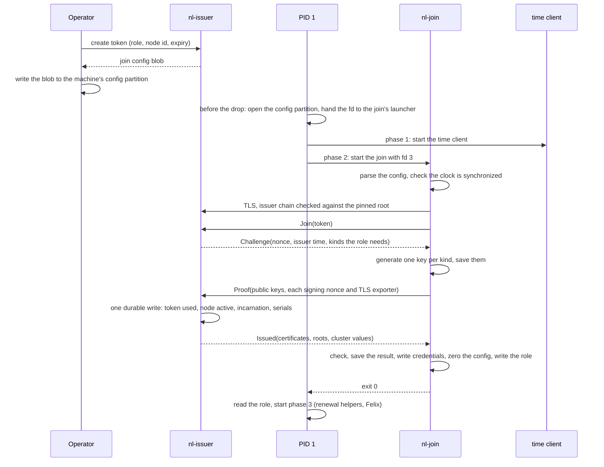

# First-boot join and machine credentials

How a machine with nothing but an image and a join token becomes a member of
one cluster, with its own keys and certificates, and how it gets its Felix
tokens afterwards. This page covers
[#5](https://github.com/GetFelix/ninelives/issues/5) (first-boot join),
[#64](https://github.com/GetFelix/ninelives/issues/64) (S20),
[#73](https://github.com/GetFelix/ninelives/issues/73) (nothing makes node
credentials from a join token) and
[#63](https://github.com/GetFelix/ninelives/issues/63) (S19). Nothing here is
built yet.

[0008](../decisions/0008-ca-keys-and-machine-certificates.md) is binding:
which CAs exist, where their keys live, what the issuer is, the token's
properties, renewal and recovery. This page does not reopen any of it. It
designs the machine's side of the join, the config partition, the exchange
with the issuer, how the result lands on disk, and how Felix tokens follow
from the certificates. Where it refines a step of 0008, it says so.
[0009](../decisions/0009-node-tokens-from-felix-exchange.md) (proposed)
records the one choice this page makes outside 0008: how node tokens are
minted.

The rule behind every choice: the join holds the token and writes every
service's credentials, so it is the machine's whole identity
([threat model](../threat-model.md#what-a-compromised-service-still-reaches),
T71). It takes as little untrusted input as possible, runs once, and fails
closed.

## What it does

`nl-join` is a short-lived Rust program the init runs once, on first boot,
as its own uid with no capabilities
([init design](init.md#programs-it-starts)). It reads the join config from the
raw config partition through one file descriptor the init hands it, waits for
an authenticated clock, connects to the cluster's issuer and checks it against
the issuer root fingerprint in the config before it sends anything, generates
one key per certificate the role needs, redeems the token with proof that it
holds each key, checks what comes back, writes each service's key,
certificate and trust bundle into that service's credential directory,
zeroes the config partition, and writes the role last. It then exits for
good. Felix tokens are not part of the join: each service's renewal helper
gets them later by presenting its certificate (see
[Felix tokens](#felix-tokens-after-the-join)).

## What it does not do

- **No issuing.** The join never signs anything for anyone. The issuer
  (`nl-issuer`) signs certificates; it gets its own design, which owns the
  registry, the token store, the admin interface and the ceremony tooling
  ([0008](../decisions/0008-ca-keys-and-machine-certificates.md#consequences)).
  This page fixes only what the issuer must check and return.
- **No renewal.** `nl-renew` renews certificates and fetches Felix tokens
  ([0008](../decisions/0008-ca-keys-and-machine-certificates.md)). This page
  fixes what the join leaves for it.
- **No Felix tokens.** The join never talks to the control plane, never sees
  a Felix token, refresh token, Raft peer token or bootstrap token.
- **No rerun.** A machine that has a role never runs the join again, whatever
  is on its config partition. There is no re-enrollment path through the join
  on a machine that kept its disk
  ([0008: Re-enrollment](../decisions/0008-ca-keys-and-machine-certificates.md)).
  A broken join is fixed by a wipe from outside (S25).
- **No cluster formation.** Creating the cluster tenant, registering the
  issuer as its identity provider, the RBAC grants for machine groups,
  `felixd init`, bootstrap, Raft membership and the Raft peer token belong to
  the formation design. The join only gives a machine the certificates that
  let it take part.
- **No network configuration.** Addresses, routes and DNS are the network
  design's. The join needs a route to the issuer and nothing else; it uses no
  DNS.
- **No TPM in M1.** The kernel has no TPM driver until M3
  ([kernel design](kernel.md)), and Felix reads its keys from files. See
  [Machine keys](#machine-keys).
- **No issuer machines.** Issuer machines are set up at the ceremony, not
  joined. A development image that runs the issuer on its core machine
  starts the issuer before the join; the issuer's design says how.
- **No cloud metadata before M5.** The format and the rules for it are fixed
  here so the M5 work has nothing to decide, but M1 reads the config
  partition only.

## Interfaces

### Overview

### The config partition

Partition 6, `ninelives-config`, 1 MiB, no filesystem
([image design](image.md#partition-layout)). A raw blob keeps the kernel's
filesystem parsers and PID 1 away from input that, on a machine taken from
its owner, is the attacker's (X7, T21).

**Layout.** All integers big-endian.

| Offset | Size | Field | Rule |
|---|---|---|---|
| 0 | 8 | magic | ASCII `NLJOIN01`. Anything else is refused. |
| 8 | 2 | version | `1`. Any other value is refused, not skipped. |
| 10 | 2 | flags | `0`. Any bit set is refused. |
| 12 | 4 | body length `n` | `1..=4096` |
| 16 | `n` | body | Records, below |
| 16+n | 32 | digest | SHA-256 of bytes `0..16+n` |
| 48+n | to 1 MiB | padding | Every byte zero |

The digest is not a signature: whoever can write the partition can recompute
it. It turns a torn or partial write by provisioning, or the wrong disk, into
"corrupt config" instead of a confusing semantic error. The zero padding
means an older, longer config written underneath cannot leave a second token
behind.

**Body.** A sequence of records, each a 2-byte tag, a 2-byte length and that
many bytes. Tags appear in strictly increasing order, except that a
repeatable tag may repeat in consecutive records. Every record's length and
count is checked against the table; a duplicate, a missing required tag, an
unknown tag, a wrong length or a byte left over rejects the whole config.
There is no "ignore unknown": a new field is a new version.

| Tag | Field | Length | Count | Content |
|---|---|---|---|---|
| 1 | token id | 16 | 1 | Random, not secret. Names the token at the issuer and in logs. |
| 2 | token secret | 32 | 1 | 256 random bits. The issuer stores only its SHA-256 (0008). |
| 3 | issuer address | 7..=47 | 1..=4 | `a.b.c.d:port` or `[v6]:port`, ASCII. Literal addresses only: the join does no DNS. |
| 4 | issuer name | 1..=253 | 1 | The DNS name on the issuer's certificate, lowercase LDH labels |
| 5 | issuer root | 32 | 1 | SHA-256 of the issuer root's SubjectPublicKeyInfo |
| 6 | cluster root | 32 | 1 | as above, cluster CA |
| 7 | internal root | 32 | 1 | as above, internal CA |
| 8 | Raft root | 32 | 1 | as above, Raft CA |

The fingerprint is of the public key, not the certificate, as kubeadm's
`discovery-token-ca-cert-hash` is: it pins the key that signs, and nothing
in the certificate's encoding can change it.

The config carries no role, node id, broker list, tenant or control-plane
address. Those come back from the issuer inside the authenticated
connection, bound to the token (see [The exchange](#the-exchange-with-the-issuer)).
What an attacker who rewrites the partition can choose is then only which
issuer the machine trusts, and a machine that trusts the attacker's issuer
joins the attacker's cluster, holding nothing of ours (see
[Failure modes](#failure-modes)).

**Who writes it.** The operator's provisioning tool, from what the issuer's
token command returns, writes all 1 MiB of the partition before first boot:
in qemu onto the disk image, on bare metal through the installer that
writes the image, on a cloud not at all. The token expires in 15 minutes by
default and 60 at most (0008), so the config is written shortly before the
machine first boots. The image ships the partition as zeros, and the image
build checks that it does ([image design](image.md#checks)).

**Cloud metadata (M5).** On a cloud the partition stays zero and the same
blob is delivered as instance user data, base64 without line breaks. The
join fetches it from the provider's metadata service with that provider's
protocol (on AWS, IMDSv2 with a session token), caps the response at 8 KiB,
decodes it and hands the bytes to the same parser. The packet filter lets
only the join's uid reach the metadata address (S18, 0008); after the join
that uid never runs again, so nothing on the machine can read the user data.
The used token stays in the provider's metadata, where it is worthless.

**Which source wins.** A partition that is all zeros is empty. An empty partition on a cloud image means metadata. A
partition that is not empty and does not parse is a permanent failure: the
join never falls back to metadata, so corrupting the partition cannot steer
the machine to another source. A non-cloud image never reads metadata.

### Reading it without root

The block device is root's (`/dev` nodes are 0600), and after the drop
nothing can open it. So PID 1 opens it before the drop, and only on first
boot:

1. In its boot step 4 ([init design](init.md#boot-as-root)), PID 1 already
   finds partitions by GPT name on the root's disk. If `$DATA/join/role` does
   not exist (one `fstatat` that follows no link, beneath the `$DATA` fd;
   `join/` is the join's directory, so the most a planted entry can decide
   is whether this fd is opened), it also finds `ninelives-config` on that disk, exactly
   once, and opens it `O_RDWR | O_CLOEXEC`. Two matches, or none, mean no fd,
   and the join then fails closed.
2. PID 1 never reads from that fd. It keeps it only until it forks the
   join's launcher, which keeps it through its `close_range`, and PID 1 then
   closes its own copy.
3. The join's launcher passes it to the join as fd 3 and nothing else does.
   On a later boot, when the role exists, PID 1 opens nothing.

This is the one exception to the init's rule that a service inherits only
fds 0, 1 and 2 (I11) and that a launcher holds only its listed fds (I20). It
has to be in the init design before code; see
[Changes this design needs elsewhere](#changes-this-design-needs-elsewhere).

The fd is read-write because the join zeroes the partition after a
successful join. The join's seccomp filter allows `pread64` and `pwrite64`
on it, `fdatasync`, and no `ioctl`, so the join cannot reread the partition
table or reach the rest of the disk. A compromised join can write garbage
into the 1 MiB partition, which nothing reads after the join.

The alternatives were worse. Mounting a filesystem puts the kernel's parser
on attacker input as root. `chown`ing the device node to `nl-join` before the
drop gives the join ownership, and an owner can `chmod` it. A copy made by
PID 1 into `$DATA` would have PID 1 reading attacker bytes as root, if only to
copy them.

### The token

| Property | Value | Why |
|---|---|---|
| What it is | A 16-byte id and a 32-byte secret, made by the issuer from `getrandom` | The id lets the issuer find the record and lets logs name a token without revealing it |
| Bound to | One node id and one role, at the issuer | The token cannot be redeemed for any other identity; the machine learns both from the issuer (0008) |
| Lifetime | 15 minutes by default, 60 at most | A stolen token is worth something only briefly (0008) |
| Single use | Marked used in the same durable write that records the node (0008) | A second redemption is refused and alerted |
| Stored | Only `SHA-256(secret)`, at the issuer | A copy of the issuer's registry yields no usable token |
| Travels | Only inside TLS to an issuer the machine has authenticated | A network attacker never sees it (T5) |
| On the machine | In the join's memory, zeroed after use; never written to the data partition | A disk read later yields nothing (S8) |
| After success | The config partition is zeroed | Defence in depth against a bug in the issuer's single-use check |

**Binding to the machine.** In M1 a token is not bound to hardware: whoever
holds it first, before it expires, can redeem it from anywhere that reaches
the issuer. What binds the result to the machine is that the keys are made
on the machine and the issuer checks a proof from each key against a fresh
nonce, so the certificates are useless without keys that never left the
machine. A token redeemed by a thief is caught when the real machine's
redemption is refused (0008). Two further factors are open:
a source prefix fixed at token creation, and operator approval for core
joins ([Open questions](#open-questions)). M3 adds hardware binding: the
issuer also checks a TPM attestation that the keys' machine booted a
NineLives image (0008, "Later proofs of identity").

### Machine keys

One ECDSA P-256 key per certificate (0008), generated by the join with
randomness from `getrandom(2)` with flags 0, which blocks until the kernel's
generator is seeded (virtio-rng seeds it in qemu, [kernel design](kernel.md)).
`GRND_INSECURE` and `/dev/urandom` are never used. No key is ever reused for
a second certificate, and the issuer refuses a public key it has seen
before.

**No TPM in M1, stated plainly.** Every key in M1 is a software key in a file
on the data partition, readable by its service and its renewal helper, and,
until M3, stored in plaintext (T52, accepted before M3). That is so even on
hardware that has a TPM, for two reasons. The M1 kernel has no TPM driver;
they come with M3's measured boot ([kernel design](kernel.md)). And Felix and
felixd load their TLS keys from PEM files (`FELIX_TLS_KEY` and the rest), so a
key that cannot leave a TPM could not be used by the service that needs it.
What protects the keys in M1 is file ownership and Landlock (S8, S6), the
24-hour lifetime (S19), and the current-serial check on renewal, which turns
a stolen key into a detected one at the next renewal (0008).

**From M3.** The data partition is encrypted under a TPM-sealed key (S16), so
keys at rest are protected. The machine also gets a TPM-resident attestation
key that never leaves the TPM (the "machine's cluster key" in the
[image design](image.md#rollback)); the issuer then requires it for the join
and for every renewal, so a service key copied off the machine cannot renew
without that machine's TPM. That design is M3's
([#9](https://github.com/GetFelix/ninelives/issues/9)); nothing here has to
change for it except an extra proof in each message.

### Certificates per role

The kinds, CAs and lifetimes are 0008's. The names are fixed by the issuer
from its registry, never taken from the request.

| Kind | CA | Names | EKU | Service | Files in `$DATA/credentials/<service>/` |
|---|---|---|---|---|---|
| felixd client | cluster | URI `felix:principal:<felixd principal>` | client | felixd (every role) | `client.pem`, `client.key` |
| Broker client listener | cluster | DNS: the node id's name and the cluster's broker name; on a core broker the second only if core brokers serve clients ([#77](#77-do-core-brokers-serve-tenant-clients)) | server | broker (core, storage) | `tls.pem`, `tls.key` |
| Broker internal | internal | DNS = node id | server, client | broker | `internal.pem`, `internal.key` |
| Broker control-plane client | cluster | URI `felix:principal:<broker principal>` | client | broker | `cp-client.pem`, `cp-client.key` |
| Control-plane API | cluster | DNS: the control plane's name, the node id's name | server | control plane (core) | `api.pem`, `api.key` |
| Control-plane Raft | Raft | DNS = member id (the node id) | server, client | control plane | `raft.pem`, `raft.key` |

Every certificate also carries the node id and the incarnation, in the
field the issuer's design fixes (0008). Each `.pem` holds the leaf and its
intermediate, so bundles hold roots only (0008).

**Trust bundles.** Each service gets only the roots it verifies peers with,
in `ca.pem` in its own directory ([init design](init.md#secrets)): felixd the
cluster root; the broker the cluster and internal roots; the control plane
the cluster and Raft roots. The issuer root goes to `$DATA/trust/issuer.pem`,
readable by every renewal helper and writable by none
([init design](init.md#secrets)). Felix takes one file per CA setting, so
where a service needs two roots the join writes one file per root
(`ca.pem` for the cluster root, `internal-ca.pem`, `raft-ca.pem`) and the
image config points each Felix setting at the right one. The bundle format
and generation number are `nl-renew`'s; the join writes the generation the
issuer states.

**Principals.** Each Felix-facing service on a machine is its own Felix
principal, so felixd's credentials do not carry the broker's node grant and
the other way round. The issuer is the identity provider for these
principals ([0009](../decisions/0009-node-tokens-from-felix-exchange.md)).
Its subject for a service is `nl/<node id>/<incarnation>/<service>`, so
every incarnation is a new principal and revoking an old one is permanent.
Felix names a principal `sha256(iss + "|" + sub)` in hex
([Felix auth](https://github.com/GetFelix/felix/blob/v0.7.2/docs/auth.md#principal-normalization)),
so the issuer computes the principal and writes it into the client
certificate's `felix:principal:` URI, which is what Felix's subject binding
matches
([`serving/tls.rs`](https://github.com/GetFelix/felix/blob/v0.7.2/services/felix-broker-service/src/serving/tls.rs)).

### The exchange with the issuer

One TCP connection to the first issuer address that answers, in the order
listed, with TLS 1.3 only (rustls), no session resumption and no early data,
so nothing is ever sent before a full handshake. The issuer port is fixed in
the image and on S7's list (0008).

**Checking the issuer before sending anything.** The join has no trust store
but the fingerprint. The issuer presents its leaf and the issuer root. The
join takes the root from the presented chain, requires
`SHA-256(SPKI)` to equal config tag 5 and the certificate to be a
self-signed CA, and uses it as the only trust anchor. The leaf must chain to
it, name the config's issuer name, carry the server EKU, and be valid at the
current time, which is why the clock comes first
([Time](#time)). Any failure closes the connection with nothing sent. The
issuer root is its own root and only issuers hold a leaf under it, so a
compromised worker or core machine, which hold leaves under the other roots,
cannot pose as the issuer (0008).

**Messages.** Each message is one frame: a 4-byte length of at most 64 KiB,
then records in the config body's encoding, so one small parser serves both.
Unknown tags are refused on both sides.

1. **Join**, machine to issuer: the protocol version, the token id and the
   secret. The issuer checks the token (checks 1 to 5 below) but commits
   nothing yet.
2. **Challenge**, issuer to machine: a 32-byte nonce, the issuer's time, and
   the kinds the token's role needs. This is how the machine learns what to
   generate without the role ever being in the config.
3. **Proof**, machine to issuer: for each kind, its public key as a
   SubjectPublicKeyInfo and an ECDSA signature by that key over the label
   `ninelives-join-v1`, 32 bytes of TLS exporter output (RFC 8446, label
   `EXPORTER-ninelives-join`), the nonce, the token id, the kind and the
   public key. The exporter ties the proof to this TLS session, so a proof
   is worthless on any other connection. The join saves the keys before it
   sends this message.
4. **Issued**, issuer to machine: the node id, the role, the incarnation id,
   for each needed kind the leaf and intermediate, the cluster, internal and
   Raft roots, the bundle generation, the values for `$DATA/join/env`, and
   the issuer's time. Or **Refused**, with one of three codes: `retry` (with
   a delay), `token_refused`, or `bad_request`.

`token_refused` covers an unknown token, a wrong secret, an expired, used or
revoked token, and a node id that is not free. The issuer's own log records
which; the wire does not, so a probe learns nothing it could act on.

The signing request is a public key and its kind, not a PKCS#10 CSR. The
issuer takes no name from a request (0008), so a CSR's only use would be
proof of possession, which the nonce signature gives with less ASN.1 for the
issuer to parse.

**What the issuer checks before it signs.** Under 0008 the issuer, not the
Felix control plane, issues machine certificates. Before it signs anything:

1. The connection presented no client certificate. The join message is
   accepted only on such a connection; every other message needs one.
2. Rate limits: failed attempts per source address, and concurrent pending
   joins (T65). Over the limit is `retry`. Failures are not limited per token
   id, so someone who saw a token id in a log cannot use it to hold off the
   real machine.
3. Its own clock is synchronized. If not, `retry`: an issuer with a wrong
   clock would issue certificates the cluster rejects, or accept expired
   tokens.
4. The token id exists; the secret's SHA-256 equals the stored hash
   (constant-time compare); the token has not expired, is not revoked and
   is unused, or the re-delivery rule below applies. A wrong secret raises
   an alert. There is no lockout: 256 random bits cannot be guessed, and a
   lockout would be a way to stop a machine's join.
5. The node id the token names has no active incarnation and was never
   revoked. A revoked node id is never reused (S25: a new identity).
6. The keys: every kind the role needs is present, each is a valid P-256
   point, no two are equal, and none matches any key the registry has ever
   seen.
7. Each proof verifies, on this connection, within 30 seconds of the
   challenge.
8. No leaf would outlive its intermediate (0008).
9. For a core-role token, the operator's approval, if that open question is
   answered yes ([Open questions](#open-questions)).

Then one durable write records the token as used, the node as active, the
new random incarnation id, each certificate's serial, and the SHA-256 of
every public key, and only after that write is synced does the issuer sign
and answer (0008 step 4). A refusal at 4 or 5 for a token that exists raises
an alert, as 0008 asks.

**Re-delivery after a lost answer.** This refines 0008 step 4, which refuses
any second use. If the issuer committed and the answer was lost (a dropped
connection, a power cut on the machine), the machine retries with the same
token and the same public keys, which it saved before the first attempt. The
issuer answers that retry with the same certificates, the same incarnation
and serials, after a fresh proof from every recorded key, until the token's
original expiry. It issues nothing new, so the retry is not a second
redemption. A redemption with different keys is refused and alerted, as 0008
says. A thief who has the token but not the machine's saved keys gains
nothing from this rule; one who also has the keys has read the machine's
disk, and the certificates, which are public, add nothing. Without the rule,
an ordinary network drop at the wrong moment costs an operator a new token
and the machine a new incarnation.

**What the join checks in the answer.** Before writing anything:

- the three roots' fingerprints equal config tags 6 to 8, and each is a
  self-signed CA certificate;
- each leaf's public key is the key the join made for that kind, it chains
  through its intermediate to the root 0008 names for that kind, it has
  exactly that kind's EKU, it is valid now, and it lives at most 24 hours
  plus the issuer's 5-minute back-dating;
- the node id and role are well formed and the role is one the image knows;
- every env name is one the image's `join_env` lists name, every value is
  printable ASCII under 1 KiB ([init design](init.md#the-config)), and
  `FELIXD_NODE_ID` equals the node id;
- the issuer's time in the answer is within 60 seconds of the local clock
  ([Time](#time)).

Any failure is permanent: an issuer that answers wrongly is not retried.

### Felix tokens after the join

Felix mints tokens only through its control plane: token exchange from a
trusted identity provider, refresh, delegation, and bootstrap
([Felix auth](https://github.com/GetFelix/felix/blob/v0.7.2/docs/auth.md#control-plane-token-exchange-flow)).
It has nothing that takes a join token, and should not: that would put
join-token checking on core machines, which already hold every tenant's
signing keys (T24). So, as recorded in
[0009](../decisions/0009-node-tokens-from-felix-exchange.md):

1. The cluster tenant trusts the issuer as an identity provider, with the
   issuer's assertion-signing public keys configured inline, so the control
   plane fetches nothing. Felix can only fetch a JWKS today, over TLS checked
   against the system trust store and from a public address unless a global
   flag opens every private one
   ([`idp_registry.rs`](https://github.com/GetFelix/felix/blob/v0.7.2/services/felix-controlplane-service/src/auth/idp_registry.rs),
   [`oidc.rs`](https://github.com/GetFelix/felix/blob/v0.7.2/services/felix-controlplane-service/src/auth/oidc.rs)).
   Inline keys are a Felix gap:
   [felix#2836](https://github.com/GetFelix/felix/issues/2836).
2. Each service's renewal helper, running at the service's uid, asks the
   issuer for an assertion over mutual TLS with the service's current client
   certificate. The issuer answers only for an active node's current
   incarnation and current serial, with an ES256 JWT: `iss` the issuer's
   cluster name, `sub` the service's subject, `aud` the cluster's control
   plane, a groups claim from the registry (the service and, for a broker,
   `node-<node id>`), a `jti`, and a lifetime of 60 seconds. A service needs
   one only when it has no working refresh chain, so the issuer allows a few
   per principal per day and alerts beyond that. The control plane holds no
   Felix principal and asks for none.
3. The helper exchanges it at `POST /v1/tenants/{t}/token/exchange` for the
   service's audience (broker audience for felixd, `felix-controlplane` for
   the broker's node credential) and writes the access and refresh tokens
   into the service's directory.
4. From then on the token is refreshed: by the broker itself from
   `FELIX_NODE_REFRESH_TOKEN_FILE`, which Felix 0.7.2 supports
   ([`config/env.rs`](https://github.com/GetFelix/felix/blob/v0.7.2/services/felix-broker-service/src/config/env.rs));
   by felixd once [felixd#276](https://github.com/GetFelix/felixd/issues/276)
   lands, and until then by felixd's renewal helper. A lost or ended refresh
   chain is replaced by a new exchange, which needs a current certificate.

Grants come from groups. Felix maps each group in an assertion to
`group:<iss>#<name>` and evaluates RBAC through it, cluster scope included
([Felix auth](https://github.com/GetFelix/felix/blob/v0.7.2/docs/auth.md#group-based-role-assignment-from-idp-groups_claim)),
so formation grants felixd's node role to `group:<iss>#felixd` once, and the
operator's token command grants `node.manage` over `node:<id>` to
`group:<iss>#node-<id>` when it creates a storage or core token. The issuer
holds no Felix credential at all.

This keeps the join out of the control plane's way, which matters for the
first core machine: at join time its control plane is not running yet, and
the cluster tenant does not exist until formation. The helpers retry until
the exchange works.

`nl-renew`'s design owns the assertion request, the exchange and the
refresh fallback. This page fixes what it relies on: the certificate the
join wrote is the machine's identity, and Felix tokens are derived from it,
never from the join token.

### Files the join writes

All under `$DATA`, through directories the init made
([init design](init.md#boot-as-root) step 5), opened with
`openat2(RESOLVE_BENEATH | RESOLVE_NO_SYMLINKS | RESOLVE_NO_XDEV)`.

| Path | Mode | Content | When |
|---|---|---|---|
| `join/pending/` | 0700, `nl-join` | The join's own crash-recovery state | Created first, removed last |
| `join/pending/keys` | 0600 | The private keys | Before the Proof is sent; removed once the keys are installed |
| `join/pending/issued` | 0600 | The issuer's Issued answer, verbatim | Right after the checks pass |
| `join/failed` | 0640 | The reason for a permanent failure, one line, no secrets | On a permanent failure |
| `credentials/<service>/*.key`, `*.pem`, `ca.pem` and the other bundles | 0640, group service (setgid directory) | As in the table above | After `issued` is saved |
| `trust/issuer.pem` | 0644 | The issuer root the join pinned | With the credentials |
| `join/env` | 0640, group init | `NAME=value` lines from the answer | After the credentials |
| `join/role` | 0640, group init | The role name | Last |

`join/` is setgid with group init ([init design](init.md#boot-as-root)), so
the pending files are 0600: the init can read `env` and `role` but not the
keys. Every file is written to a temporary name, `fsync`ed, renamed into
place, and its directory `fsync`ed. Before `role`, the join calls `syncfs` on
`$DATA` so everything else is on the device first; the init treats a present
`role` as a completed join ([init design](init.md#programs-it-starts)).

**Order of a run:**

1. If `join/failed` exists: exit with the permanent status, contacting
   nothing.
2. If `join/pending/issued` exists: skip to step 9. The config may already
   be zero.
3. If credential files exist with no pending state, the disk holds
   something the join did not write: permanent failure.
4. Read and parse the config (fd 3, or metadata on a cloud image).
5. Wait for the clock ([Time](#time)).
6. Connect, check the issuer, send Join, read the Challenge.
7. If `join/pending/keys` exists and covers exactly the kinds asked for,
   load it; if it exists and does not, permanent failure; otherwise generate
   the keys and save them. Then send the Proof.
8. Check the answer and save it as `join/pending/issued`.
9. Write every credential file, the bundles, `trust/issuer.pem` and `env`.
   Keys come from `join/pending/keys`; if that is already gone, each
   installed key must match its certificate, or the run fails permanently.
10. `syncfs`, then remove `join/pending/keys`, so no second copy of a key
    outlives the join.
11. Zero the config partition and `fdatasync` it (skipped on a cloud image).
12. `syncfs`, write `role`, remove `join/pending/`, exit 0.

A crash at any step leaves a state that step 1, 2 or 7 resumes from. A crash
between writing `role` and removing `join/pending/` leaves only the saved
answer, which holds certificates and no secret.

**Exit status.** 0 on success. 75 (`EX_TEMPFAIL`) for anything worth
retrying: no route, the issuer down, `retry`, the clock not synchronized, a
full disk. 78 (`EX_CONFIG`) for a permanent failure, after writing
`join/failed`. The init today retries any non-zero exit with backoff
([init design](init.md#failure-modes)); step 1 makes those retries cost
nothing and contact nothing, which is what 0008 asks ("a loud alert, not a
retry loop"). Teaching the init to stop on 78 is optional and listed below.

## Time

Certificates are checked against the clock, so the join's first question is
whether the clock can be trusted, and at first boot it may not be: a board
without a battery-backed clock starts in 1970 or at its build date, and a
cloud image's clock comes from the hypervisor.

S15 requires authenticated time
([#59](https://github.com/GetFelix/ninelives/issues/59)), and its source has
its own chicken-and-egg: NTS key exchange is TLS, and TLS checks certificate
dates. The join does not solve that; the time client does, and the join
waits for it.

- **Where time comes from.** On qemu and clouds with a KVM clock, chrony
  reads the hypervisor's clock (`PTP_1588_CLOCK_KVM`,
  [kernel design](kernel.md)), which needs no network and no certificate. On
  bare metal, chrony uses NTS, and the chicken-and-egg is chrony's own
  `nocerttimecheck` for its first updates, a choice #59 settles. Either way
  the time client runs in phase 1, before the join.
- **The join waits for a synchronized clock.** It reads the kernel's clock
  state with `adjtimex` (read-only; without `CAP_SYS_TIME` a write is
  refused) and proceeds only when `STA_UNSYNC` is clear, which chrony does
  once it is synchronized, and the clock is no earlier than the image's
  build time, which the join carries as a constant. Until then it exits 75
  and is retried; nothing is sent.
- **A second, independent check.** The issuer's time arrives in the
  Challenge and in Issued, inside the authenticated connection. If it differs
  from the local clock by more than 60 seconds, the join stops with a
  permanent failure and says why. This catches a clock moved by a
  compromised time client (T69), which can clear `STA_UNSYNC` as easily as
  set the time. Two clocks, each synchronized from authenticated sources,
  agree far closer than 60 seconds.
- **Certificates tolerate small skew.** The issuer back-dates `notBefore` by
  5 minutes, so a machine a few seconds behind can use its certificates at
  once.

The cross-check cannot help against an attacker who controls both the clock
and a retired issuer's key, since that attacker also chooses the issuer's
time. That needs a time client compromised in the first seconds of a fresh
machine and a key the ceremony deleted.

The join never uses the issuer's time to set the clock, and never checks a
certificate with time checks turned off: an expired issuer leaf from a
retired issuer must not be accepted just because the clock is unknown.

A machine that cannot get authenticated time does not join, and says so in
its output. That is the fail-closed answer, and on clouds whose metadata NTP
servers lack NTS, the hypervisor clock is what makes it work
([init design open question](init.md#open-questions)).

## Renewal and revocation

**Renewal** is 0008's: `nl-renew` per service, at that service's uid, at half
life, with a new key, presenting the current certificate. The join leaves it
everything it needs: the certificate and key in the service's directory, the
bundle and its generation, the pinned issuer root in `$DATA/trust/`, and a
registry at the issuer that records the serials the join received as
current. `nl-renew` starts in phase 3, after the join, so the first
certificate is always there ([init design](init.md#programs-it-starts)).

**Revocation**, for one machine (S19, S25), is three steps an operator tool
runs together:

1. At the issuer: mark the node revoked and add its current serials to the
   refused list. Renewals and assertions stop at once; certificates die
   within 24 hours (0008).
2. At the control plane: revoke each of the machine's service principals
   (`POST /v1/tenants/{t}/refresh-tokens/revoke`), which ends their refresh
   chains and the broker streams their tokens opened
   ([Felix auth](https://github.com/GetFelix/felix/blob/v0.7.2/docs/auth.md#revoking-a-principal)).
3. At the control plane: remove the `node-<id>` group's grant, so no later
   exchange for that node gets `node.manage`.

What still works after that, and for how long, is listed under
[Failure modes](#failure-modes): the certificate until it expires, and open
connections until Felix bounds them
([felix#2817](https://github.com/GetFelix/felix/issues/2817)).

## Wipe and rejoin (S25)

A compromised machine is wiped from outside, through the hypervisor or a
reimage, never on the machine (S25, [#75](https://github.com/GetFelix/ninelives/issues/75)).
After the revocation above:

- The wipe destroys the data partition, so `$DATA/join/role` is gone and the
  init runs the join on the next boot. A reimage also rewrites the config
  partition as zeros.
- The operator creates a new token. It names a **new node id**, since a
  revoked node id is never reused (issuer check 5), and the join gets a new
  incarnation and new keys. Nothing from the old disk survives.
- A machine that kept its disk never runs the join again, so writing a new
  config onto a running machine's partition does nothing. A machine with a
  half-finished or failed join is wiped too, not repaired.

## Privileges, sandbox and egress

| | Value | Why |
|---|---|---|
| uid | `nl-join`, its own | T71: the uid runs once, so nothing later shares it |
| Capabilities | none | Everything it writes is in directories the init made for it |
| fds | 0, 1, 2, and fd 3, the config partition, on first boot only | [Reading it without root](#reading-it-without-root) |
| Landlock read | `/usr/lib/ninelives/nl-join`, the libraries it links, `/proc/self` | Nothing else: no system trust store, no `/etc`, no DNS config |
| Landlock write | `$DATA/join`, `$DATA/trust`, each `$DATA/credentials/<service>` | Exactly its outputs |
| Landlock devices | `/dev/null` | Randomness comes from `getrandom`, not a device node |
| Network | TCP connect, IPv4 and IPv6 | To the issuer; on a cloud image also to the metadata address |
| seccomp | An allowlist: file calls beneath its directories, `pread64`, `pwrite64` and `fdatasync` on fd 3, `getrandom`, `adjtimex`, `clock_gettime`, `socket` for `AF_INET` and `AF_INET6` with `SOCK_STREAM` only, `connect`, `sendto` and `recvfrom` on that socket, memory and thread calls, `exit_group`. No `ioctl`, no `execve`, no `AF_NETLINK`, no `AF_UNIX`, no UDP | No DNS, no other process, nothing beyond one TCP connection |
| Egress (S18) | The join's uid may connect only to the issuer's TCP port, and on a cloud image to the metadata address | The ruleset is static, from the image, and the issuer's address is in the config, which only the join parses. So egress is limited by port, not by address. |
| Ingress | none | The join listens on nothing |
| Run timeout | 120 seconds per run | A hung connection is a transient failure, retried |
| cgroup | 64 MiB memory, small pids limit | It parses at most 4 KiB of config and a 64 KiB frame |

The S7 list's "the join" means the issuer's join endpoint on an issuer
machine. An ordinary machine opens no port for the join.

## Changes this design needs elsewhere

| Where | Change | Status |
|---|---|---|
| [init design](init.md) | Boot step 4 opens `ninelives-config` read-write on first boot only; the join's launcher keeps that fd and passes it as fd 3; I11 and I20 name this one exception; the join's `run_timeout_s` is 120 | Listed as an init open question in this change |
| [init design](init.md) | Optional: exit 78 from the join means `failed`, no restart | Proposed here; the marker file works without it |
| [image design](image.md) | The config partition is written once more on the machine: zeroed by the join after a successful join | Updated in this change |
| [image design](image.md) | The packet filter allows the join's uid TCP to the issuer port and, on cloud images, the metadata address, and nothing else | For the packet filter's ruleset (S18, [#62](https://github.com/GetFelix/ninelives/issues/62)) |
| `nl-issuer` design | Every issuer check and message above; re-delivery; assertions for renewal helpers; inline assertion keys exported for formation | Not written |
| `nl-renew` design | Assertion request, token exchange, felixd refresh until felixd#276 | Not written |
| Formation design | Register the issuer with inline keys on the cluster tenant; grant `group:<iss>#felixd`; deliver the Raft peer token to a new core member | Not written |
| [0008](../decisions/0008-ca-keys-and-machine-certificates.md) | Re-delivery refines step 4 | Stated here; 0008 is not edited |
| Felix | Inline identity-provider keys ([felix#2836](https://github.com/GetFelix/felix/issues/2836)); reload the broker's control-plane client certificate ([felix#2837](https://github.com/GetFelix/felix/issues/2837)) | Filed, v0.8.0 |

## Invariants

- **J1.** The join sends no byte of the token until the issuer's leaf has
  been verified against a root whose SPKI SHA-256 equals config tag 5, with
  the issuer name and server EKU checked, at a time the clock is
  synchronized and no earlier than the image's build time.
- **J2.** The token secret is never written to the data partition, output,
  records or any file, and is zeroed in memory after the Join message is
  sent.
- **J3.** Every private key is generated on the machine from `getrandom`
  with flags 0, never leaves the machine, and is used for exactly one
  certificate. The issuer receives public keys and signatures only.
- **J4.** Every certificate the join installs has the public key the join
  generated for its kind, chains to the root 0008 names for that kind, has
  that kind's EKU, is valid at install time and lives at most 24 hours and
  5 minutes. If any certificate fails, nothing is installed.
- **J5.** The roots the join installs are exactly the three in Issued plus
  the pinned issuer root, each matching its config fingerprint, and each
  service's bundle holds only the roots listed for that service.
- **J6.** Each file the join writes is in its service's directory, or in
  `$DATA/join` or `$DATA/trust`, written by temporary file, `fsync` and
  rename. Keys and certificates are mode 0640 with the service's group;
  pending state is 0600.
- **J7.** `$DATA/join/role` is written last, after `syncfs` has returned 0,
  and only when every other output is in place. The init starts no role
  service without it (I24), and never starts the join once it exists.
- **J8.** Values in `$DATA/join/env` come only from the issuer's Issued
  answer, use only names the image's `join_env` lists, and are printable
  ASCII under 1 KiB. Nothing from the config partition reaches `env` or
  `role`.
- **J9.** A config that is not exactly the format above, byte for byte,
  including all-zero padding, is refused whole, and a non-empty partition
  that does not parse is never replaced by another source.
- **J10.** After a successful join on a non-cloud image the config
  partition is all zeros.
- **J11.** After a permanent failure, every later run of the join exits 78
  without opening a socket.
- **J12.** The join holds no capability, opens no listening socket, makes no
  DNS query, and connects only to issuer addresses from the config and, on a
  cloud image, the metadata address.
- **J13.** The issuer signs only after the durable write that marks the
  token used, and a retry under one token yields the same certificates or
  nothing.
- **J14.** The join stops with a permanent failure when the issuer's time
  and the local clock differ by more than 60 seconds.

## Failure modes

Every row fails closed: no credentials are written unless every check
passed, and no role service starts without a role.

| Failure | Detected by | What happens | Why that is acceptable |
|---|---|---|---|
| **Bad token** (unknown, wrong secret, expired, wrong role) | Issuer check 4 | `token_refused`; `join/failed`; exit 78; issuer alerts | An operator issues a new token and wipes the machine |
| **Replay** of a captured exchange | The exchange is inside TLS to the authenticated issuer; proofs bind a fresh nonce and the session's exporter | A replayed Join gets a new nonce the replayer cannot sign; a replayed Proof fails on another session | 0008's x509pop-style nonce plus channel binding |
| **Stolen token, used first by the thief** | The real machine's redemption is refused; the issuer alerts on a second use with different keys | The thief holds that one node id's certificates for that role, at most until the operator revokes the node, plus one certificate lifetime | Bounded by expiry (15 min default), single use, one role. For a core token this is the cluster (threat model), which is why core approval is an open question |
| **Stolen token, not yet used** | Not detected | Worthless after expiry | 15 minutes, 60 at most |
| **Stolen config partition before first boot (X7)** | Not detected | As a stolen token, within its expiry | Fingerprints are not secret |
| **Stolen config partition after the join (X7)** | | It is zero | J10 |
| **Rewritten config partition (X7, before first boot)** | Not detected | The machine trusts the attacker's issuer and joins the attacker's cluster. It holds none of ours, and our issuer never hears from it. | An attacker with the disk before M3 can replace the image too (T46). From M3, attestation ties joins to a signed image. |
| **Stolen current certificate and key** (X4 copies them off a running machine) | The real machine's next renewal presents a superseded serial (0008) | Until then the thief can renew, and can get assertions and start refresh chains for that principal. Those chains outlive the certificate, but their tokens need a certificate bound to the principal on every client port and on the control-plane API (S10), except on the forward path (T73) and on refresh itself ([felix#2822](https://github.com/GetFelix/felix/issues/2822)). Revocation (issuer first, then Felix) ends all of it | 0008's detected-not-prevented residual; the assertion rate limit and alert make a burst visible |
| **Stolen data partition after the join (X7)** | Not detected | Plaintext keys until M3 (T52): the certificates work until they expire, and a renewal by the thief is detected when the real machine's next renewal presents a superseded serial (0008) | Accepted before M3; S16 closes it |
| **Rogue control plane** | Felix services verify it against the cluster root | The join never talks to it; services refuse it | The join's trust is the issuer root only |
| **Fake issuer: MITM on first contact, a compromised worker or core machine** | J1 | Connection closed before any token byte; exit 75, retried | The issuer root is pinned and only issuers hold leaves under it |
| **A compromised real issuer** | Not by the join | Can issue anything | 0008: the issuer is trusted; recovery is a ceremony |
| **Partial failure: crash before the Proof** | No `issued` | Next run tries again, reusing saved keys if any | The issuer committed nothing |
| **Partial failure: issuer committed, answer lost** | Next run, same keys | Re-delivery returns the same certificates | No new incarnation, nothing new issued |
| **Partial failure: crash while writing credentials** | `join/pending/issued` exists | Next run writes from the saved answer without contacting the issuer | Every write is idempotent |
| **Crash after zeroing the config, before `role`** | `issued` exists, config is zero | Finished from the saved answer | Step 2 runs before the config is read |
| **Power cut while writing a file** | Temporary names | A torn temporary file is overwritten on the next run | Rename is atomic |
| **Clock wrong at first boot** | `STA_UNSYNC`, build-time floor, issuer time check | Not synchronized: exit 75, retried. Synchronized but off by more than 60 s: permanent failure | A machine without trustworthy time must not judge certificates |
| **No authenticated time source at all** | As above | The join never runs its exchange; reported | Fail closed, by S15 |
| **Issuer down or unreachable** | Connect timeout | Exit 75; the init retries with backoff | Machines wait; the token may expire, then a new one is needed |
| **Issuer rate-limits** | `retry` | Exit 75 after the stated delay | T65 |
| **Disk full** | Write fails | Exit 75; quota on `$DATA/join` | Retried; nothing half-installed counts, since `role` is last |
| **Config fd missing** (no or two config partitions) | fd 3 not open | Permanent failure | Never guesses which disk |
| **Foreign files in credential directories with no pending state** | Step 5 | Permanent failure | The disk holds something the join did not write; wipe |
| **The join panics or is killed** | Exit status | Treated as 75, retried; pending state resumes | |
| **The join hangs** | `run_timeout_s` | Killed, retried | |
| **A hostile issuer answer** (oversized, malformed, wrong keys or roots) | Frame cap, parser, the answer checks | Permanent failure, nothing written | J4, J5 |
| **A compromised join** (code execution through its parser) | Not detected | It can write any credential and bundle on this machine (T71), and talk TCP to any host on the issuer port. It holds no Raft peer token and no Felix token. | Its input is a 4 KiB config and the authenticated issuer's frames; it runs once, then its uid never runs again |

## Security

**What it runs as and reaches.** See the
[privileges table](#privileges-sandbox-and-egress). Compromised, it is the
machine's identity (T71) for one boot, and nothing more: no capability, no
other service's uid, no Felix token, no route to anything but the issuer
port.

**What it trusts, and why.**

- The issuer root's key, by its fingerprint in the config. That is the
  join's only anchor. Under X7 the config is attacker input, and the
  consequence is spelled out above.
- The issuer, once authenticated, for everything else: the role, the node id,
  the roots (also pinned), the cluster values. 0008 makes the issuer the
  thing that can mint any machine identity, so the join gains nothing by
  distrusting it, except the cheap sanity checks it makes.
- The time client's synchronized clock, cross-checked against the issuer's.

**Requirements it meets.** S8 (the token never written; keys only in their
service's directory), S10 and S19 (every certificate, per machine, from the
join), S15 (it waits for authenticated time), S18 (egress by port), S20
(single-use, expiring, role-bound token; issuer checked before sending; the
join issues the first certificates), S24 (no capability, a raw partition
read without root), S25 (rejoin under a new identity).

**Threats it answers.** From the [threat model](../threat-model.md):

| Threat | How |
|---|---|
| T2, pose as a broker to felixd | The join installs the cluster root, matched against its fingerprint, as felixd's only CA |
| T5, steal the token or pose as the issuer | Token only inside TLS to the pinned issuer root; single use, short expiry, one role; nonce proofs |
| T6, spoofed DHCP or DNS | The join uses no DNS, and a redirected connection fails J1 before any token byte. Denial of service remains. |
| T8, a parser reached before authentication | The join listens on nothing. The issuer's join endpoint is pre-auth input; it takes only the record encoding with fixed caps, and its hardening is the issuer design's. |
| T7 and T69, a moved clock | Waits for synchronized time; cross-checks the issuer's time |
| T17, read another service's credentials | Each service's files in its own directory with its own group; the join's pending keys 0600 |
| T18, call out from the join | No DNS, TCP to the issuer port only |
| T19, persist through join output | Partial: the join runs once and never reads its output again; the init reads only `role` and `env` with its own checks. Root on the machine can still rewrite them (S25). |
| T21, exploit PID 1 through the join config | PID 1 opens the partition and never reads it; the join parses it as an unprivileged service |
| T22, secrets in a crash dump | The token is in memory only during the exchange and zeroed after; a dump taken then holds it, and dumps are already secrets (S11) |
| T23, secrets in output | J2; output names a token by its id only |
| T30, a stolen machine credential used elsewhere | Client certificates bound to per-service principals; Felix tokens derived from them |
| T31, keep working after revocation | Per-service principals and the three-step revocation; certificates die within 24 h |
| T32, take another machine's node id | Names come from the issuer's registry; a revoked node id is never reused |
| T52, read credentials from a stolen disk | Partial: the config is zeroed and the token never stored; keys are plaintext until S16 (accepted before M3) |
| T65, flood the join | Rate limits at the issuer, per source and per token; lock after five bad secrets |
| T71, a compromised join | Runs once; no capability; installs only roots matching the config's fingerprints; no Raft peer token |
| T72 | Depends on [#77](#77-do-core-brokers-serve-tenant-clients) |
| X7 | Config zeroed after use; a rewritten config cannot reach our cluster |

T4, T24 and T25 are not changed by the join: they are Felix's
([felix#2802](https://github.com/GetFelix/felix/issues/2802),
[felix#2801](https://github.com/GetFelix/felix/issues/2801)). T10 (bootstrap)
and T28 (node trims) belong to the formation design.

**Dependencies on Felix and felixd.**

| Gap | Effect here | Issue |
|---|---|---|
| No inline identity-provider keys | The control plane cannot trust the issuer for machine principals without a JWKS fetch through the system trust store | [felix#2836](https://github.com/GetFelix/felix/issues/2836) |
| An upstream token can be exchanged until it expires | A stolen 60-second assertion can start a second refresh chain for that principal within its minute | [felix#2836](https://github.com/GetFelix/felix/issues/2836) (the `jti` part) |
| The broker reads its control-plane client certificate once | A 24-hour certificate expires under a running broker | [felix#2837](https://github.com/GetFelix/felix/issues/2837) |
| Refresh is not bound to the client certificate | A stolen refresh token plus any cluster certificate refreshes another principal's chain | [felix#2822](https://github.com/GetFelix/felix/issues/2822) |
| Connections outlive their certificate | A revoked machine's open connection outlives its certificate | [felix#2817](https://github.com/GetFelix/felix/issues/2817) |
| Raft TLS read once | Control-plane members restart after Raft renewal (0008) | [felix#2815](https://github.com/GetFelix/felix/issues/2815) |
| Internal port serves before an identity-checked Hello | Any internal certificate acts as any broker on replication | [felix#2819](https://github.com/GetFelix/felix/issues/2819) |
| felixd presents no client certificate | felixd's tokens are bearer tokens | [felixd#275](https://github.com/GetFelix/felixd/issues/275) |
| felixd does not refresh its token | felixd's renewal helper refreshes it until then | [felixd#276](https://github.com/GetFelix/felixd/issues/276) |

The control-plane API's client CA
([felix#2811](https://github.com/GetFelix/felix/issues/2811)) is closed on
Felix's main branch, after 0.7.2; the broker's `cp-client` certificate is for
it.

## Test plan

Unit tests run the join's state machine with a fake issuer, fake clock and a
fake partition file. qemu tests boot the image with a test issuer on the test
network. Fault tests use a test-image hook that kills the join at a named
step.

| Test | Where | Proves |
|---|---|---|
| Config parser fuzzed (cargo-fuzz) and property-tested: every single-byte change, truncation, extension, reordered or duplicated tag, nonzero padding, wrong version or flag is refused; the canonical encoding round-trips | unit, CI and scheduled fuzzing | J9 |
| Frame parser fuzzed the same way, against oversized and malformed Issued answers | unit, scheduled | Hostile answer row |
| A test issuer with a leaf under another root, a wrong name, an expired leaf, a server-EKU-less leaf: the issuer's capture shows zero application bytes | qemu | J1, S20 (wrong CA) |
| Used, expired, unknown and wrong-role tokens: `token_refused`, `join/failed`, a second boot exits 78 without a connection (packet capture) | qemu | S20, J11 |
| Join twice with one token from two machines: the second is refused and the issuer raises an alert | qemu | single use, stolen token row |
| Drop the connection after the issuer's commit: the next run gets the same certificates and incarnation | unit and qemu | J13, re-delivery |
| Kill the join at each step 3 to 10, then boot again: it finishes, or fails permanently where the table says, and never yields two incarnations | fault | partial failure rows, J7 |
| Answers with a certificate on another key, under the wrong root, with a 48-hour lifetime, a root that does not match its fingerprint, an env name outside `join_env`: nothing is written | unit | J4, J5, J8 |
| Clock: start with `STA_UNSYNC` set; with a clock before the build time; with an issuer 2 minutes off. No token sent in the first two; permanent failure in the third | unit and qemu | J1, J14 |
| After a join: the config partition reads all zeros; file modes and groups as in the table; `role` is newer than every other file | qemu | J6, J7, J10 |
| A planted known token and test keys: the console, captured output, records and the data partition outside the credential directories are searched; the token is never found anywhere | qemu | J2, S8 |
| Under the join's profile: opening `/dev/vda`, an `ioctl` on fd 3, a UDP socket, a connection to another port, writing outside its directories all fail | qemu (test image) | J12, sandbox |
| A second boot does not start the join; a new config written onto a joined machine's partition is ignored | qemu | No rerun, S25 |
| S20's bootstrap check stays with formation | formation's tests | |
| Revoke one of three machines: within one certificate lifetime it cannot read or write, the other two keep working | qemu, M2 | S19, with [#63](https://github.com/GetFelix/ninelives/issues/63) |
| Wipe and rejoin one of three: new node id, new incarnation, old credentials refused everywhere | qemu, M2 | S25, with [#75](https://github.com/GetFelix/ninelives/issues/75) |

## Open questions

| Question | Proposal | Decides | Needed by |
|---|---|---|---|
| Do core brokers serve tenant clients ([#77](https://github.com/GetFelix/ninelives/issues/77), T72)? | See [below](#77-do-core-brokers-serve-tenant-clients). Left to the owner. | Owner | M1 |
| Do core-role joins need an operator's approval after the request arrives? A stolen core token is the cluster. | Yes in production: the issuer holds a core redemption as pending until an operator approves it, comparing the key fingerprint the join prints on the console. Development images skip it. Adds one issuer state and one console line; no change to the machine's flow beyond waiting. | Owner, with the `nl-issuer` design | M1 |
| Should a token optionally name the source prefix it may be redeemed from? | Yes, optional, set at token creation. Useful on a known LAN or VPC, useless behind NAT. Adds one issuer check. | `nl-issuer` design | M1 |
| Is re-delivery an acceptable refinement of 0008 step 4? | Yes, as written above. If not, a lost answer costs a new token and a wipe. | Owner | M1 |
| How does a new core member get the Raft peer token until [felix#2802](https://github.com/GetFelix/felix/issues/2802) removes it? It is shared cluster admin (T25), so neither the join nor the issuer should carry it in the clear. | The operator encrypts it to the new member's Raft public key, read from the issuer's registry after the join, and the control plane's renewal helper fetches the ciphertext from the issuer, which cannot read it. Ties naturally to core approval. | Formation design | M1 |
| Should the init stop retrying on exit 78? | Yes, small change: `failed`, no restart. The marker file already makes retries harmless. | Init design | M1 |
| The frame encoding with the issuer | The config's record encoding, as above | `nl-issuer` design | M1 |
| Bare metal without a hypervisor clock: does chrony's `nocerttimecheck` count as authenticated time under S15? | Yes for at most its first update, with the issuer cross-check as the second factor | [#59](https://github.com/GetFelix/ninelives/issues/59) | M5 |
| Egress by port, not address, for the join | Accept: the issuer address is only in the config, and the packet filter must not parse it | Threat model | M1 |

### #77: do core brokers serve tenant clients

The join does not decide this, but it fixes which names go on which
certificates, so each answer changes it.

- **Yes, core brokers serve clients.** Every broker's client-listener
  certificate carries the cluster's broker name. The broker list the issuer
  returns for `FELIX_BROKERS` holds every broker, core included. Nothing else
  changes. T72 stays open as written.
- **No, in clusters that have storage machines.** A core broker's
  client-listener certificate carries only its node id's name, never the
  cluster broker name, so a client sent to a core broker by name fails the
  TLS check. The issuer returns only storage brokers in `FELIX_BROKERS`,
  felixd on core machines included, and so needs to know whether the
  cluster has storage machines; it refuses a core token's role values until
  at least one storage machine is active, or the cluster is marked as having
  none. S7's port list then closes the core client port to everything but
  peers. A cluster without storage machines (the smallest fault-tolerant
  one) must answer yes.
- **No, always.** As above, and a cluster needs storage machines to serve
  any client, which raises the smallest fault-tolerant cluster from three
  machines to five.
