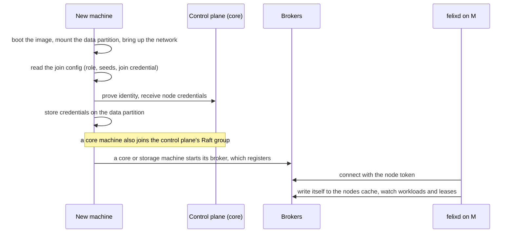
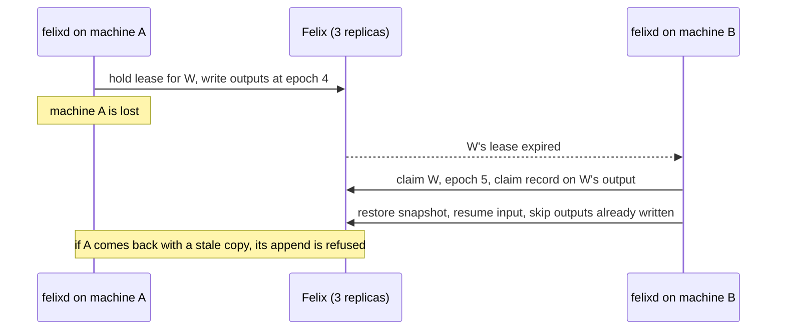

# NineLives design

## Goal

A cluster that behaves like one machine, where the system's memory is a
replicated log. Any program's state can be rebuilt from the log, so failover,
migration and time travel are the same operation.

NineLives is an image. It ships [felixd](https://github.com/GetFelix/felixd),
the node agent that runs workloads from the log, and
[Felix](https://github.com/GetFelix/felix), the log. felixd's
[design](https://github.com/GetFelix/felixd/blob/main/docs/design.md) covers
how workloads run, hold leases, write exactly-once output and replay. This
document covers the operating system around it: what runs on each machine, how
a machine joins, what we can promise when a machine is lost, and the plan for
the first three milestones against felixd as released
([v0.1.0-preview.1](https://github.com/GetFelix/felixd/releases/tag/v0.1.0-preview.1),
tested against Felix 0.6.2).

Very little of the operating system is decided. The kernel, the init system,
how images are built and how a machine proves who it is are all
[open questions](#open-questions). Where this document names a tool, it is a
proposal, written down so it can be argued with.

## What runs on a machine

Every machine runs the NineLives image: a kernel, an init system, felixd and
the Felix binaries. Its role, from the join config, decides which of them start
([topology.md](topology.md)):

| Role | Starts | How many |
|---|---|---|
| core | Felix control plane, Felix broker, felixd | 3, or 5 in larger clusters (1 for development) |
| storage | Felix broker, felixd | optional |
| worker | felixd | optional |

Felix is the one layer NineLives does not schedule, because everything else is
recorded in it. The control plane and brokers are services the image starts,
like felixd. Workloads, and later the scheduler and name service, run on top.

A machine runs one felixd and nothing else that claims work. One machine is one
failure domain ([Lessons from Barrelfish](#lessons-from-barrelfish)).

| OS concept | In NineLives |
|---|---|
| Process | A workload: a module plus its input streams. Its state is a fold over its inputs. |
| PID | A workload id, independent of the machine running it |
| Pipes and IPC | Streams, durable and across machines |
| Files | Append-only streams. A mutable file is a workload that folds edits into contents, so old versions come for free. |
| Namespace | A tree of stream and cache names, with per-user views as in Plan 9 |
| Scheduler | A workload that reads heartbeats and demand and writes assignments, so its decisions can be replayed |
| Users and permissions | Felix tenants and grants. A program's token is its capability. |
| Boot | Read the desired state and claim leases. A cold start of the cluster is a replay. |
| Upgrades | Machines: an image swap that can roll back (A/B partitions are the proposal). Workloads: run the new module over recorded inputs, compare, switch at an offset. |

In felixd 0.1 a workload is a deterministic WebAssembly component. Native
programs are felixd's next tier
([felixd#75](https://github.com/GetFelix/felixd/issues/75)) and are not built
yet, so until then a workload on NineLives is Wasm.

## How a machine joins

1. Firmware loads the bootloader, which loads the kernel. Early init mounts the
   read-only root and the data partition and brings up the network.
2. On first boot the machine reads its join config: its role, the seed
   addresses of the core machines and a join credential. Where that config
   comes from (cloud metadata, a config partition, the kernel command line) and
   what the credential is are [open](#node-identity-and-credentials).
3. It exchanges the join credential for its node credentials and keeps them on
   the data partition, so a reboot does not join again.
4. The init system starts the services for its role. A core machine's control
   plane joins the Raft group from the seed list. A broker registers with the
   control plane and serves only the streams it has assignments for.
5. felixd starts with its connection settings: `FELIX_BROKERS` (IP addresses;
   felixd 0.1 does not resolve host names), `FELIX_AUTH_TENANT`,
   `FELIX_AUTH_TOKEN_FILE` and `FELIX_CA_FILE`. NineLives sets
   `FELIXD_NODE_ID` to the machine's identity. felixd's default, host name plus
   process id, changes on every restart.

In felixd terms a machine has joined when its agent writes itself to the
`nodes` cache. The entry has the lease TTL, so it goes away about when a dead
machine's leases do. From then on the agent watches `workloads` and `leases`
and claims free workloads.

A rebooted machine keeps its node id. felixd never adopts a lease it finds
under its own name, so the restarted agent waits for its old leases to expire
before it claims again.

## What surviving the loss of a machine means

This is the claim M2 has to show, so it is worth saying exactly what felixd
0.1 promises and what it does not.

**Leases.** Each workload has a lease in the `leases` cache with a TTL (10 s
by default, at least 2 s). An agent claims a free workload with a conditional
put, renews every third of the TTL, and stops its workloads once two thirds of
the TTL pass without a renewal. When a machine dies its leases stop being
renewed and expire.

**Failover.** Every agent watches `leases`. After an expiry, any agent with
room claims the workload after a random delay of up to `--claim-delay-ms`
(1 s by default). The new owner restores the latest snapshot and resumes the
input from the offset recorded in it. Placement is first claim wins, capped
by `--max-workloads` per agent. So a lost machine's workloads run again
elsewhere within about one TTL plus the claim delay.

**Exactly-once output.** A new owner takes a higher epoch and writes a claim
record on the output stream before anything else. Outputs are appended with
`publish_if` at the tail the owner expects, so a machine that was frozen
rather than dead, and wakes with a stale copy, has its next append refused.
Each output names the input offset that produced it, so the new owner skips
outputs that already landed. The lease decides who should run; the fence is
what keeps the output correct.

**The log survives too.** felixd 0.1 creates its caches and streams with three
`Quorum` replicas by default. With three core machines, losing one leaves a
majority for the control plane and for every shard.

What this does not cover yet:

- **Native programs.** Only Wasm workloads fail over with exactly-once output
  ([felixd#75](https://github.com/GetFelix/felixd/issues/75)).
- **Effects.** A workload cannot reach the network, files or clocks
  ([felixd#71](https://github.com/GetFelix/felixd/issues/71)).
- **Speed when a core machine is lost.** Felix failover still waits on the
  control plane's lease
  ([felix#1009](https://github.com/GetFelix/felix/issues/1009),
  [felix#1197](https://github.com/GetFelix/felix/issues/1197)), so losing the
  machine that holds it slows recovery for every workload.
- **Rejoining during a core outage.** A broker cannot rejoin while the control
  plane is down ([felix#1196](https://github.com/GetFelix/felix/issues/1196)).
- **Losing a quorum.** If two of three core machines are gone, every workload
  stalls until they return. Nothing is lost or repeated, but nothing moves.

## Lessons from Plan 9

Plan 9 is the closest ancestor of what NineLives is trying to be, and the
reasons it didn't spread are well documented. felixd's design covers the
lessons for workloads
([Lessons from Plan 9](https://github.com/GetFelix/felixd/blob/main/docs/design.md#lessons-from-plan-9)).
These are the ones for the operating system around it:

- **A migration path from the first release.** Plan 9 asked people to leave
  their software behind, and Pike's own summary is that it lost to systems
  that were good enough. Its POSIX layer, APE, could not emulate much of what
  existing programs needed. NineLives aims to run existing programs unmodified
  through felixd's native tier
  ([felixd#75](https://github.com/GetFelix/felixd/issues/75)), which is not
  built yet, and to stay compatible with Linux programs whichever kernel is
  chosen.
- **Drivers come from an existing kernel or a compatibility layer.** Few
  drivers was one of the usual reasons given for Plan 9's slow adoption.
  NineLives does not plan to write its own.
- **Permissive licensing from the start.** Plan 9 spent years under licenses
  that kept outside developers away and only became MIT in 2021. NineLives is
  MIT already.
- **No hidden distribution.** A Plan 9 client that lost its file server hung,
  and losing the root server meant a reboot. In NineLives every machine keeps
  its root on local disk, and a lost machine or a lost Felix quorum is
  reported as a typed outcome (degraded, unknown, failed) rather than a hang.
- **Typed interfaces.** System services expose versioned, typed records, not
  text commands in `ctl` files and string errors.
- **An upgrade and package story.** Machines upgrade by swapping whole
  images atomically, with rollback. Images are built reproducibly and signed,
  so anyone can check that an image matches its source.
- **Fault tolerance as a first principle.** Plan 9's recovery tools were added
  later. Here, losing a machine is the normal case the design starts from.

Every kernel, init and image choice below stays open; these are constraints on
whichever is picked.

Sources: Pike, TUHS mailing list, 2023-01-31; Raymond, *The Art of Unix
Programming*, ch. 20; Trickey, "APE: The ANSI/POSIX Environment"; the Plan 9
Foundation's 2021 license announcement; Guardiola, Cox and Van Hensbergen,
"Persistent 9P Sessions for Plan 9" (2006).

## Lessons from Barrelfish

Barrelfish ran a separate kernel on every core of one machine and kept OS
state as replicas that change by agreement. It did not become a mainstream
system, and its authors say the scalability premise did not arrive: core counts
grew slowly and Linux was made to scale with modest changes. The parts that
carry over to NineLives are about how to account for a machine, not about the
kernel. The felixd design has the workload-level
[lessons](https://github.com/GetFelix/felixd/blob/main/docs/design.md#lessons-from-barrelfish).

- **One agent and one failure domain per machine.** Barrelfish treated the
  whole machine as a single failure unit. A machine runs one felixd. Several
  agents on one machine would look like independent failures and are not.
  felixd plans one session lease per machine
  ([felixd#82](https://github.com/GetFelix/felixd/issues/82)); 0.1 holds a
  lease per workload.
- **Don't treat one many-core node as a distributed system.** Message passing
  between cores on cache-coherent hardware is built on shared memory anyway, and
  the best in-kernel descendant (NrOS) replicates per NUMA node over shared
  memory, not per core over messages. NineLives does not need a multikernel.
  Inside a node, felixd pins an instance to a NUMA node and uses local memory,
  never Felix.
- **Heterogeneous hardware is a set of scheduler facts.** NUMA nodes, core
  counts, instruction set and accelerators are recorded as node facts that the
  scheduler reads. A GPU or DPU host is an effect executor. Mixed x86_64 and
  aarch64 clusters stay pinned by instruction set until CI shows that replay
  matches across both, which the M0 images can do.
- **No heavyweight capability system.** Barrelfish's distributed capabilities
  took about 8,000 lines and a two-phase protocol, and one of its authors calls
  the model its biggest distraction. A program's token is its capability, it
  expires, and the epoch fence refuses a stale one.
- **Policy separate from mechanism.** The scheduler decides where work runs and
  is a workload on the log. If it is missing or stale, first claim wins and the
  system keeps running. Nothing on the boot path may depend on it.
- **Upgrades can park and return.** A planned image swap records that the
  machine's work should come back when it rejoins.

Barrelfish also supports two directions this document already takes: run
existing programs rather than excluding compatibility, and take drivers from an
existing kernel. Its team wrote its own drivers, and building high-level
services "took years".

Sources: Baumann et al., "The Multikernel", SOSP 2009; Baumann, "Fish in a
Barrel", SIGOPS blog (2021); Bhardwaj et al., "NrOS", OSDI 2021; Boyd-Wickizer
et al., "An Analysis of Linux Scalability to Many Cores", OSDI 2010 (abstract
only); Gerber, PhD thesis (ETH, 2018).

## Open questions

Nothing in this section is decided. Each question lists the options, what
they cost, when a milestone needs an answer, and a proposal. A proposal is
what we would try first, written down so it can be argued with.

| Question | Needed by | Proposal |
|---|---|---|
| [The kernel](#the-kernel) | M0, for the first image's kernel | Stock Linux through M2, then look again |
| [PID 1](#pid-1) | M1, when services start | systemd through M2, then look again at M4 |
| [The image build](#the-image-build) | M0 | mkosi, built in CI |
| [Node identity and credentials](#node-identity-and-credentials) | M1 | A one-time join token; TPM and cloud identity later |

### The kernel

Tracked in [Discussion #22](https://github.com/GetFelix/ninelives/discussions/22)
and [#3](https://github.com/GetFelix/ninelives/issues/3).

| Option | For | Against |
|---|---|---|
| Stock Linux | Drivers, every cloud, and the storage semantics Felix's recovery depends on (`fsync`, `pread`, preallocation, io_uring). Felix and felixd already run on it. | A large trusted base. Nothing about it is shaped around the log. A Linux image carries GPL source obligations ([Licensing](#licensing)). |
| A Linux-compatible Rust kernel (Asterinas) | Smaller and in Rust, and felixd could in principle run unchanged | Has to earn Felix's trust in `fsync` and preallocation. How much of what real programs use it covers is unknown, which is where Plan 9's APE fell short. |
| A unikernel (Hermit) | A machine that only runs Felix and felixd could be one image | No general-purpose userland, so no native tier. tokio and quinn need porting. |
| A kernel of our own | Deterministic scheduling and I/O, syscalls designed around the log | Drivers, a network stack, storage semantics, security fixes and SMP are all ours. Booting is weeks; what comes after is years. |

**Needed by:** M0 needs a kernel to pin (#3). M1 and M2 need one that runs
the Felix broker, which today ships only as a Linux x86_64 binary. Nothing in
M0 to M2 needs a kernel feature of its own.

**Proposal:** stock Linux through M2, which is where the reading in Discussion
#22 points, and keep felixd's and Felix's dependence on the kernel narrow
(standard syscalls, no kernel modules) so a move stays possible. Booting the
same root on Asterinas could run as a CI experiment once M2 passes, without
blocking anything. The question stays open after M2.

### PID 1

Tracked in [#15](https://github.com/GetFelix/ninelives/issues/15).

| Option | For | Against |
|---|---|---|
| systemd | cgroup isolation per service, which keeps a busy workload from slowing the log on a shared machine. Mounts, networking, the journal. systemd-sysext for upgrading Felix apart from the image, systemd-repart for partitions, systemd-boot's boot counting for falling back after a failed upgrade. Works with mkosi. | Large. Much of its job (supervision, ordering, restart policy) is what NineLives eventually wants on the log. Needs Linux. |
| A small init of our own, beside felixd | Small and in Rust. Could start the Felix services and felixd and report their state as records. Could work on a kernel other than Linux. | Mounts, network, cgroups, watchdogs and service isolation all have to be written and hardened. |
| Another init (s6, runit, dinit) | Small and proven | Less of what M3 wants (sysext, boot counting). Still needs Linux. |
| felixd as PID 1 | One less process | felixd depends on Felix, and Felix has to start before it. That inverts the bootstrap boundary, so we do not consider it a real option. |

**Needed by:** M0 boots with whichever init the image build produces. M1 is
where it matters: the join, the role's services and their isolation hang off
it. M3 (rollback) and M4 (system programs on the log) are where we learn how
much of its job moves to the log.

**Proposal:** systemd through M2, as #15 suggests, with each Felix service and
felixd as a unit under its own user and cgroup ([topology.md](topology.md)).
After M4, decide whether systemd still earns its place.

### The image build

Tracked in [#1](https://github.com/GetFelix/ninelives/issues/1) and
[#2](https://github.com/GetFelix/ninelives/issues/2).

| Option | For | Against |
|---|---|---|
| mkosi | Builds a bootable disk image, unified kernel images and A/B partition layouts from a config and distribution packages. Aims at reproducible builds. Pairs with systemd. | Linux only, and wants root or user namespaces. Tied to systemd tooling, so it fits less well if PID 1 changes. |
| bootc (OCI images as the OS) | Images move through a registry, and upgrades and rollback come with it | Puts a registry on the upgrade path. Built around Fedora, CentOS and systemd. |
| Buildroot or Yocto | Very small images, any init, good for a Raspberry Pi | A build system to learn and maintain. Long builds. |
| Our own script (debootstrap or similar, plus systemd-repart) | No new tool | We maintain the image logic ourselves. |

All of these build on Linux. Development machines are often Macs, so images
are built in CI on Linux runners, and a local run boots the image CI built in
qemu. CI boots each image on every pull request (#2): x86_64 with KVM, aarch64
on an Arm runner or under emulation.

**Needed by:** M0, since the first image has to come from something.

**Proposal:** mkosi for M0 to M2, built in CI only. Look again if PID 1 moves
away from systemd, or at M5 if a Raspberry Pi image is easier with something
else.

### Node identity and credentials

Tracked in [#16](https://github.com/GetFelix/ninelives/issues/16). This is the
first join, before the machine has any credential.

A machine needs at least a Felix token for felixd and the CA that signs broker
certificates. Core and storage machines also need a broker certificate and
key. Felix tokens come from the control plane, which exchanges a token from a
trusted OIDC issuer for one scoped by its grants and refreshes it with
single-use refresh tokens. Felix's day-0 bootstrap creates a tenant once and is
then turned off.

| Option | For | Against |
|---|---|---|
| A one-time join token (from cloud metadata, a config partition or the kernel command line) | Simple, works in qemu and on any cloud | A shared secret on the way in. Needs something that accepts it and mints node credentials, which Felix does not do today. |
| TPM attestation | Ties identity to hardware; no shared secret | Needs a TPM (qemu has swtpm), an attestation service and enrolment. Much more to build. |
| Cloud instance identity | Clouds already sign a document naming the instance, and some issue OIDC tokens that Felix's exchange could trust directly | Different on every cloud. Nothing on bare metal or in qemu. |

felixd adds two constraints. It reads its token file once at start and does not
refresh it, so a node token has to outlive the agent process, or felixd has to
learn to refresh. And in felixd 0.1 any node may write any workload's output:
the fence keeps output correct, but a compromised node could write garbage.
felixd's answer is per-lease tokens and identities issued by the cluster
([felixd#74](https://github.com/GetFelix/felixd/issues/74)).

**Needed by:** M1. M2 needs only what M1 ships. Hardware-backed identity
matters for M3 (signed images and secure boot) and M5 (real hardware and
clouds).

**Proposal:** M1 ships a one-time join token on a config partition (in qemu, a
small second disk), exchanged at the core machines for node credentials kept on
the data partition. The development clusters for M1 and M2 mint those
credentials with an operator script and say so, as felixd's compose files do.
TPM and cloud identity come with M3 and M5. Secrets never go on the log.

### Other open questions

- How machines are upgraded: A/B root partitions with rollback are the
  proposal ([#8](https://github.com/GetFelix/ninelives/issues/8)).
- Who decides a machine's role, and how a machine changes role later.
- Encrypting records and redacting history, since the log holds everything
  that passed through it.

## Milestones

| | What works at the end |
|---|---|
| M0 | An image boots in qemu (x86_64 and aarch64) and CI boots it on every PR |
| M1 | Felix and felixd start on the image; a machine joins a cluster on first boot |
| M2 | Three VMs form a cluster, run a workload, lose one VM, and the workload continues. CI runs this. |
| M3 | Atomic A/B upgrades with rollback, and signed images |
| M4 | The scheduler, name service and `fx` shell run as programs on the log |
| M5 | Cloud images and Raspberry Pi |

M0 to M2 are planned below against felixd v0.1.0-preview.1 and Felix 0.6.2.
Features on felixd's main branch that are not in that release count as gaps
until a release has them.

### M0: boots in a VM

Issues: [#1](https://github.com/GetFelix/ninelives/issues/1) image build,
[#2](https://github.com/GetFelix/ninelives/issues/2) CI boot,
[#3](https://github.com/GetFelix/ninelives/issues/3) kernel.

The image boots to a login prompt in qemu on both architectures, built in CI
the same way every time. It contains the felixd binary but starts nothing that
needs a cluster.

**From felixd 0.1:** release builds for Linux x86_64 and aarch64, with a
`SHA256SUMS` file signed through Sigstore. The builds are reproducible, so the
image build can check what it ships.

**Gaps:** none in felixd. Felix publishes its broker and control plane only for
Linux x86_64, so an aarch64 image cannot take a core or storage role yet.

**Decisions needed:** the kernel, the image build, and which init the first
image boots with.

### M1: joins a cluster

Issues: [#4](https://github.com/GetFelix/ninelives/issues/4) data partition,
[#5](https://github.com/GetFelix/ninelives/issues/5) first-boot join,
[#6](https://github.com/GetFelix/ninelives/issues/6) Felix and felixd in the
image, [#15](https://github.com/GetFelix/ninelives/issues/15) PID 1,
[#16](https://github.com/GetFelix/ninelives/issues/16) identity.

A machine boots, joins with its role, and its felixd appears in `nodes`.
Nobody logs in to set it up.

**From felixd 0.1:**

- `felixd agent`, configured entirely from environment variables and flags,
  which suits a service unit.
- `FELIXD_NODE_ID`, so the node id can be the machine's identity.
- The `nodes` cache with a TTL, which is how we tell a machine has joined.
- Leases that a clean shutdown deletes, so a planned reboot hands work over at
  once instead of after a TTL.

**Gaps:**

- **Node credentials.** The token is a file read once at start, with no
  refresh, and any node may write any output
  ([felixd#74](https://github.com/GetFelix/felixd/issues/74)). For M1 we
  issue a long-lived development token per machine.
- **Submitting work needs admin rights.** `felixd run` creates streams with the
  control plane token, so whoever submits holds admin. Intake, admission, the
  thin `felixd run`, `felixd init` and their grants fix that
  ([felixd#114](https://github.com/GetFelix/felixd/issues/114),
  [#115](https://github.com/GetFelix/felixd/issues/115),
  [#116](https://github.com/GetFelix/felixd/issues/116),
  [#117](https://github.com/GetFelix/felixd/issues/117)). For M1 an operator
  submits from a core machine.
- **Broker addresses are IP addresses.** felixd 0.1 does not resolve host
  names, so the join config carries IPs. There is no felixd issue for this yet.
- **No status command in the release.** `felixd ps` and `felixd drain` are on
  felixd's main branch but not in 0.1. Until a release has them, the M1 check
  reads the `nodes` cache directly.
- **Felix:** a broker cannot rejoin while the control plane is down
  ([felix#1196](https://github.com/GetFelix/felix/issues/1196)).

**Decisions needed:** PID 1 and node identity.

### M2: survives losing a machine

Issue: [#7](https://github.com/GetFelix/ninelives/issues/7) three-VM demo.

`task cluster` boots three core VMs, submits a workload with a producer
feeding its input, kills the VM holding it, and checks that the workload
continues on another VM with no output lost or repeated. CI runs the same test.

**From felixd 0.1:**

- Leases with a TTL, failover within about one TTL, and first claim wins.
- The epoch fence and claim record, so a VM that was frozen rather than killed
  writes nothing when it wakes.
- Snapshots (`--snapshot-every`, `--snapshot-every-ms`) and resume from the
  snapshot's input offset.
- Three `Quorum` replicas by default, matching three core machines.
- `felixd check --complete`, which replays each workload and reports gaps,
  duplicates and divergence. This is the demo's pass condition.
- felixd's own three-node failover test, which keeps killing lease holders in
  CI. The demo repeats it with whole machines.

**Gaps:**

- **Wasm only.** The demo runs felixd's example `counter` workload. An
  unmodified program needs the native tier
  ([felixd#75](https://github.com/GetFelix/felixd/issues/75)).
- **Recovery waits on Felix's control plane lease** when the lost VM held it
  ([felix#1009](https://github.com/GetFelix/felix/issues/1009),
  [felix#1197](https://github.com/GetFelix/felix/issues/1197)). The demo should
  kill that VM in some runs and report how long recovery took.
- **Placement.** First claim wins is enough for the demo, but a VM that comes
  back gets no work back until something else frees up. Assignments from a
  scheduler ([felixd#60](https://github.com/GetFelix/felixd/issues/60)) and
  drain with return ([felixd#82](https://github.com/GetFelix/felixd/issues/82))
  fix that.
- **Streams grow without bound.** Trim points are recorded on felixd's main
  branch but nothing is deleted until Felix can trim at an offset
  ([felixd#19](https://github.com/GetFelix/felixd/issues/19),
  [felix#1662](https://github.com/GetFelix/felix/issues/1662)). Fine for a
  test, not for a machine left running.
- **No local degraded state.** A machine cut off from Felix stops its
  workloads but does not yet report it in a form the OS can show.

## What NineLives needs from felixd next

In order:

1. **A release with `ps`, `drain` and metrics.** They are on felixd's main
   branch. M1 needs a status view, and M2's demo is easier to follow with one.
2. **Node credentials that outlive a process** (part of
   [felixd#74](https://github.com/GetFelix/felixd/issues/74)): refresh the node
   token, or re-read the token file, so a machine keeps running on the
   credentials it got at join. Per-lease tokens follow.
3. **Submission without admin rights** through intake and admission
   ([felixd#114](https://github.com/GetFelix/felixd/issues/114),
   [#115](https://github.com/GetFelix/felixd/issues/115),
   [#116](https://github.com/GetFelix/felixd/issues/116),
   [#117](https://github.com/GetFelix/felixd/issues/117)), with `felixd init`
   as the step the image runs once when a cluster first forms.
4. **Broker addresses by host name**, so a join config can name the core
   machines rather than their IPs.
5. **One session lease per machine and drain with return**
   ([felixd#82](https://github.com/GetFelix/felixd/issues/82)), which M3's
   upgrades rely on.
6. **The scheduler workload**
   ([felixd#60](https://github.com/GetFelix/felixd/issues/60)), for M4.
7. **The native tier**
   ([felixd#75](https://github.com/GetFelix/felixd/issues/75)), so existing
   programs run unmodified.

## Licensing

This repository is MIT. If the kernel is Linux, a built image will contain it
and other GPL-licensed software. Publishing images means publishing the matching source,
or a written offer for it, for those components.
