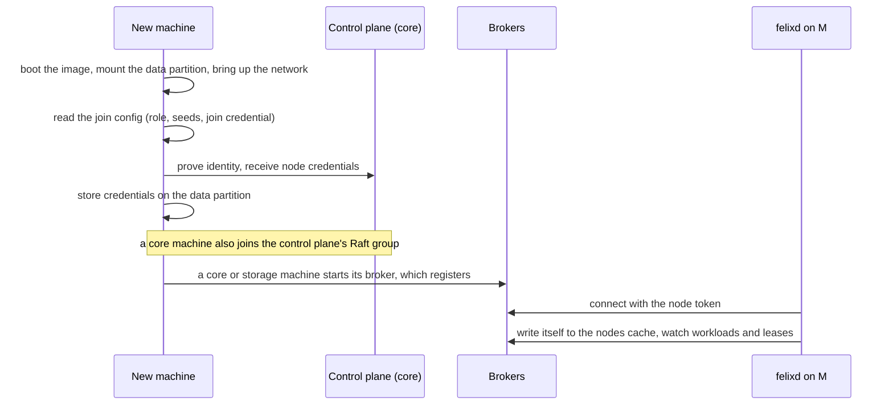
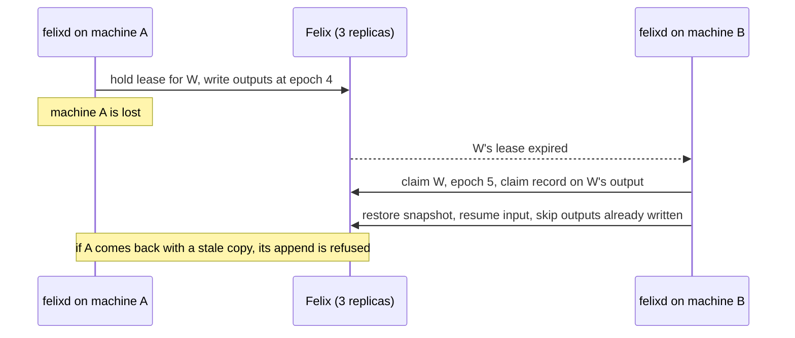

# NineLives design

## Goal

A cluster that behaves like one machine, where the system's memory is a
replicated log. Any program's state can be rebuilt from the log, so failover,
migration and time travel are the same operation.

NineLives is an image. It ships [felixd](https://github.com/GetFelix/felixd),
the node agent that runs workloads from the log, and
[Felix](https://github.com/GetFelix/felix), the log. felixd's
[design](https://github.com/GetFelix/felixd/blob/main/docs/design.md) covers
how workloads run, hold leases, write exactly-once output and replay. This
document covers the operating system around it: what runs on each machine, how
a machine joins, what we can promise when a machine is lost, and the plan for
the first three milestones against felixd as released
([v0.1.0](https://github.com/GetFelix/felixd/releases/tag/v0.1.0), on
Felix 0.7.2).

The choices that shape the system are [decision records](decisions/), each
with what it costs and when it gets reviewed again. Through M2: stock Linux,
our own init as PID 1, a kernel built from upstream source, a minimal Debian 13
root, images built with mkosi, and Felix and felixd shipped
from pinned releases checked by hash and, where the upstream signs them, by
signature. What is still undecided is under
[Open questions](#open-questions). What NineLives relies on from felixd is in
[felixd-contract.md](felixd-contract.md).

## What runs on a machine

Every machine runs the NineLives image: a kernel, our init, felixd and
the Felix binaries. Its role, from the join config, decides which of them start
([topology.md](topology.md)):

| Role | Starts | How many |
|---|---|---|
| core | Felix control plane, Felix broker, felixd | 3, or 5 in larger clusters (1 for development) |
| storage | Felix broker, felixd | optional |
| worker | felixd | optional |

Felix is the one layer NineLives does not schedule, because everything else is
recorded in it. The control plane and brokers are services the image starts,
like felixd. Workloads, and later the scheduler and name service, run on top.

A machine runs one felixd and nothing else that claims work. One machine is one
failure domain ([Lessons from Barrelfish](#lessons-from-barrelfish)).

| OS concept | In NineLives |
|---|---|
| Process | A workload: a module plus its input streams. Its state is a fold over its inputs. |
| PID | A workload id, independent of the machine running it |
| Pipes and IPC | Streams, durable and across machines |
| Files | Append-only streams. A mutable file is a workload that folds edits into contents, so old versions come for free. |
| Namespace | A tree of stream and cache names, with per-user views as in Plan 9 |
| Scheduler | A workload that reads heartbeats and demand and writes assignments, so its decisions can be replayed |
| Users and permissions | Felix tenants and grants. A program's token is its capability. |
| Boot | Read the desired state and claim leases. A cold start of the cluster is a replay. |
| Upgrades | Machines: an image swap that can roll back (A/B partitions are the proposal). Workloads: run the new module over recorded inputs, compare, switch at an offset. |

In felixd 0.1 a workload is a deterministic WebAssembly component. Native
programs are felixd's next tier
([felixd#75](https://github.com/GetFelix/felixd/issues/75)) and are not built
yet, so until then a workload on NineLives is Wasm.

## How a machine joins

1. Firmware loads the bootloader, which loads the kernel. Early init mounts the
   read-only root and the data partition and brings up the network.
2. On first boot the machine reads its join config: its role, the seed
   addresses of the core machines and a join credential. Where that config
   comes from (cloud metadata, a config partition, the kernel command line) and
   what the credential is are [open](#node-identity-and-credentials).
3. It exchanges the join credential for its node credentials and keeps them on
   the data partition, so a reboot does not join again.
4. The init starts the services for its role. A core machine's control
   plane joins the Raft group from the seed list. A broker registers with the
   control plane and serves only the streams it has assignments for.
5. felixd starts with its connection settings: the brokers and control plane
   from the join config, the tenant, and the token and CA files from the data
   partition. NineLives sets `FELIXD_NODE_ID` to the machine's identity,
   because felixd's default (host name plus process id) changes on every
   restart. The full list is in [felixd-contract.md](felixd-contract.md).

In felixd terms a machine has joined when its agent writes itself to the
`nodes` cache. The entry has the lease TTL, so it goes away about when a dead
machine's leases do. From then on the agent watches `workloads` and `leases`
and claims free workloads.

A rebooted machine keeps its node id. felixd never adopts a lease it finds
under its own name, so the restarted agent waits for its old leases to expire
before it claims again.

## What surviving the loss of a machine means

This is the claim M2 has to show, so it is worth saying exactly what felixd
0.1 promises and what it does not.

**Leases.** Each workload has a lease in the `leases` cache with a TTL (10 s
by default, at least 2 s). An agent claims a free workload with a conditional
put, renews every third of the TTL, and stops its workloads once two thirds of
the TTL pass without a renewal. When a machine dies its leases stop being
renewed and expire.

**Failover.** Every agent watches `leases`. After an expiry, any agent with
room claims the workload after a random delay of up to `--claim-delay-ms`
(1 s by default). The new owner restores the latest snapshot and resumes the
input from the offset recorded in it. Placement is first claim wins, capped
by `--max-workloads` per agent. So a lost machine's workloads run again
elsewhere within about one TTL plus the claim delay.

**Exactly-once output.** A new owner takes a higher epoch and writes a claim
record on the output stream before anything else. Outputs are appended with
`publish_if` at the tail the owner expects, so a machine that was frozen
rather than dead, and wakes with a stale copy, has its next append refused.
Each output names the input offset that produced it, so the new owner skips
outputs that already landed. The lease decides who should run; the fence is
what keeps the output correct.

**The log survives too.** felixd 0.1 creates its caches and streams with three
`Quorum` replicas by default. With three core machines, losing one leaves a
majority for the control plane and for every shard.

What this does not cover yet:

- **Native programs.** Only Wasm workloads fail over with exactly-once output
  ([felixd#75](https://github.com/GetFelix/felixd/issues/75)).
- **Effects.** A workload cannot reach the network, files or clocks
  ([felixd#71](https://github.com/GetFelix/felixd/issues/71)).
- **Speed when a core machine is lost.** Felix failover still waits on the
  control plane's lease
  ([felix#1009](https://github.com/GetFelix/felix/issues/1009),
  [felix#1197](https://github.com/GetFelix/felix/issues/1197)), so losing the
  machine that holds it slows recovery for every workload.
- **Rejoining during a core outage.** A broker cannot rejoin while the control
  plane is down ([felix#1196](https://github.com/GetFelix/felix/issues/1196)).
- **Losing a quorum.** If two of three core machines are gone, every workload
  stalls until they return. Nothing is lost or repeated, but nothing moves.

## Lessons from Plan 9

Plan 9 is the closest ancestor of what NineLives is trying to be, and the
reasons it didn't spread are well documented. felixd's design covers the
lessons for workloads
([Lessons from Plan 9](https://github.com/GetFelix/felixd/blob/main/docs/design.md#lessons-from-plan-9)).
These are the ones for the operating system around it:

- **A migration path from the first release.** Plan 9 asked people to leave
  their software behind, and Pike's own summary is that it lost to systems
  that were good enough. Its POSIX layer, APE, could not emulate much of what
  existing programs needed. NineLives aims to run existing programs unmodified
  through felixd's native tier
  ([felixd#75](https://github.com/GetFelix/felixd/issues/75)), which is not
  built yet, and to stay compatible with Linux programs whichever kernel is
  chosen.
- **Drivers come from an existing kernel or a compatibility layer.** Few
  drivers was one of the usual reasons given for Plan 9's slow adoption.
  NineLives does not plan to write its own.
- **Permissive licensing from the start.** Plan 9 spent years under licenses
  that kept outside developers away and only became MIT in 2021. NineLives is
  MIT already.
- **No hidden distribution.** A Plan 9 client that lost its file server hung,
  and losing the root server meant a reboot. In NineLives every machine keeps
  its root on local disk, and a lost machine or a lost Felix quorum is
  reported as a typed outcome (degraded, unknown, failed) rather than a hang.
- **Typed interfaces.** System services expose versioned, typed records, not
  text commands in `ctl` files and string errors.
- **An upgrade and package story.** Machines upgrade by swapping whole
  images atomically, with rollback. Images are built reproducibly and signed,
  so anyone can check that an image matches its source.
- **Fault tolerance as a first principle.** Plan 9's recovery tools were added
  later. Here, losing a machine is the normal case the design starts from.

These are constraints on every kernel, init and image choice, the ones made
for M0 to M2 included.

Sources: Pike, TUHS mailing list, 2023-01-31; Raymond, *The Art of Unix
Programming*, ch. 20; Trickey, "APE: The ANSI/POSIX Environment"; the Plan 9
Foundation's 2021 license announcement; Guardiola, Cox and Van Hensbergen,
"Persistent 9P Sessions for Plan 9" (2006).

## Lessons from Barrelfish

Barrelfish ran a separate kernel on every core of one machine and kept OS
state as replicas that change by agreement. It did not become a mainstream
system, and its authors say the scalability premise did not arrive: core counts
grew slowly and Linux was made to scale with modest changes. The parts that
carry over to NineLives are about how to account for a machine, not about the
kernel. The felixd design has the workload-level
[lessons](https://github.com/GetFelix/felixd/blob/main/docs/design.md#lessons-from-barrelfish).

- **One agent and one failure domain per machine.** Barrelfish treated the
  whole machine as a single failure unit. A machine runs one felixd. Several
  agents on one machine would look like independent failures and are not.
  felixd plans one session lease per machine
  ([felixd#82](https://github.com/GetFelix/felixd/issues/82)); 0.1 holds a
  lease per workload.
- **Don't treat one many-core node as a distributed system.** Message passing
  between cores on cache-coherent hardware is built on shared memory anyway, and
  the best in-kernel descendant (NrOS) replicates per NUMA node over shared
  memory, not per core over messages. NineLives does not need a multikernel.
  Inside a node, felixd pins an instance to a NUMA node and uses local memory,
  never Felix.
- **Heterogeneous hardware is a set of scheduler facts.** NUMA nodes, core
  counts, instruction set and accelerators are recorded as node facts that the
  scheduler reads. A GPU or DPU host is an effect executor. Mixed x86_64 and
  aarch64 clusters stay pinned by instruction set until CI shows that replay
  matches across both, which the M0 images can do.
- **No heavyweight capability system.** Barrelfish's distributed capabilities
  took about 8,000 lines and a two-phase protocol, and one of its authors calls
  the model its biggest distraction. A program's token is its capability, it
  expires, and the epoch fence refuses a stale one.
- **Policy separate from mechanism.** The scheduler decides where work runs and
  is a workload on the log. If it is missing or stale, first claim wins and the
  system keeps running. Nothing on the boot path may depend on it.
- **Upgrades can park and return.** A planned image swap records that the
  machine's work should come back when it rejoins.

Barrelfish also supports two directions this document already takes: run
existing programs rather than excluding compatibility, and take drivers from an
existing kernel. Its team wrote its own drivers, and building high-level
services "took years".

Sources: Baumann et al., "The Multikernel", SOSP 2009; Baumann, "Fish in a
Barrel", SIGOPS blog (2021); Bhardwaj et al., "NrOS", OSDI 2021; Boyd-Wickizer
et al., "An Analysis of Linux Scalability to Many Cores", OSDI 2010 (abstract
only); Gerber, PhD thesis (ETH, 2018).

## Decisions

Each of these has a record with the options we turned down, what the choice
costs and when it is reviewed again.

| Decision | Holds through | Record |
|---|---|---|
| The kernel is stock Linux, pinned, no patches or out-of-tree modules | M2, then reviewed | [0001](decisions/0001-linux-kernel.md) |
| PID 1 is our own init, in Rust, with a deliberately small scope | M2, reviewed again at M4 | [0002](decisions/0002-our-own-init.md) |
| Images are built with mkosi, in CI, reproducibly | M2 | [0003](decisions/0003-mkosi-image-build.md) |
| Felix and felixd ship from pinned releases, checked by hash and by signature where signed | Open-ended | [0004](decisions/0004-components-from-pinned-releases.md) |
| System code is Rust, with `unsafe` confined to one module per crate | Open-ended | [0005](decisions/0005-rust-and-unsafe.md) |
| The root is built from a minimal Debian 13, pinned through snapshot.debian.org | M2 | [0006](decisions/0006-debian-base.md) |
| The kernel is built from upstream LTS source with our own hardened, network-tuned config and no loadable modules | Open-ended | [0007](decisions/0007-kernel-from-upstream-source.md) |

Every decision is measured against the
[security and networking requirements](requirements.md), which say how each
property is checked and from which milestone. The
[threat model](threat-model.md) says who the attacker is, what one
compromised machine can do to the rest of the cluster, and which requirement
stops each threat.

Everything NineLives writes uses standard system calls only, so that after
M2 the same root can boot on another kernel as an experiment. The first one
planned is [Asterinas](https://github.com/asterinas/asterinas), in CI,
without blocking anything.

## Open questions

Nothing in this section is decided. Each question lists the options, what
they cost, when a milestone needs an answer, and a proposal. A proposal is
what we would try first, written down so it can be argued with.

| Question | Needed by | Proposal |
|---|---|---|
| Which kernel LTS release, and how a bump is tested | M0 ([#3](https://github.com/GetFelix/ninelives/issues/3)) | Settled in #3 |
| [Node identity and credentials](#node-identity-and-credentials) | M1 | A one-time join token; TPM and cloud identity later |

### Node identity and credentials

Tracked in [#16](https://github.com/GetFelix/ninelives/issues/16). This is the
first join, before the machine has any credential.

A machine needs at least a Felix token for felixd and the CA that signs broker
certificates. Core and storage machines also need a broker certificate and
key. Felix tokens come from the control plane, which exchanges a token from a
trusted OIDC issuer for one scoped by its grants and refreshes it with
single-use refresh tokens. Felix's day-0 bootstrap creates a tenant once and is
then turned off.

| Option | For | Against |
|---|---|---|
| A one-time join token (from cloud metadata, a config partition or the kernel command line) | Simple, works in qemu and on any cloud | A shared secret on the way in. Needs something that accepts it and mints node credentials, which Felix does not do today. |
| TPM attestation | Ties identity to hardware; no shared secret | Needs a TPM (qemu has swtpm), an attestation service and enrolment. Much more to build. |
| Cloud instance identity | Clouds already sign a document naming the instance, and some issue OIDC tokens that Felix's exchange could trust directly | Different on every cloud. Nothing on bare metal or in qemu. |

felixd re-reads its token file each time it uses the token, so replacing the
file on the data partition rotates a machine's token without restarting
anything. The remaining constraint is that in felixd 0.1 any node may write any
workload's output: the fence keeps output correct, but a compromised node
could write garbage.
felixd's answer is per-lease tokens and identities issued by the cluster
([felixd#74](https://github.com/GetFelix/felixd/issues/74)).

**Needed by:** M1. M2 needs only what M1 ships. Hardware-backed identity
matters for M3 (signed images and secure boot) and M5 (real hardware and
clouds).

**Proposal:** M1 ships a one-time join token on a config partition (in qemu, a
small second disk), exchanged at the core machines for node credentials kept on
the data partition. The development clusters for M1 and M2 mint those
credentials with an operator script and say so, as felixd's compose files do.
TPM and cloud identity come with M3 and M5. Secrets never go on the log.

### Other open questions

- How machines are upgraded: A/B root partitions with rollback are the
  proposal ([#8](https://github.com/GetFelix/ninelives/issues/8)).
- Who decides a machine's role, and how a machine changes role later.
- Encrypting records and redacting history, since the log holds everything
  that passed through it.

## Milestones

| | What works at the end |
|---|---|
| M0 | An image boots in qemu (x86_64 and aarch64) and CI boots it on every PR |
| M1 | Felix and felixd start on the image; a machine joins a cluster on first boot |
| M2 | Five VMs (3 core + 2 storage) form a cluster, run a workload, lose one VM, and the workload continues. CI runs this. |
| M3 | Atomic A/B upgrades with rollback, and signed images |
| M4 | The scheduler, name service and `fx` shell run as programs on the log |
| M5 | Cloud images and Raspberry Pi |

M0 to M2 are planned below against felixd 0.1.0 and Felix 0.7.2, the versions
pinned in [`images/components.toml`](../images/components.toml). Features on
felixd's main branch that are not in that release count as gaps until a
release has them.

### M0: boots in a VM

Issues: [#1](https://github.com/GetFelix/ninelives/issues/1) image build,
[#3](https://github.com/GetFelix/ninelives/issues/3) kernel,
[#46](https://github.com/GetFelix/ninelives/issues/46) init design,
[#47](https://github.com/GetFelix/ninelives/issues/47) the init's first slice,
[#2](https://github.com/GetFelix/ninelives/issues/2) CI boot.

The image boots our init in qemu on both architectures, and the init reports
ready on the serial console. CI builds the image twice from the same commit,
checks the two are identical, and boots it on every pull request. The image
contains felixd and Felix, checked against the manifest, but starts nothing
that needs a cluster.

**From felixd 0.1:** release builds for Linux x86_64 and aarch64, with a
`SHA256SUMS` file signed through Sigstore. The builds are reproducible, so the
image build can check what it ships.

**Gaps:** none in felixd. Felix publishes its broker and control plane only
for Linux x86_64 ([felix#2797](https://github.com/GetFelix/felix/issues/2797)),
so an aarch64 image cannot take a core or storage role yet, and its checksums
are not signed ([felix#2796](https://github.com/GetFelix/felix/issues/2796)).

**Decisions needed:** the kernel LTS release (#3).

### M1: joins a cluster

Issues: [#4](https://github.com/GetFelix/ninelives/issues/4) data partition,
[#5](https://github.com/GetFelix/ninelives/issues/5) first-boot join,
[#6](https://github.com/GetFelix/ninelives/issues/6) Felix and felixd in the
image, [#48](https://github.com/GetFelix/ninelives/issues/48) the init's
services and shutdown, [#16](https://github.com/GetFelix/ninelives/issues/16)
identity, [#49](https://github.com/GetFelix/ninelives/issues/49) the system
call check, [#50](https://github.com/GetFelix/ninelives/issues/50) fault
injection, [#51](https://github.com/GetFelix/ninelives/issues/51) and
[#52](https://github.com/GetFelix/ninelives/issues/52) keeping up with felixd.

A machine boots, joins with its role, and its felixd appears in `nodes`.
Nobody logs in to set it up. A clean shutdown leaves Felix with nothing to
repair on the next boot.

**From felixd 0.1:** everything M1 uses is listed in
[felixd-contract.md](felixd-contract.md). The parts that matter most:

- `felixd agent`, configured entirely from environment variables and flags.
- `FELIXD_NODE_ID`, so the node id can be the machine's identity.
- A token file that is re-read on every use, so the join can rotate it.
- Broker addresses by host name or IP.
- The `nodes` cache with a TTL, which is how we tell a machine has joined,
  and `felixd ps` to show it.
- Leases that a clean shutdown deletes, so a planned reboot hands work over at
  once instead of after a TTL.
- Intake and admission, so submitting work does not need admin rights, and
  `felixd init`, which the image runs once when a cluster first forms.

**Gaps:**

- **Any node may write any output.** The fence keeps output correct, but a
  compromised node could write garbage. Per-lease tokens fix that
  ([felixd#74](https://github.com/GetFelix/felixd/issues/74)). For M1 each
  machine gets a node token from the join.
- **Felix:** a broker cannot rejoin while the control plane is down
  ([felix#1196](https://github.com/GetFelix/felix/issues/1196)).

**Decisions needed:** node identity (#16).

### M2: survives losing a machine

Issues: [#7](https://github.com/GetFelix/ninelives/issues/7) five-VM demo,
[#54](https://github.com/GetFelix/ninelives/issues/54) the Asterinas
experiment, [#53](https://github.com/GetFelix/ninelives/issues/53) reviewing
the M0 to M2 decisions.

`task cluster` boots three core VMs, submits a workload with a producer
feeding its input, kills the VM holding it, and checks that the workload
continues on another VM with no output lost or repeated. CI runs the same test.

**From felixd 0.1:**

- Leases with a TTL, failover within about one TTL, and first claim wins.
- The epoch fence and claim record, so a VM that was frozen rather than killed
  writes nothing when it wakes.
- Snapshots and resume from the snapshot's input offset.
- Three `Quorum` replicas by default, matching three core machines.
- `felixd check --complete`, which replays each workload and reports gaps,
  duplicates and divergence. This is the demo's pass condition.
- Workloads a node keeps failing on are released and marked `degraded`, so
  another node gets a turn and `felixd ps` shows why.
- felixd's own three-node failover test, which keeps killing lease holders in
  CI. The demo repeats it with whole machines.

**Gaps:**

- **Wasm only.** The demo runs felixd's example `counter` workload. An
  unmodified program needs the native tier
  ([felixd#75](https://github.com/GetFelix/felixd/issues/75)).
- **Recovery waits on Felix's control plane lease** when the lost VM held it
  ([felix#1009](https://github.com/GetFelix/felix/issues/1009),
  [felix#1197](https://github.com/GetFelix/felix/issues/1197)). The demo should
  kill that VM in some runs and report how long recovery took.
- **A returning VM gets no work back** until something else frees up. Drain
  with return and one failure domain per machine fix that
  ([felixd#82](https://github.com/GetFelix/felixd/issues/82)).

## What NineLives needs from felixd next

In order:

1. **One failure domain per machine, and drain with return**
   ([felixd#82](https://github.com/GetFelix/felixd/issues/82)). M2 is easier
   to read with it, and M3's upgrades rely on it.
2. **Per-lease tokens and identities issued by the cluster**
   ([felixd#74](https://github.com/GetFelix/felixd/issues/74)), so a
   compromised machine cannot write other workloads' output.
3. **Effects** ([felixd#71](https://github.com/GetFelix/felixd/issues/71)),
   so a workload can reach the network, files and clocks through recorded
   requests.
4. **The native tier**
   ([felixd#75](https://github.com/GetFelix/felixd/issues/75)), so existing
   programs run unmodified.

## Licensing

This repository is MIT. A built image also contains software under other
licenses, which keep them: the Linux kernel and other GPL software, and Felix,
which is AGPL-3.0. Publishing images means publishing the matching source, or
a written offer for it, for those components. The image's inventory
([0004](decisions/0004-components-from-pinned-releases.md)) lists each one
with its license.
