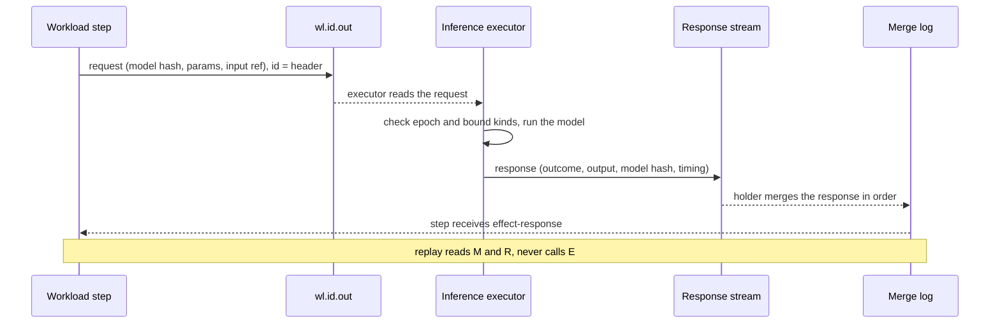
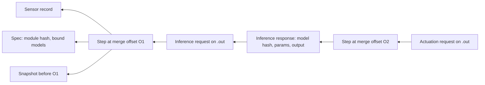

# Inference as an effect

> **Accepted design, not built.** This document describes how model inference
> runs on NineLives so that its decisions can be replayed, and what felixd and
> Felix need first. The open questions are settled under
> [Decisions](#decisions).

## The claim

Fleets of devices increasingly act on what a model tells them: a camera flags a
part, a controller opens a valve, a robot stops. When one of those decisions
goes wrong, the questions are always the same. What did the machine see, which
model was running, what did the model say, and would it do the same again?

NineLives can answer those questions by construction. Every automated decision
can be traced to its exact inputs and model version, and replayed. That is the
whole claim, and the rest of this document is what it takes to keep it true
when a model is in the loop.

It builds on felixd's [Effects](https://github.com/GetFelix/felixd/blob/main/docs/design.md#effects),
[Determinism](https://github.com/GetFelix/felixd/blob/main/docs/design.md#determinism)
and [Replay](https://github.com/GetFelix/felixd/blob/main/docs/design.md#replay),
and on the workload contract in
[`wit/workload.wit`](https://github.com/GetFelix/felixd/blob/main/wit/workload.wit).

## Why inference needs care

A felixd workload replays because it is a deterministic fold over recorded
inputs. Running a model again is not a replay, because inference is usually not
bit-reproducible:

- **Floating point addition is not associative.** GPU kernels reduce in
  parallel, often with atomics, so the order of additions changes from run to
  run. The same input can give different low bits, and a different argmax when
  two scores are close.
- **Libraries choose kernels at run time.** Inference engines pick algorithms
  by hardware, driver version, autotuning and batch size. A request batched
  with others can produce different numbers than the same request alone.
- **CPU is not automatically safe.** SIMD width (SSE, AVX2, AVX-512, NEON),
  fused multiply-add and thread count all change reduction order. ONNX Runtime
  and llama.cpp give different results across machines and thread settings.
- **Sampling uses randomness.** A language model at a temperature above zero
  draws from a random number generator, usually seeded from a clock.
- **Hardware and drivers move.** Results change across GPU generations and
  driver updates, and a fleet never upgrades all at once.

So there are two ways to keep a decision replayable: make the computation
deterministic by construction, or record its result and never compute it
again. NineLives would support both.

## Two modes

| | Mode A: inside the step | Mode B: as an effect |
|---|---|---|
| Where it runs | In the workload's WebAssembly step, under wasmtime | On an executor node, outside the workload |
| Model size | Small: classifiers, anomaly detection, keyword spotting | Anything, including large language and vision models |
| Hardware | CPU only | GPU or other accelerators |
| Replay | Recomputes, and gets the same bits | Reads the recorded response, never calls the model |
| Latency | One step, no log round trip | At least one round trip through the log (milliseconds) |
| Works when the node is cut off | Yes | Only if an executor is reachable |

The two combine well. A device can run a small mode A model locally and ask a
larger mode B model only when the small one is unsure, or when it can reach
one.

### Mode A: small models inside the deterministic step

The model runs inside `step` as ordinary Wasm code, with an inference engine
compiled to Wasm (tract is one open-source option for ONNX models). Because
the step is deterministic, replay recomputes the inference and must land on
the same bits. That holds only if the determinism ABI
([felixd#62](https://github.com/GetFelix/felixd/issues/62)) guarantees the
following:

- **Floats are IEEE 754 with canonical NaNs.** Wasm scalar and 128-bit SIMD
  floating point is deterministic apart from NaN bit patterns, and wasmtime's
  NaN canonicalization covers those. The ABI records that the setting is on.
- **No relaxed SIMD.** Relaxed SIMD instructions have implementation-defined
  results (for example, fused or unfused multiply-add) by design. The ABI
  either turns the proposal off or pins wasmtime's deterministic mode for it.
- **No threads and no shared memory.** A parallel reduction inside the guest
  would bring back the ordering problem.
- **No clocks or randomness except recorded ones.** The component already gets
  no WASI imports. Time is the input's `timestamp-micros`. A sampling seed
  comes from an input record or is derived from the input offset, never from
  the host.
- **The weights are part of what is hashed.** Either they are compiled into
  the module, so the module hash covers them, or the spec names them by content
  hash and the runtime hands the same bytes to every node.
- **Limits are in the spec.** Inference is expensive, so fuel and memory
  limits matter more than usual. They are already spec fields, so every node
  fails at the same input.
- **The runtime is pinned.** The felixd runtime version, the wasmtime version
  and settings, and the instruction set (until cross-ISA replay passes in CI)
  are part of the ABI, as #62 describes.

Integer-quantized models suit this mode best: integer arithmetic is exact, so
most of the float rules stop mattering. The cost is speed. A fuel-metered
Wasm step with 128-bit SIMD is several times slower than the same model on
native code, and there is no GPU.

`wasi-nn` and similar host calls are not mode A. A host call that runs the
model natively brings back every problem above. If a workload wants native
inference, it asks for it as an effect.

### Mode B: large models as an effect

The model runs on an executor, and the workload never calls it. It asks,
following felixd's effect rules
([felixd#71](https://github.com/GetFelix/felixd/issues/71)):

1. `step` returns a `request` output whose `kind` is an inference interface
   (for example a hypothetical `ninelives:inference/run@0.1.0`) and whose body
   names the model, the parameters and the input.
2. felixd writes it on the workload's output stream like any other output. Its
   header (input offset, index, epoch) is the effect id.
3. An executor that serves the kind and has the model picks it up, checks the
   epoch and the spec's bound kinds
   ([felixd#97](https://github.com/GetFelix/felixd/issues/97)), runs the
   model, and writes a response with a typed outcome to the workload's
   response stream.
4. The lease holder merges the response into the workload's input through the
   recorded merge order
   ([felixd#58](https://github.com/GetFelix/felixd/issues/58)), and `step`
   receives it as an `effect-response`.
5. On replay, the response is read from the merge log like any input. No
   executor is contacted and no model is loaded.

Inference has no side effects, so the executor may retry it freely. What
matters is that the fold sees exactly one answer per request. The proposal: the
first response merged for an effect id is the one `step` sees, and a later
response for the same id is passed over and recorded as such, the same way a
late response after a `timeout` is.

The round trip through the log costs milliseconds. That suits decisions made
on a scale of tens of milliseconds and up. A control loop that has to close in
microseconds stays on the device, in mode A or outside NineLives.

## What a recorded inference carries

Everything a later reader needs to explain or check the decision has to be on
the record, because the model and the executor may be gone by then.

| Field | In | What it is |
|---|---|---|
| Model identity | request and response | The content hash of the model artifact. A registry name and version may be given at submit time but are resolved to a hash then; only the hash is compared. The response repeats the hash the executor actually loaded. |
| Parameters | request | Everything that changes the result: temperature, seed, top-p, maximum tokens, precision, preprocessing version. A missing parameter means the interface's documented default, never the engine's. |
| Input reference | request | Which records the model was given: stream, incarnation and offset, or a chunk hash. Inputs are referenced, not copied. |
| Deadline | request | How long the workload will wait. It is a determinism input, since it changes which outcome is recorded. |
| Outcome | response | `ok`, `error` with a code, `timeout`, `unknown` or `backpressure`, as in `workload.wit` |
| Output | response | The result, inline when small, otherwise a chunk hash and size |
| Executor | response | Node id, engine name and version (for example ONNX Runtime or llama.cpp at a release), device class |
| Timing | response | When the executor received, started and finished the request, by its own clock. For people only, never compared. The broker's append time on the response is the time the fold uses. |

**Where it lives.**

- The request is an output on `wl.<id>.out`. Its header is its id.
- The response goes on the workload's response stream, which felixd's design
  names but does not lay out yet (#71). This document calls it `wl.<id>.resp`
  as a placeholder.
- The merge log, `wl.<id>.merge`, records where the response entered the
  fold.
- Model artifacts live in a content-addressed store
  ([Decisions](#where-model-artifacts-live)).

**Size limits.** A Felix record is bounded by the broker's frame cap (16 MiB
by default), and large records on a `Quorum` stream make every replica slower.
The proposal is a small inline limit (64 KiB, to be measured) for request and
response bodies. Anything larger goes by reference:

- Camera frames and other large inputs are already records somewhere, so the
  request names them by stream and offset, or by chunk hash.
- A large output (an embedding batch, a segmentation mask, a long generation)
  is written by the executor to the chunk store, and the response carries its
  hash and size.
- `step` makes no host calls, so it cannot fetch a reference itself. felixd
  resolves the reference before calling `step`, checks the hash, and hands over
  the bytes. Replay does the same. If the chunk has been deleted, replay stops
  and reports it, as it does for a trimmed input.

## Replay and audit

### Why did unit X act at time T

Every link in the chain is a record that names the one before it, so the
question has a mechanical answer. The walk, which an `fx why` command could do
(not built; felixd's design sketches it):

1. Find the actuation request on unit X's workload `.out` at time T. Its header
   gives the step's input offset and the epoch.
2. The claim for that epoch names the spec record, which gives the module hash
   and the bound models.
3. The merge log entry at that offset gives the input the step received. If it
   was an inference response, read it: model hash, parameters, output.
4. That response names its request, whose header gives an earlier step and its
   input: the sensor reading, frame or message the model was asked about.
5. The snapshot before the earliest of those steps, plus the inputs after it,
   is the workload's state at the time. `felixd replay --to` prints it.

The answer is a set of records, not a log line someone chose to write. Replaying
from the snapshot through O2 reproduces the decision bit for bit, in either
mode.

### What `replay --diff` means when something changes

`felixd replay --diff --module` ([felixd#29](https://github.com/GetFelix/felixd/issues/29))
runs a new module over recorded inputs and reports the first output that
differs. With inference in the loop there are three cases:

- **The workload code changes, the requests do not.** Replay reuses the
  recorded responses, so the diff isolates the code change. This is #29 as it
  stands.
- **The code changes and issues different requests** (a new prompt, a new
  threshold for asking). There is no recorded response for a request that was
  never made. The proposal: replay stops at the first such request and reports
  it as a divergence of requests, not of outputs. It never calls an executor.
- **The model changes.** Every request now names a different hash, so no
  recorded response applies. Comparing models is not a replay. It is a
  **shadow evaluation**: send the recorded requests, with the new model, to an
  executor, write the responses to a separate stream, run the fold over them,
  and diff the decisions against the recorded ones. The report gives the first
  differing decision, how many differ, and the per-request output differences.
  The shadow responses are recorded, so the evaluation is itself replayable
  and can be cited later.

Shadow evaluation writes nothing to the live workload's streams and is never
seen by its executors' deduplication, because its requests carry their own ids.

### Upgrading a model

The proposal is that a workload's spec binds model names to hashes, as it binds
effect kinds and credentials (#97). Changing a model is then a spec change, and
inherits what the workload contract says about upgrades:

1. **Shadow over history.** Run the shadow evaluation above over a stated range
   of recorded requests (#29).
2. **Shadow over live traffic.** Run the new model beside the old one for a
   stated window, recording its responses but acting on none
   ([felixd#102](https://github.com/GetFelix/felixd/issues/102)).
3. **Switch at a recorded offset.** Write the new binding to take effect at a
   stated input offset ([felixd#64](https://github.com/GetFelix/felixd/issues/64),
   the remaining piece). Every request at or after it names the new hash, on
   every node, after any failover.
4. **Roll back forward.** Rolling back writes the old binding at a later
   offset. It never replays over outputs already written (#102).

Today felixd refuses a new module once a workload has output, so a model
change means a new workload id. Until #64's switch lands, that is the upgrade
path, and the audit trail crosses from one id to the next by hand.

## Actuation

An actuator command is also an effect: a request on `.out` with a kind such as
"set valve position", executed by a node or gateway that can reach the device.
Unlike inference, acting twice can be harmful. felixd already covers part of
this:

- **Outputs are written once.** A new owner skips outputs that already landed,
  so failover never writes a second request for the same step.
- **Executors refuse lower epochs.** A stale owner's request is refused once
  the new owner has claimed.
- **The effect id is the idempotency key.** It is deterministic, so a retried
  request carries the same id.

What is left is the case where the executor itself fails. Outcomes are
recorded, never guessed (#71):

| Outcome | What it means | Safe to reissue? |
|---|---|---|
| `backpressure` | The executor's queue was full; nothing was done | Yes |
| `timeout` | Nobody accepted the request before its deadline; nothing was done | Yes |
| `error` | The executor or device refused, with a code | Depends on the code |
| `unknown` | The executor accepted it and was lost; it may have acted | Not blindly |

The proposal for telling `timeout` from `unknown`: an executor writes an
"accepted" record before it acts. A request with no accept by its deadline is
a `timeout`. A request that was accepted and has no response when the
executor's lease expires is `unknown`. Whoever writes that outcome (another
executor of the same kind, or the lease holder's runtime) writes it as a
record, so the fold sees it in order and replay sees the same thing.

How a workload handles `unknown` is its own decision, and the runtime never
makes it. Patterns that keep an actuator from acting twice:

- **Absolute commands.** "Set the valve to 40%" can be repeated safely;
  "open the valve 10% more" cannot. Prefer set-points to deltas.
- **Read back before reissuing.** The device's own telemetry is an input. After
  `unknown`, the workload waits for the next reading and decides from it,
  instead of reissuing at once.
- **Device-side deduplication.** An actuator kind whose guarantee is
  *idempotent* or *fenced* (#71) has the device or its gateway remember recent
  effect ids, or the highest epoch, and refuse repeats. A reissue after
  `unknown` names the original id, so the device can tell.
- **At-most-once kinds stop.** If the device cannot dedupe and cannot be read
  back, the kind is at-most-once: `unknown` becomes a recorded alarm for a
  person, not a retry.

## Executors

**Which node runs inference.** An executor is a service on a node with the
hardware for it. It advertises the effect kinds and versions it serves, as
felixd's design already requires, and the scheduler sees its accelerators as
node facts on `sys.facts`
([felixd#60](https://github.com/GetFelix/felixd/issues/60)). Proposed
additions for inference:

- **Models it can serve,** by hash, and which are loaded. Loading a large model
  takes seconds to minutes, so requests should go to a warm executor. What is
  loaded is node-local state, reported as a fact and never agreed.
- **Capacity,** as a queue limit per kind, so placement and backpressure use
  the same number.

A node never claims a workload whose effect kinds nobody serves (#71). For
inference, "serves" should include the bound model hash, so a workload is not
placed where its model can never run.

**Timeouts.** The deadline is in the request, so it is a determinism input. A
`timeout` outcome is a record, never a timer inside `step`. A response that
arrives after its request timed out is passed over.

**Backpressure.** Two limits, both from felixd's design: outstanding requests
per workload (a spec field, since hitting it changes when requests are issued)
and a queue limit per executor, which answers an excess request with
`backpressure`. Queue depth is a metric per workload and per executor.

**An executor dying mid-request.** Covered by the accepted record above:
before acceptance the request is a `timeout` and another executor may take it;
after acceptance it is `unknown`. For inference, `unknown` is harmless and the
workload simply asks again under a new id. A GPU running out of memory or a
driver fault is an `error` with a code, not a crash of the workload.

**Edge sites.** A device fleet is rarely one cluster with good links. Small
devices run mode A locally. Larger models run on a site gateway or in a data
center. When the link is down, mode B requests time out, the `timeout` is
recorded, and a workload that planned for it falls back to its local model.
The records from the device reach the rest of the fleet later, which needs
Felix to forward a local log upstream ([What has to land first](#what-has-to-land-first)).

## Decisions

Accepted 2026-10-31. Each outcome is short; the options that were weighed are
in the PR discussion.

### Where model artifacts live

felixd's chunk store ([felixd#77](https://github.com/GetFelix/felixd/issues/77)).
A Felix cache value is one record, bounded by the frame cap, and models are
megabytes to gigabytes. Until the chunk store exists, mode A weights go inside
the module, so the module hash covers them, and mode B executors load models
from local disk and refuse any whose hash does not match.

### Whether mode A is in scope before the determinism ABI

Mode B comes first, as the first effect kind of
[felixd#71](https://github.com/GetFelix/felixd/issues/71). Mode A is allowed
only for integer-quantized models, pinned to an instruction set and marked
experimental, until [felixd#62](https://github.com/GetFelix/felixd/issues/62)
lands. Nothing refuses a node with different settings, so `replay --diff` in CI
is the guard.

### How model identity is attested

The executor checks the hash as it loads the model from the content-addressed
store, and signs responses once per-node identities exist
([felixd#74](https://github.com/GetFelix/felixd/issues/74),
[ninelives#16](https://github.com/GetFelix/ninelives/issues/16)). Hardware
attestation comes later, with signed images and secure boot (M3) and real
hardware (M5), if a user needs it.

### Retention of recorded responses versus head trim

Each workload states an audit horizon in its spec. Response and merge streams
are trimmed only below the lower of the resume floor and the horizon, using
Felix's head trim at an offset
([felix#1662](https://github.com/GetFelix/felix/issues/1662)). Large outputs
are stored by reference so the horizon stays cheap. Redaction, when a record
must go early, uses the chunk store's per-tenant keys (#77).

### Whether the executor is part of felixd

No. The executor is a separate service, one per machine, in its own cgroup
([topology.md](topology.md)). A GPU driver fault or a model's memory use then
cannot stall felixd's lease renewals. The machine is still one failure domain;
the separation only keeps an engine crash from looking like a lost node.

## What has to land first

In order:

1. **Effects** ([felixd#71](https://github.com/GetFelix/felixd/issues/71)),
   with inference as the first effect kind, and effect kinds bound in the spec
   ([felixd#97](https://github.com/GetFelix/felixd/issues/97)). Mode B and
   actuation both rest on this.
2. **The determinism ABI** ([felixd#62](https://github.com/GetFelix/felixd/issues/62)),
   with the float, NaN, SIMD and clock rules above. Mode A rests on this.
3. **A module upgrade at a recorded input offset**, the piece of
   [felixd#64](https://github.com/GetFelix/felixd/issues/64) still open, with
   `replay --diff --module` ([felixd#29](https://github.com/GetFelix/felixd/issues/29))
   before it and provisional upgrades
   ([felixd#102](https://github.com/GetFelix/felixd/issues/102)) after.
4. **An edge-footprint measurement.** The memory, disk and CPU a Felix broker
   and felixd need on a small device, alongside a mode A model. It decides
   whether a device runs its own log or only reaches a gateway's. No issue yet;
   it belongs with the Raspberry Pi image
   ([ninelives#14](https://github.com/GetFelix/ninelives/issues/14)).
5. **Edge-to-cloud store-and-forward in Felix.** A site or device keeps
   appending while cut off and forwards its records upstream later, in order and
   without duplicates, so the fleet's history ends up in one place. No issue
   yet.

Also needed, already tracked: the content-addressed chunk store
([felixd#77](https://github.com/GetFelix/felixd/issues/77)) for model artifacts
and large outputs, and head trim at an offset
([felix#1662](https://github.com/GetFelix/felix/issues/1662)) for retention.
