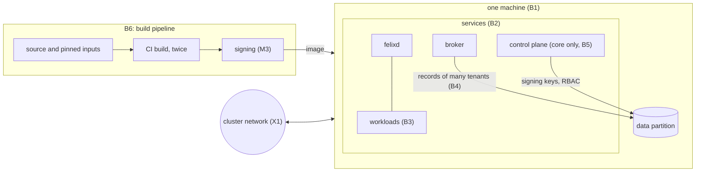

# Threat model

Who attacks a NineLives cluster, what they start with, what they want, and
what stops them. Every component design cites the threats here that it
answers ([CONTRIBUTING.md](../CONTRIBUTING.md#component-designs)), and every
mitigation names the [requirement](requirements.md) that checks it.

This page covers the image and the machine: the kernel, the init, the
services it starts, how a machine joins, how the image is built, signed,
booted and updated. Felix and felixd are in scope as components the image
ships and configures, at the versions pinned in
[`images/components.toml`](../images/components.toml) (Felix 0.7.2,
felixd 0.1.0). Their own threat models are the source for how they behave:
Felix's [auth design](https://github.com/GetFelix/felix/blob/v0.7.2/docs/auth.md),
[internal threat model](https://github.com/GetFelix/felix/blob/v0.7.2/docs/threat-model-internal.md)
and [security page](https://github.com/GetFelix/felix/blob/v0.7.2/docs-site/src/content/docs/features/security.md),
and felixd's [grants](https://github.com/GetFelix/felixd/blob/v0.1.0/docs/design.md#grants)
and [credentials](https://github.com/GetFelix/felixd/blob/v0.1.0/docs/design.md#credentials).

**What is built.** None of the image is built yet: no image build, kernel,
init or join exists in this repository. Every NineLives mitigation below is a
requirement, and a threat counts as closed only once that requirement's check
passes. Where this page says Felix or felixd does something, that is in the
pinned release.

## How to read it

One compromised machine is a foothold into every other machine and into the
log. Attackers now include automated ones that find every reachable bug in a
parser and chain small holes faster than a person reviews them. So this page
assumes:

- **Any bug an attacker can reach will be found.** A defence that relies on
  nobody noticing a weakness counts as no defence.
- **Code execution in a service is followed by a kernel exploit.** The
  no-root rule ([below](#no-root-after-early-boot)) means a compromised
  service starts with only its own uid, but an attacker who finds a reachable
  kernel bug gets the whole machine. So each service is judged twice: what its
  own uid reaches, and what a fully compromised machine reaches.
- **Two independent checks beat one strong one.** Where a threat has a single
  mitigation, the table says so.

A threat is closed by a requirement, is a **gap** (no mitigation exists; the
row names the new requirement or upstream issue that would close it), or is
**accepted** with the reason. Upstream gaps are things only Felix or felixd
can fix; NineLives configures around them where it can and says so here.

## What we trust

These are assumptions, not threats we defend against:

- **Hardware, firmware and the hypervisor.** CPU, memory, disk controller,
  UEFI firmware, and on a cloud the provider's hypervisor and control plane.
  A cloud provider can read any machine it hosts.
- **The cryptography** in TLS 1.3, Ed25519, SHA-256 and the signature schemes
  named below, as implemented by rustls, ring and the kernel.
- **GitHub** as a host for source and releases, its Actions OIDC issuer, and
  Sigstore's Fulcio and Rekor for keyless signatures.
- **Debian's archive signing keys and kernel.org's stable maintainers' keys**,
  pinned as described in [0006](decisions/0006-debian-base.md) and
  [0007](decisions/0007-kernel-from-upstream-source.md).
- **The cluster's operators.** Whoever holds the control plane's admin
  credentials or the image signing keys can do anything. This page is about
  limiting what everyone else can do.

## Assets

| # | Asset | Where it lives | What an attacker wants with it |
|---|---|---|---|
| A1 | **The log**: every stream and cache of every tenant, including workload inputs, outputs, snapshots, specs and modules | Brokers' directories on the data partitions of core and storage machines, in plaintext ([Felix: not built](https://github.com/GetFelix/felix/blob/v0.7.2/docs-site/src/content/docs/features/security.md#not-built)) | Read it, append to it, erase history (trims), or stop it |
| A2 | **Control-plane metadata**: tenants, RBAC, shard placement, membership, and every tenant's Ed25519 signing-key seeds | The Raft store on every core machine's data partition. The seeds are stored as they are; whoever reads them can mint a token for any tenant ([Felix](https://github.com/GetFelix/felix/blob/v0.7.2/docs/metadata-raft-design.md)) | Mint credentials, change who may do what, replace the store |
| A3 | **Machine credentials**: join token, node tokens and refresh tokens, the broker's node credential, broker and Raft TLS keys, the Raft peer token, the bootstrap token, and the CA keys that issue certificates | Data partition (S8), except the join token, which arrives on a config partition or from cloud metadata, and the CA keys, whose home is not decided ([#16](https://github.com/GetFelix/ninelives/issues/16)) | Act as a machine, or as the control plane |
| A4 | **Node identity**: the node id felixd and the broker use, and the certificate names bound to it | Data partition, from the join | Pose as another machine, take its work |
| A5 | **Workload outputs and decisions**: what workloads write, which felixd keeps exactly once | Part of A1 | Forge or suppress results other systems act on |
| A6 | **The image and its signing chain**: this repository, `components.toml`, the Debian snapshot pin, kernel source and keys, CI, the build, and the image signing keys (from M3) | GitHub, CI runners, wherever signing keys are kept (S13) | Ship code that runs on every machine |
| A7 | **Availability**: a quorum of core machines, leases, the time source | Spread across the cluster | Stop work, or make failover churn |

## Attackers

| # | Attacker | Starts with | Typical goal |
|---|---|---|---|
| X1 | **Network attacker on the cluster network** | Can send, drop, delay and observe packets on the network the machines share. On a cloud this includes a neighbour on the same virtual network and anyone who reaches an exposed port. | Steal credentials in transit, impersonate a machine, exploit a listening parser |
| X2 | **Compromised workload** | A WebAssembly module running under felixd, submitted by a submitter or by someone holding a submitter's credential | Escape the sandbox, read or forge other workloads' data, exhaust the machine |
| X3 | **Compromised service** | Code execution as one service's user (broker, control plane, felixd, DHCP or time client, the join, the diagnostics interface), through a bug | Read other services' secrets, become root, call out |
| X4 | **Compromised machine or peer node** | Root on one machine, with all of its credentials. Also covers credentials stolen from a machine and used elsewhere. | Move to other machines and to the log |
| X5 | **Malicious upstream** | A release of Felix or felixd, a Debian package, the kernel source, a Rust crate, mkosi, a GitHub Action or CI tool | Get code into every image |
| X6 | **Compromised CI or release pipeline** | Control of a workflow, a runner, a maintainer's GitHub account, or (from M3) a signing key | Publish an image that machines accept |
| X7 | **Physical access** | The disk (stolen, decommissioned, or a cloud snapshot), the console, or a device port | Read the data partition, change what boots |

X2 is treated as X3 for felixd. X3 is analysed at the service's own uid in
[No root after early boot](#no-root-after-early-boot), and as X4 for when it
also has a kernel exploit.

## Trust boundaries

| # | Boundary | Between | What enforces it |
|---|---|---|---|
| B1 | **Machine** | One machine and the network, and so every other machine | Ports open only as listed (S7); mutual TLS with certificates from the join on every Felix listener that takes a client CA, and client certificates bound to the token's subject on the client port (S10); per-machine, short-lived credentials (S19); limited egress (S18) |
| B2 | **Service** | Services on one machine, and each service and the kernel | Per-service user, cgroup, seccomp, Landlock, no capabilities beyond each service's listed ones (S6); no root after early boot (S24); hardened kernel without modules (S2); read-only root (S3) |
| B3 | **Workload sandbox** | A WebAssembly workload and felixd's process | felixd's Wasm runtime, fuel and memory limits; no effects in felixd 0.1 |
| B4 | **Felix tenant** | Tenants, and inside felixd's tenant the namespace and its `.sys` namespace | Felix tokens carry a tenant and permissions, checked by every broker; felixd's grants |
| B5 | **Control plane** | Who may mint credentials, change RBAC and membership, and place shards, versus everyone else | Raft peer token plus mutual TLS between members (S10), though any Raft certificate can speak for any member ([felix#2802](https://github.com/GetFelix/felix/issues/2802)); `felix-controlplane` audience tokens over server-authenticated TLS, since Felix's API takes no client certificate; the join (S20) |
| B6 | **Build pipeline** | Source and upstream inputs, and the bytes a machine boots | Pinned and verified inputs (S4, S21, S23), reproducible builds (S5), signatures and verified boot (S13), authenticated updates (S22) |

## What one compromised machine can do

This is the question every design here has to answer, so it gets its own
section. Without root, a compromised service reaches only its own row in
[What a compromised service still reaches](#what-a-compromised-service-still-reaches).
This section assumes the attacker also has a kernel exploit: X4, root on one
machine, with every credential on it. The attacker can reach other machines
only through the ports S7 lets them open, and only with the credentials this
machine holds.

**A core machine today is the whole cluster.** Its control-plane member holds
every tenant's signing-key seeds, so it can mint a Felix token for any tenant
carrying any permission, cluster scope included, and every broker accepts it.
It holds the Raft peer token, which is the cluster-admin credential: a
`propose` of `ImportState` with overwrite replaces the whole metadata store
([Felix](https://github.com/GetFelix/felix/blob/v0.7.2/docs/metadata-raft-design.md#transport-and-peer-authentication)).
If the CA that issues broker certificates is kept on core machines, it can
also issue a certificate for any node id. Nothing in NineLives or Felix limits
this today (T24, T25).

| Role | Holds | Can do to other machines and the log | Cannot do |
|---|---|---|---|
| **core** | Everything a storage machine holds, plus the Raft store (signing-key seeds, RBAC, membership), the Raft peer token and TLS key, and while the cluster forms, the bootstrap token | Mint any token for any tenant; read, append to and trim any stream; change RBAC; replace metadata; move shards; admit machines | Rewrite records already stored on honest replicas through replication, which compares bytes and refuses a conflict; make a follower that holds records discard them through bootstrap ([Felix](https://github.com/GetFelix/felix/blob/v0.7.2/docs/threat-model-internal.md)). Neither stops a forged token with trim rights. |
| **storage** | Broker TLS key and node credential (`node.view:cluster:*`), felixd's node token and refresh token, the plaintext records of the shards it holds | Read every record of every tenant on its shards; append records to shards it replicates, indistinguishable from the leader's; serve wrong data to readers that reach it; act with the rights of any client token presented to it, until the token expires (900 s by default) or is revoked, but only by forwarding requests to other brokers, which check the token and not its certificate binding (T73); read cluster metadata | Mint tokens; touch shards it does not replicate; speak as another broker (certificates are bound to node ids); present a client's token on another broker's client port, which needs the certificate key bound to the token's subject; delegate it, since `/token/delegate` needs `token.delegate` and a `may_act` naming the caller; use a client's broker token against the control-plane API (audiences differ) |
| **worker** | felixd's node token and refresh token | Through the node grant: read every stream and cache in felixd's namespace and its `.sys` namespace; publish to every stream of the namespace, inputs included; take any workload's lease with a higher epoch and write its output; mark workloads failed; overwrite other nodes' entries; poison `sys.facts`, which the scheduler reads ([felixd grants](https://github.com/GetFelix/felixd/blob/v0.1.0/docs/design.md#grants)) | Write `sys.specs` or modules; change RBAC; reach other namespaces or tenants; mint tokens; rewrite records already written (trims need `--grant-trim`, which the image does not use, T28) |

Every role can also attack other machines' listening services with crafted
input (T29), and every role can stop being a working member of the cluster.
The worker row is the floor: even the least privileged machine can forge any
workload's output in its namespace. `felixd check --complete` finds outputs
that differ from a replay of their inputs, but not outputs produced from
inputs the attacker also forged.

What narrows each row:

- **Worker:** per-lease tokens, so a node can write only the outputs it holds
  ([felixd#74](https://github.com/GetFelix/felixd/issues/74), which carries
  what remains now that Felix's scoped lease tokens have landed). Felix 0.7.2
  has lease tokens, but they still let a node that can write the lease cache
  take a lease, and felixd 0.1 does not use them.
- **Storage:** signed records, so a reader can tell a broker's injected record
  from a producer's. Felix has none (T26).
- **Core:** signing keys held somewhere other than the Raft store of a machine
  that also runs a broker and workloads, and a Raft peer credential per member.
  Felix has neither (T24, T25). Until then, the only lever is fewer things
  running on core machines ([Open questions](#open-questions)).

## No root after early boot

Nothing on a NineLives machine runs as root once early boot is over, PID 1
included: the no-root rule (S24). The init drops to its own uid and keeps
only a few capabilities, each with a stated reason. There are no setuid
binaries, no file capabilities, no root login or root shell, and no service
gets a capability that amounts to root.

What that buys: getting root back after the drop takes a kernel bug. There is
no setuid program to exploit, no root daemon to send input to, and no file
that grants capabilities when executed.

Locked securebits (`NOROOT`, `NO_SETUID_FIXUP`) are not enough on their own.
They stop a process gaining capabilities when it executes a program, but uid
0 still matters: root-owned files and several `/proc/sys` checks key on the
effective uid. A PID 1 that kept `CAP_SETUID` could `setuid(0)`, write
`kernel.core_pattern` as a pipe to a program of its choosing, and the kernel
would run that program as full root on the next crash. So:

- **PID 1 keeps only `CAP_KILL` and `CAP_SYS_BOOT`.** Before the drop it
  forks one launcher per service, already running as that service's uid and
  holding only that service's listed capabilities. After the drop PID 1
  cannot change uid. A qemu test checks that its uids are not 0, its
  `CapPrm` has no `CAP_SETUID` and its securebits are locked; calling
  `setuid(0)` from PID 1 itself would need a test hook inside it.
- **Launchers are protected from their own services.** A launcher runs at its
  service's uid without the service's seccomp filter or Landlock rules, so the
  service could otherwise ptrace it. Yama's `ptrace_scope` is 3, so nothing
  can ptrace anything, and launchers are non-dumpable. A launcher takes no
  input from its service, and each service's seccomp filter allows
  `prlimit64`, `setpriority`, `ioprio_set` and the `sched_set*` calls only on
  the caller itself. PID 1 cannot fork a new launcher after the drop, so when a
  Felix or felixd launcher dies the init reboots the machine, at most twice in
  any 24 hours of uptime counted across boots; after that the machine stays
  up and degraded (T74).
- **Capabilities are listed per service** (S6). The DHCP applier and the
  time client get theirs as ambient capabilities from their launchers, since
  with no file capabilities that is the only way to hold one across `exec`.
  Every other service holds none, and each service's bounding set holds only
  its list, with `no_new_privs` set.
- **`CAP_NET_ADMIN` cannot change the packet filter's rules, but tc can get
  around them.** The packet filter is loaded before the drop. DHCP is split:
  an unprivileged parser reads replies from a packet socket the applier
  opened and handed to it, and passes a typed lease to the applier. The
  applier opens the socket with protocol 0, attaches a classic BPF filter
  that passes only DHCP and locks it with `SO_LOCK_FILTER`, and only then
  binds it to one interface and the protocol, so it never receives stray
  packets before the filter is on; the parser's
  seccomp filter denies `bind` and `setsockopt`, so it cannot widen what it
  receives. The applier's seccomp filter allows netlink sockets only for
  `NETLINK_ROUTE`, so `NETLINK_NETFILTER` is denied, and denies the xtables
  `setsockopt` options (`IPT_SO_SET_*`, `IP6T_SO_SET_*`, `EBT_SO_SET_*`,
  `ARPT_SO_SET_*`, `IP_VS_SO_SET_*`), which change rules without netlink; S2
  also leaves legacy xtables and IPVS out of the kernel. That does not cover tc: qdiscs, classifiers and
  actions such as `pedit`, `nat` and `mirred` are configured over
  `NETLINK_ROUTE`, and run before netfilter on ingress and after it on
  egress, so they can rewrite or redirect what S7 and S18 allow. S2 builds the
  kernel without the classifiers and actions NineLives does not use; what is
  left is open ([#69](https://github.com/GetFelix/ninelives/issues/69)).
  Unprivileged user namespaces are off (S2), so no service can gain
  `CAP_NET_ADMIN` in a namespace of its own and reach nf_tables or tc that
  way.
- **Nothing a root-owned check guards stays writable.** `/proc/sys` is
  read-only after boot, `kernel.core_pattern` is fixed on the kernel command
  line at build to a path, never a pipe, and no root-owned file is writable
  after the drop.
- **The image build fails** on any file with a setuid bit or a
  `security.capability` attribute.

### What a compromised service still reaches

Each row is X3: code execution as that service's uid, without a kernel bug.

| Service | Reaches without root | Cannot reach |
|---|---|---|
| Felix broker | Its data directory, so every record of the shards it holds, in plaintext; its TLS key and node credential; client tokens presented to it, usable only through forwarding (T73); the ports S18 allows. This is the storage row of the next section. | The control plane's store and Raft token, even on a core machine; felixd's token; the packet filter, the clock, other services' memory |
| Felix control plane (core) | The Raft store, so every tenant's signing-key seeds and the Raft peer token. **This is the whole cluster** (T24, T25); the no-root rule does not narrow it. | Other services' files on the machine, which it does not need |
| felixd | Its node and refresh tokens, and the workloads it runs: the worker row of the next section | The broker's records on disk, the control plane's store |
| DHCP parser | A packet socket the applier handed it, bound to one interface with a locked filter that passes only DHCP: it can read DHCP replies, send forged frames on the local link, and feed the applier a lease. No capability, and no `bind` or `setsockopt`. | Routes, addresses, the packet filter, credentials, records, the clock |
| DHCP applier | `CAP_NET_ADMIN`, `CAP_NET_RAW` and `CAP_NET_BIND_SERVICE` (ambient, listed in S6), with netlink limited to `NETLINK_ROUTE`: addresses and routes, so it can send this machine's traffic anywhere; tc, so it can rewrite or redirect packets past the packet filter with whatever classifiers and actions the kernel has (S2, [#69](https://github.com/GetFelix/ninelives/issues/69)); raw sockets, so it can sniff and spoof on the machine's interfaces. TLS keeps the traffic unreadable (T2). A bug in route or tc handling reached through it is a kernel bug (T70). | The packet filter's rules (no `NETLINK_NETFILTER`, no xtables `setsockopt`), credentials, records, the clock |
| Time client | `CAP_SYS_TIME` (ambient, listed in S6): the machine's clock. On a core machine, the control plane then mints tokens whose `iat` and `exp` follow that clock, and other brokers accept them until `exp` by their own clocks, so a clock set a day ahead yields tokens valid for a day. Revocation cutoffs move the same way. | Credentials, records, the packet filter |
| Join | The join token, and write access to every service's credential directory. That includes the CA bundles felixd and the broker trust, so it can install an attacker's CA and let a fake broker or control plane collect their tokens (T2). It never holds the Raft peer token or a Felix token ([join design](components/join.md)). **This is the machine's whole identity** (T71). | Running as another service's uid; it writes credentials without `CAP_DAC_OVERRIDE` or `CAP_CHOWN`, into directories made for it |
| Diagnostics interface | Every service's captured output, and kernel crash dumps, which hold credentials (T22) | Writing anything |
| PID 1, after the drop | `CAP_KILL` and `CAP_SYS_BOOT`: starting, stopping and signalling every service through its launcher; every service's captured output; the cgroup tree; reboot. Each launcher runs only its own service's program from the read-only root, with settings fixed before the drop, so PID 1 cannot run other code as a service's uid. If the init design cannot hold that, this row is the union of every row above, and on a core machine the cluster. | Root or any other uid: it has no `CAP_SETUID`, `CAP_SETGID` or `CAP_SYS_ADMIN` |

So the rule turns most service compromises into that service's reach and no
more. It does not help where the service's own reach is already large: the
control plane, the join, and PID 1 if its launchers take orders. Those must
take the least untrusted input, which is why the join config is parsed outside
PID 1 (T21) and the join runs only on first boot (T71). The network helpers
keep capabilities that cut into other requirements: the DHCP applier's
`CAP_NET_ADMIN` can reroute traffic and, through tc, get around S7 and S18, and
`CAP_SYS_TIME` can defeat S15 from inside the machine (T69, T70).

### From kernel exec to the drop

Between the kernel starting PID 1 and the drop, PID 1 is uid 0 with every
capability. Anything that subverts it in that window gets the machine with
nothing to escalate. What it handles there:

- **The kernel command line and the root.** Fixed by the image. Before M3
  nothing verifies them, but an attacker who can change them has already
  replaced the init itself (T46). From M3 they are signed and verified (S13).
- **The data partition**, which PID 1 mounts. The filesystem metadata is
  parsed by the kernel and can be crafted by anyone who wrote the disk offline
  (X7). S16 requires authenticated encryption, so a block changed offline is
  refused before the filesystem parses it. That does not cover root on the
  running machine, which writes through the decrypted device (T19). PID 1
  reads no file from the data partition before the drop.
- **Devices** as they appear. A hostile device attacks the kernel's driver,
  not PID 1 (T54).
- **Its own code.** A bug in the early-boot path runs as root. That path stays
  small, reads no network input and no join config, and starts no service
  before the drop.

The init design has to list everything PID 1 does before the drop and the
capabilities it keeps after it, and a qemu test checks `/proc/1/status` after
boot: no uid or gid 0 (real, effective, saved or filesystem), only the listed
capabilities effective and permitted, and securebits locked (T67, T68).

## Credentials: blast radius and rotation

Every machine credential, what stealing it gives, and how it is replaced and
revoked. "Not built" means NineLives has no code for it yet.

| Credential | Held by | Lifetime | Stolen, it gives | Rotation | Revocation |
|---|---|---|---|---|---|
| Join token | The config partition or cloud metadata, until used | Single use, short expiry (S20) | A machine's credentials for the role the token names. For a core role, the cluster. | One per machine | Refused once used or expired (S20). The issuer accepts it and issues certificates; Felix tokens are then exchanged from those certificates, never from the join token ([join design](components/join.md), [0009](decisions/0009-node-tokens-from-felix-exchange.md), proposed). Not built ([#73](https://github.com/GetFelix/ninelives/issues/73)). |
| felixd node token (broker audience) | Every machine | 900 s access token | The worker row above, until it expires | felixd re-reads the file on every use; something on the machine has to refresh it before expiry. Not built ([felixd#276](https://github.com/GetFelix/felixd/issues/276)). | Felix revokes a principal and ends its broker streams, so revoking one machine needs one principal per machine (S19). On a broker that cannot reach the control plane, revocation fails open: a revoked token works until it expires, and open streams stay open until the feed returns. |
| Refresh token | Every machine | 30 days, single use | A chain of fresh node tokens. Using it once revokes the chain when the genuine holder refreshes next, so theft is detected rather than silent, except within the 30 s reuse window | Every refresh replaces it | Ends with the principal's revocation |
| Broker node credential (`felix-controlplane` audience) | Core and storage | 900 s, refreshed by the broker | The cluster's catalog, nodes and placement: reconnaissance, not writes | Broker's own refresh loop | As above |
| Broker TLS certificate and key | Core and storage | At most 24 h, renewed at half its life (S19) | Speaking as that broker to peers and clients | Files re-read every 30 s | Felix documents no revocation list, so only expiry ends one. Short lifetimes are the only revocation (S19). |
| Client certificate and key (felixd and every service client) | Every machine | At most 24 h, renewed at half its life (S19) | Presenting that machine's tokens on a client port, where the broker binds the token's subject to the certificate. Not yet for felixd, which presents none ([felixd#275](https://github.com/GetFelix/felixd/issues/275)). | Files re-read where the client supports it | Expiry only |
| Raft TLS certificate and key | Core | At most 24 h, renewed at half its life (S19) | The control-plane Raft listener checks only that a client certificate chains to the Raft CA, not which member it names, so any Raft certificate can speak for any member ([felix#2802](https://github.com/GetFelix/felix/issues/2802)). Broker replication certificates, unlike these, are bound to node ids. | Read only at startup, unlike the broker's, so a new one needs a restart ([felix#2815](https://github.com/GetFelix/felix/issues/2815)) | Expiry, after renewal is refused (S25) |
| Raft peer token | Every core machine, shared | Static | Cluster admin over metadata, including replacing the store | Restart every member together with the new token, an outage, until [felix#2813](https://github.com/GetFelix/felix/issues/2813) | None short of rotating it on every member |
| Tenant signing keys | The Raft store on every core machine | Until rotated | Any token for that tenant | Stage, activate, retire through the control plane ([Felix](https://github.com/GetFelix/felix/blob/v0.7.2/docs/auth.md#rotating-signing-keys)) | A retired key keeps verifying on a broker for about 10 minutes, and for up to 24 hours on a broker that cannot reach the control plane |
| Bootstrap token | The core machine forming the cluster | Static, while bootstrap is on | Initialising tenants; with dev tokens on, any token | Felix accepts a previous token alongside the current one | Turn bootstrap off (S20) |
| Admission token and control-plane token | The one machine running admission, and `felixd init` once | Per Felix token TTL | Admission: write `sys.specs`, and delete, patch or trim any workload stream (`stream.manage`). Control plane: create streams and RBAC policy. | As for node tokens | As for node tokens |
| Lease key | Every broker, shared, if lease tokens are turned on | Static | Minting lease tokens every broker accepts | Not used: felixd 0.1 does not use lease tokens, so the image does not set one | n/a |
| CA keys (broker, Raft) | Not decided ([#16](https://github.com/GetFelix/ninelives/issues/16)) | Long | A certificate for any node id | Not designed | Not designed |
| Image signing keys | Outside CI's reach (S13) | Long | Images every machine boots | Written down with S13; not designed | Through the firmware's key database; not designed |

**Certificates carry more weight than tokens here.** With mutual TLS on
every listener (S10) and subject binding on the client port, a stolen token is
useless without the certificate key it is bound to, and a stolen certificate
key is useful until the certificate expires. Felix checks no revocation list,
so the lifetime is the revocation: S19 sets it at 24 hours at most, renewed on
the machine when half its life has passed by presenting the current
certificate to the cluster's CA, and Felix picks up the renewed files within 30
seconds without a restart. Renewal alone would let a key thief renew forever,
so the CA checks cluster membership on every renewal and refuses a revoked
principal or a machine that is no longer a member. The join issues the first certificate (S20). Where the CA keys live
and what does the issuing is not decided
([#16](https://github.com/GetFelix/ninelives/issues/16)), and that gates all
of it: a CA key on a machine that can be compromised turns every certificate
into one the attacker can issue.

S19 makes each machine's credentials its own and short-lived, and lists every
secret two machines share with how it is rotated. Today the Raft peer token is
shared by design in Felix. The further goal, that one machine's credentials
let it do no more than its role needs, cannot be met or tested yet: it is
blocked upstream (T24, T25, T27), and the core role holds far more than its
job needs.

## Supply chain

From source to a booted machine, every input and what checks it.

| Step | Input | Checked by | What the check does not stop | Status |
|---|---|---|---|---|
| Source | This repository | `main` requires a pull request and `CI ok`, and squash merges | The ruleset requires zero approving reviews, and repository admins can bypass it through a pull request. CONTRIBUTING's independent review is a rule people follow, not one GitHub enforces, and enforcing it needs a second GitHub identity. | gap, decision open |
| CI tools | GitHub Actions, linters, Zola, mkosi, the runner image | Actions pinned by commit; Zola by SHA-256 | `actionlint` is installed by piping a script fetched from a tag into bash, unhashed. mkosi is not installed yet. `ubuntu-latest` moves. | S21, gap today |
| Components | Felix and felixd releases | Hash in `components.toml`, and the upstream's Sigstore signature where it signs (S4, [0004](decisions/0004-components-from-pinned-releases.md)) | felixd: a valid signature means felixd's release workflow ran at that tag, so whoever can push a felixd tag can ship a signed release. Felix: no signature ([felix#2796](https://github.com/GetFelix/felix/issues/2796)), so the hash is trusted only because a reviewer checked it; its server build is not checked as reproducible ([felix#2799](https://github.com/GetFelix/felix/issues/2799)). NineLives does not rebuild either to compare. | S4, S23; Felix is an upstream gap |
| Packages | Debian 13 from snapshot.debian.org at a pinned timestamp | The archive signature; the timestamp moves only in a reviewed pull request (S4, [0006](decisions/0006-debian-base.md)) | A malicious package or maintainer, or a compromised archive key | Accepted: we trust Debian, and S1 keeps the package list short |
| Kernel | An upstream LTS tarball | PGP signature against fingerprints pinned in `kernel/keys/` (S4, [0007](decisions/0007-kernel-from-upstream-source.md)) | A malicious commit that upstream accepted | Accepted: nobody reviews the kernel line by line, and S2 shrinks what is compiled in |
| Rust crates | NineLives' own dependencies | `Cargo.lock`, `cargo deny` for advisories and licenses, a sentence per new dependency ([0005](decisions/0005-rust-and-unsafe.md)) | A malicious release of a crate we already depend on | Accepted with few dependencies; no crates exist yet |
| Build | All of the above, in mkosi on a CI runner | Built twice, the second time clean, and compared (S5) | Anything common to both builds: the same mkosi, runner image, snapshot and components produce the same malicious bytes twice | S21 for the tools; the common-mode case is accepted until the first published image, then S12's provenance lets anyone rebuild elsewhere |
| Signing | The built image | Detached signature, keys outside CI (S13) | Theft of the key; a CI compromise that gets an unsigned malicious image booted on development machines | S13 from M3; before M3 no image is published |
| Publishing | Image, SBOM, provenance, GPL source | Release workflow fails if any is missing (S12) | | S12 |
| Boot and update | The signed image on a machine | Secure boot, dm-verity, minimum version (S13); authenticated, fresh updates (S22) | | M3 |

## Boot integrity

Before M3 there is none. Anyone who can write the disk (X7, the hypervisor, or
root on the machine with X4) can replace the kernel or the root, and the
machine boots it. The read-only root (S3) stops a service writing through the
mounted filesystem, not root writing the block device. That is accepted for
M1 and M2, which run development clusters and publish no images.

From M3 (S13): the firmware checks a signed unified kernel image, so the
kernel command line is signed too. The firmware's key database holds only
NineLives keys: a cloud's default database trusts the Microsoft UEFI CA, and
any shim it signed boots anything its distribution signed. The kernel then
checks the root against a dm-verity hash, and the machine refuses an image
older than its minimum version. The data partition is the one writable place, so S3 also requires
that nothing on it can be executed. That does not stop root on a running
machine (X4) from persisting through it: configs, CA bundles and the join's
output are read at every start, and crafted filesystem metadata is parsed
before the drop. Verified boot cannot tell a machine that had root from one
that did not, so a machine found compromised is replaced from outside: an
operator reprovisions it through the hypervisor or a reimage, never through
the machine itself, which a root attacker would ignore (S25). A production
machine refuses a development image, which carries a serial console shell
(S22). The minimum version has to live somewhere an attacker with the disk
cannot reset, which with S16 means sealed with the disk key. That is for the
verified boot design to settle ([#9](https://github.com/GetFelix/ninelives/issues/9)).

## Updates and rollback

Upgrades are not designed yet ([#8](https://github.com/GetFelix/ninelives/issues/8)).
The design must answer these, which S22 makes checkable:

- **A malicious image.** Only a signature from the image key is accepted.
- **Rollback.** An older image is refused below the minimum version (S13).
  Rolling back also must never land on an image whose Felix release cannot
  read the data partition, or an attacker who can force a rollback loses
  acknowledged records.
- **Freeze.** An attacker who withholds updates leaves machines running known
  holes with nothing failing. Update metadata expires, each machine reports
  its image version to the log, and a machine past the S9 deadline is
  reported.
- **Too many at once.** An update that restarts more core machines than the
  cluster can lose stops the log. The cluster never updates more machines at
  once than it can lose.

## Threat table

Each row: the threat, the attacker (X), the boundary it crosses (B), the
mitigation, and what checks it. Rows are numbered so designs can cite them.

### Network

| # | Threat | X | B | Mitigation | Check |
|---|---|---|---|---|---|
| T1 | Read or change traffic between machines | X1 | B1 | QUIC is always TLS 1.3. Felix's control-plane API, Raft peer port and bootstrap listener are plain HTTP unless configured; the image configures mutual TLS on every one that takes a client CA, and server TLS on the control-plane API, which takes none. | S10; upstream gap for the API's client certificates ([felix#2811](https://github.com/GetFelix/felix/issues/2811)) |
| T2 | Pose as a broker to felixd and collect bearer tokens. Felix's default is a self-signed `localhost` certificate that clients cannot verify. | X1 | B1 | Brokers serve certificates from the cluster CA with `FELIX_TLS_REQUIRE_CERT=true`, and every client verifies them against that CA (`FELIX_CA_FILE` and `FELIX_SERVER_NAME` for felixd), with the CA's fingerprint from the join config. A fake broker without a certificate from that CA fails the handshake before any token is sent. | gap: S10, S20 |
| T3 | Pose as a peer broker and inject records through replication | X1 | B1 | Felix refuses to start without peer mTLS unless `FELIX_INTERNAL_ALLOW_UNAUTHENTICATED=true`; the image never sets it. Certificates are bound to node ids. | S10 |
| T4 | Pose as a control-plane member | X1 | B5 | Felix requires the Raft peer token, and mTLS on top when configured. Broker replication binds peer certificates to node ids; the control-plane Raft listener checks only that a certificate chains to the Raft CA, so any Raft certificate can speak for any member and the Raft CA must issue only to core machines. | S10, S19; upstream gap ([felix#2802](https://github.com/GetFelix/felix/issues/2802)) |
| T5 | Steal the join token, or answer a joining machine as a fake core machine | X1 | B1, B5 | Join token single use, short lived and bound to a role; the machine checks the issuer against the issuer root's fingerprint in its join config before sending it, and proves each key against a fresh nonce ([join design](components/join.md#the-exchange-with-the-issuer)) | gap: S20 |
| T6 | Spoof DHCP or DNS to redirect a machine's connections | X1 | B1 | TLS verification turns redirection into a failed connection (T2). Denial of service remains. | S10; DoS accepted on a hostile local network |
| T7 | Move a machine's clock: tokens accepted past expiry, revocations missed, leases expiring early | X1 | B1 | Time from an authenticated source only | gap: S15 |
| T8 | Exploit a parser that runs before authentication: QUIC and TLS handshakes, Felix's pre-auth frames, the control-plane HTTP API, the join, diagnostics | X1 | B1 | Only listed ports open; the service behind each is isolated and patched on deadline. Felix bounds pre-auth input (64 KiB frames, 16 streams per connection, 10 s to authenticate) and fuzzes its internal decoder. | S7, S6, S9 |
| T9 | Read unauthenticated metrics and health endpoints (Felix binds metrics on all interfaces by default; felixd's has no authentication) | X1 | B1 | Broker and control-plane metrics bind to loopback, and a scraper on the machine forwards them over mutual TLS. The control plane's tenant JWKS stays unauthenticated: it is public keys, and S10 names it. | S10, S7 |
| T10 | Reach the bootstrap listener, or a production cluster with dev tokens on (dev tokens mint any token) | X1 | B5 | Bootstrap on loopback, only while the cluster forms, then off; dev tokens never in a production image | gap: S20 |

### Workloads

| # | Threat | X | B | Mitigation | Check |
|---|---|---|---|---|---|
| T11 | Escape the Wasm sandbox into felixd, which holds the node token | X2 | B3 | felixd runs isolated, so an escape gets felixd's user and nothing else on the machine; the runtime is patched on deadline. An escape still gets the worker row above. | S6, S9; upstream gap ([felixd#74](https://github.com/GetFelix/felixd/issues/74)) |
| T12 | Exhaust CPU or memory | X2 | B3, B2 | felixd's fuel and memory limits per workload; felixd's cgroup; Felix's reserved share on shared machines | S6, N4 |
| T13 | Reach the network, files or clock | X2 | B3 | felixd 0.1 gives workloads no effects. Revisited when effects land ([felixd#71](https://github.com/GetFelix/felixd/issues/71)). | accepted: not possible in the pinned felixd |
| T14 | One submitter changes or stops another's workloads | X2 | B4 | felixd's shipped admission policy has no ownership rule; a policy that lists requesters narrows who may submit | upstream gap (felixd admission) |
| T15 | Native programs with a full Linux interface | X2 | B3 | Not built ([felixd#75](https://github.com/GetFelix/felixd/issues/75)). This page is revised before NineLives ships them. | accepted: not shipped |

### Services on one machine

| # | Threat | X | B | Mitigation | Check |
|---|---|---|---|---|---|
| T16 | Become root from a service, through a kernel bug, a capability or a setuid program | X3 | B2 | No root process to attack, no setuid binaries or file capabilities, no capability that amounts to root; seccomp and Landlock per service; no shell or compiler; hardened kernel with lockdown and no modules; patch deadline. A kernel bug still wins. | the no-root rule (S24), S6, S1, S2, S9; kernel bugs accepted ([0001](decisions/0001-linux-kernel.md)) |
| T17 | Read another service's credentials | X3 | B2 | Credentials readable only by their service; Landlock limits each service to its own files | S8, S6 |
| T18 | Call out from a compromised service: exfiltrate, fetch tools, reach cloud metadata | X3 | B1 | Each service connects only where its role needs; cloud metadata only from the join | gap: S18 |
| T19 | Persist across a reboot | X3, X4 | B2, B6 | Read-only root; nothing on the data partition can be executed; from M3, dm-verity. Against X4 this is partial: root writes the data partition through the mounted filesystem or the decrypted device, including configs, CA bundles and join output read at every start, and filesystem metadata parsed before the drop. | S3, S13 for X3; partial for X4: S25, reprovision from outside ([#75](https://github.com/GetFelix/ninelives/issues/75)) |
| T20 | Exploit the DHCP or time client, which parse network input and need some privilege | X1, X3 | B2 | Clients chosen without shell hooks ([0006](decisions/0006-debian-base.md)); each runs as its own uid with only the capability it needs. Those capabilities are still large (T69, T70). | the no-root rule (S24), S6, S1 |
| T21 | Exploit PID 1 through the join config, which comes from cloud metadata or a config partition | X1, X7 | B2 | The join runs as its own isolated service, not inside PID 1. The init and join designs must hold to this. | gap: init and [join](components/join.md#reading-it-without-root) designs ([#46](https://github.com/GetFelix/ninelives/issues/46), [#5](https://github.com/GetFelix/ninelives/issues/5)); PID 1 opens the raw partition and never reads it |
| T22 | Read secrets out of the diagnostics interface: a kernel crash dump holds memory, credentials included | X3, X4 | B1 | Crash dumps are treated as secrets: reading one needs more than reading service output | S11, S8 |
| T23 | Secrets written to service output or to the log | X3 | B2, B4 | felixd formats tokens as placeholders and tests for leaks; Felix's output is not tested by us; S8's test scans everything captured | S8 |
| T67 | Take over PID 1 after the drop | X3, X1 | B2 | PID 1's input after the drop is the launcher channel (fixed-size typed messages: started, exited with a status) and the services' output pipes, which it copies to bounded storage without parsing. It takes no network input and does not parse the join config. It keeps only `CAP_KILL` and `CAP_SYS_BOOT`; launchers run only their fixed program; `/proc/sys` read-only after boot. | the no-root rule (S24); gap: init design ([#46](https://github.com/GetFelix/ninelives/issues/46)) lists them |
| T68 | Subvert PID 1 before the drop, while it is uid 0 with every capability | X7, X6 | B2, B6 | A small early path that reads no network input, no join config and no data partition files; signed kernel, command line and root from M3; a crafted data partition needs the disk key (S16) | the no-root rule (S24), S13, S16; accepted before M3 (T46) |
| T69 | A compromised time client sets the clock; on a core machine, minted tokens outlive their TTL on every broker | X1, X3 | B2, B5 | Authenticated time stops a network attacker, not the client itself. Nothing bounds what a process with `CAP_SYS_TIME` sets. | S15; gap: init design must bound or cross-check clock changes |
| T70 | A compromised DHCP client uses `CAP_NET_ADMIN` to open ports, lift egress limits or reroute traffic, `CAP_NET_RAW` to sniff or spoof, or chains a parser bug with an nf_tables or tc bug into root | X1, X3 | B2, B1 | The parser holds no capability; a separate applier holds them, with seccomp allowing netlink only for `NETLINK_ROUTE` and denying the xtables `setsockopt` options, and a kernel without legacy xtables or unused tc classifiers and actions (S2). The packet filter loads before the drop, so no service needs `NETLINK_NETFILTER`. Unprivileged user namespaces are off, so no service gets `CAP_NET_ADMIN` in a namespace of its own. TLS keeps rerouted or sniffed traffic unreadable. Left: a parser bug reaches the applier only through a typed lease; an applier bug can reroute traffic, spoof frames on the local link, and use the tc actions the kernel keeps to get around S7 and S18; a route-handling kernel bug is still root. | S6, S2, S24, S10; gap: init design ([#69](https://github.com/GetFelix/ninelives/issues/69)) |
| T71 | A compromised join installs an attacker's CA or credentials for every service, or takes the Raft peer token on a core machine | X1, X7 | B2, B5 | The join runs only on first boot and its uid never runs again; it writes each service's directory without being able to read the others afterwards; the CAs it installs must match the fingerprints in the join config; it never carries the Raft peer token or any Felix token | gap: [join design](components/join.md) ([#5](https://github.com/GetFelix/ninelives/issues/5)), S20 |
| T74 | A service attacks its own launcher, which shares its uid but not its seccomp filter or Landlock rules, or kills it | X3 | B2 | Yama `ptrace_scope` 3 and non-dumpable launchers, so the service cannot ptrace or read it; the launcher takes no input from its service; the service's seccomp filter allows `prlimit64`, `setpriority`, `ioprio_set` and `sched_set*` only on itself. PID 1 cannot re-fork a launcher, so when a Felix, felixd or renewal launcher dies the init reboots the machine, at most twice in any 24 hours of uptime counted across boots, then leaves it up and degraded. | S24, S2; the rate-limited reboot is accepted (one machine is one failure domain) |

### One machine to the cluster

| # | Threat | X | B | Mitigation | Check |
|---|---|---|---|---|---|
| T24 | Forge any tenant's tokens from a core machine's Raft store | X4, X7 | B5, B4 | None today. Encryption at rest (S16) covers only a disk read offline. | gap: upstream ([felix#2801](https://github.com/GetFelix/felix/issues/2801): signing-key seeds in every member's store) |
| T25 | Replace or rewrite control-plane metadata with the shared Raft peer token | X4 | B5 | None beyond holding the token only on core machines | gap: upstream ([felix#2802](https://github.com/GetFelix/felix/issues/2802): one shared cluster-admin token), S19 lists it |
| T26 | Inject records into shards a compromised broker replicates, or serve readers wrong data | X4 | B1, B4 | Felix compares replicated bytes, so existing records on honest replicas cannot be rewritten, and refuses bootstrap over a follower that holds records. Appends past the tail are accepted. | gap: upstream ([felix#2803](https://github.com/GetFelix/felix/issues/2803): no record signatures) |
| T27 | Forge any workload's output, take any lease, mark workloads failed, read all of felixd's namespace, from any machine | X4, X2 | B4 | The epoch fence stops a stale owner, not a hostile one. `felixd check --complete` finds outputs that do not match a replay. | gap: upstream ([felixd#74](https://github.com/GetFelix/felixd/issues/74)) |
| T28 | Erase history with a node's trim grant | X4 | B4 | `felixd init --grant-trim` gives every node trim over the whole namespace. The image's cluster formation does not pass it. Nothing checks that yet. | gap: join design ([#5](https://github.com/GetFelix/ninelives/issues/5)) |
| T29 | Attack other machines through their open ports with crafted input | X4 | B1 | As T8: listed ports, isolated and patched services | S7, S6, S9 |
| T30 | Use a stolen machine credential from another host | X4, X7 | B1 | With `FELIX_TLS_CLIENT_CERT_BIND_SUBJECT=true`, a token presented on a client port without the certificate key issued to its subject is refused, so a token alone is useless. That holds for felixd once it presents a certificate; until then felixd's tokens are bearer tokens. Stealing the key as well works until the certificate expires (24 h at most). Forwarded requests skip the binding (T73). | S10, S19; upstream gap ([felixd#275](https://github.com/GetFelix/felixd/issues/275)) |
| T31 | Keep working after the machine is found and revoked | X4 | B1, B5 | Per-machine principal so revocation hits one machine; its certificates are not renewed and expire within 24 h, after which its tokens are refused on every client port and peers refuse its internal and Raft connections. Felix has no certificate revocation, so until expiry the certificates work, and revocation of tokens fails open on a broker cut off from the control plane. | S19, S25; fail-open accepted (Felix chose availability, and alerts on the feed's age) |
| T32 | Pose as another machine in felixd's `nodes` cache or take its node id | X4 | B4 | Broker identity is certificate-bound. felixd's `nodes` cache is writable by every node. | S19; upstream gap ([felixd#74](https://github.com/GetFelix/felixd/issues/74), [felixd#82](https://github.com/GetFelix/felixd/issues/82)) |
| T33 | Delete, patch or trim any workload stream from the machine that runs admission | X4 | B4 | Felix has no create-only stream action, so admission's grant includes delete. The image runs admission only on a core machine, which is already the most trusted. | accepted until Felix has a create-only grant ([felix#2805](https://github.com/GetFelix/felix/issues/2805)) |
| T72 | Attack a core machine's broker through the input it parses after login (publish, subscribe, cache frames), with any tenant's client token or a stolen worker token, plus the certificate bound to it. This moves from a worker to a core machine with no workload on the core machine. | X4, X2 | B1, B4 | Mutual TLS narrows it to holders of a certificate from the cluster's client CA and a matching token; the Kafka and MQTT listeners are off. As T29. A broker exploit gets the broker's uid, which does not reach the control plane's store on the same machine (S6, S24); a kernel exploit from there gets the cluster. | S10, S6, S9, S24 narrow it. Decided ([#77](https://github.com/GetFelix/ninelives/issues/77)): core brokers serve no tenant clients, so the core client port is closed (S7) and no client is sent there ([join design](components/join.md#core-machines-are-internal-only)). That narrows this threat, not closes it: forwarding still reaches a core broker that owns a tenant shard (T73) until placement keeps tenant shards off core brokers ([felix#2840](https://github.com/GetFelix/felix/issues/2840)); not built |
| T73 | A compromised broker reuses client tokens it was shown, by forwarding requests to other brokers | X4 | B1, B4 | The owning broker verifies a forwarded token's signature, tenant and grants, but not its certificate binding: in Felix 0.7.2 the forward path calls `authenticate`, not the binding check. So the broker can act with any client's rights for publish and cache operations on streams other brokers own, until the token expires (900 s) or is revoked. It cannot use the token on a client port, or delegate it. | upstream gap ([felix#2812](https://github.com/GetFelix/felix/issues/2812)) |

### Supply chain and pipeline

| # | Threat | X | B | Mitigation | Check |
|---|---|---|---|---|---|
| T34 | A felixd release that is signed but malicious | X5 | B6 | Signature and hash (S4), reviewed bump. felixd builds are reproducible, so the bump job can rebuild from the tag and compare. | S4, gap: S23 |
| T35 | A tampered Felix release | X5 | B6 | Hash checked by a reviewer only | upstream gap ([felix#2796](https://github.com/GetFelix/felix/issues/2796), [felix#2799](https://github.com/GetFelix/felix/issues/2799)) |
| T36 | A malicious Debian package or a compromised archive key | X5 | B6 | Archive signature, pinned snapshot, short package list | S4, S1; accepted (we trust Debian) |
| T37 | The Debian pin falls behind security fixes | X5 | B6 | Advisory feeds open pull requests; rebuild on deadline | S9 |
| T38 | Tampered kernel source, or a malicious upstream commit | X5 | B6 | Signature against pinned fingerprints; a malicious accepted commit is not caught | S4; accepted for upstream commits |
| T39 | Compromised mkosi, CI tool, Action or runner image | X5, X6 | B6 | Everything CI runs is pinned by commit or hash. A compromise common to both reproducible builds is not caught by S5. | gap: S21; common mode accepted until S12 lets others rebuild |
| T40 | `actionlint` fetched by an unhashed script today | X5 | B6 | Pin by hash. The lint job has a read-only token and no secrets, which limits it now. | gap: S21 ([#70](https://github.com/GetFelix/ninelives/issues/70)) |
| T41 | A malicious release of a Rust crate we depend on | X5 | B6 | `Cargo.lock`, `cargo deny`, few dependencies | accepted |
| T42 | A malicious change merged to `main` | X6 | B6 | Pull request and `CI ok` required. An approving review by someone other than the author is not enforced, and cannot be with one maintainer account, which is also the identity agents act through. | gap, decision open ([#71](https://github.com/GetFelix/ninelives/issues/71)) |
| T43 | A pull request workflow that steals secrets or writes to the repository | X6 | B6 | Workflows run with `contents: read` and no secrets. Publishing credentials only in the release workflow on a protected tag. | S21 |
| T44 | Theft of the image signing key | X6 | B6 | Kept outside CI's reach, rotation written down | S13 (M3) |
| T45 | Users cannot tell what an image contains or where it came from | X5, X6 | B6 | SBOM, provenance, source | S12 |

### Boot, updates and physical access

| # | Threat | X | B | Mitigation | Check |
|---|---|---|---|---|---|
| T46 | Replace the kernel or root on disk, or boot another signed loader | X7, X4 | B6 | Signed kernel image and dm-verity root; a key database with only NineLives keys, so a stock signed shim does not boot. Before M3, none. | S13; accepted before M3 (no published images) |
| T47 | Change the kernel command line (`init=`, `mitigations=off`, lockdown off) | X7, X4 | B6 | The command line is inside the signed kernel image | S13, S17 |
| T48 | Boot an older signed image with known holes | X6, X7 | B6 | From M3, an old image boots but gets no credentials: they are TPM-sealed under a PCR policy signed offline and a minimum-version NV floor | S13 |
| T49 | A production machine boots a development image with a console shell | X6, X7 | B6 | Production refuses development images | gap: S22 |
| T50 | A malicious, old, withheld or badly timed update | X6, X1 | B6 | Signed, fresh, staged updates; versions reported | gap: S22 |
| T51 | A rollback onto a Felix that cannot read the data | X6, X4 | B6 | Rollback limited to images whose Felix reads the data partition | gap: S22 |
| T52 | Read the data partition from a stolen disk or a cloud snapshot: credentials, signing seeds, the log | X7 | B1 | Encryption at rest with the key sealed to the machine's boot state | gap: S16 (M3); accepted before M3 |
| T53 | A console login | X7 | B1 | No shell in production images | S1 |
| T54 | DMA from a device | X7 | B1 | IOMMU on in strict mode, through the hardening config | S2 |
| T55 | Firmware or bootloader implants, cold-boot memory reads | X7 | B1 | None | accepted (hardware and firmware are trusted) |
| T56 | Read another service's or workload's memory through CPU flaws | X2, X3 | B2, B3 | Current microcode, kernel mitigations on | gap: S17 |

### Denial of service

| # | Threat | X | B | Mitigation | Check |
|---|---|---|---|---|---|
| T57 | Flood a machine's ports | X1 | B1 | Felix caps client connections per address, and peer connections at 512 total and 16 per source; listed ports only | S7; volumetric floods accepted (the network's job) |
| T58 | Fill a broker's disk by publishing: Felix has publish rate caps but no storage quotas | X4, X2 | B4 | Service output and crash dumps are bounded and kept apart from Felix's data, so they cannot fill it. Felix's own data can still fill. | S11; upstream gap ([felix#2804](https://github.com/GetFelix/felix/issues/2804): per-tenant quotas) |
| T59 | A busy workload slows the log on a shared machine | X2 | B2 | Felix's reserved share | N4 |
| T60 | Take every lease or mark every workload failed from one machine | X4 | B4 | None: lease tokens still let a node take a lease | upstream gap ([felixd#74](https://github.com/GetFelix/felixd/issues/74)) |
| T61 | Take down a majority of core machines | X1, X4 | B5 | Inherent in a majority quorum. Five core machines tolerate two. | accepted |
| T62 | Cut a broker off from the control plane so revocations and key retirements stop reaching it | X1 | B5 | Felix keeps serving and fails open, for up to one token TTL for new connections and indefinitely for open streams, and exports the feed's age | accepted (Felix's choice of availability; the age is alerted on) |
| T63 | Skew clocks so leases churn | X1 | B1 | Authenticated time. Output stays correct regardless, because the fence, not the lease, guards it. | S15 |
| T64 | Crash a service or the kernel repeatedly with crafted input | X1, X4 | B1, B2 | Restart with backoff; the cluster survives a lost machine; dumps kept for diagnosis | S11; accepted (one machine is one failure domain) |
| T65 | Flood the join with attempts | X1 | B5 | Join attempts rate limited and single use | gap: S20 |
| T66 | Fork bomb or memory blowup inside one service | X3 | B2 | Per-service cgroup limits | S6 |

## Gaps

All of these are tracked from [#74](https://github.com/GetFelix/ninelives/issues/74).

Closed by new requirements on this repository:

- **S15** ([#59](https://github.com/GetFelix/ninelives/issues/59)) authenticated time (T7, T63)
- **S16** ([#60](https://github.com/GetFelix/ninelives/issues/60)) encryption at rest (T24 offline, T52)
- **S17** ([#61](https://github.com/GetFelix/ninelives/issues/61)) CPU microcode and mitigations (T47, T56)
- **S18** ([#62](https://github.com/GetFelix/ninelives/issues/62)) egress limited per service (T18)
- **S19** ([#63](https://github.com/GetFelix/ninelives/issues/63)) credentials per machine, certificates at most 24 h and renewed on the machine, shared secrets listed (T4, T30, T31, T32). Gated on where the CA keys live ([#16](https://github.com/GetFelix/ninelives/issues/16)). Narrowing a machine to its role's needs is blocked upstream.
- **S20** ([#64](https://github.com/GetFelix/ninelives/issues/64)) authenticated join and bootstrap, and the first certificate (T2, T5, T10, T65, T71)
- **S21** ([#65](https://github.com/GetFelix/ninelives/issues/65)) the pipeline's own inputs pinned (T39, T40, T43). Required review by a second identity (T42) is open.
- **S22** ([#66](https://github.com/GetFelix/ninelives/issues/66)) authenticated, fresh, safe updates (T49, T50, T51)
- **S23** ([#67](https://github.com/GetFelix/ninelives/issues/67)) independent rebuild of reproducible components (T34)
- **S24** ([#68](https://github.com/GetFelix/ninelives/issues/68)) no root after early boot (T16, T67, T68, T70, T74)
- **S25** ([#75](https://github.com/GetFelix/ninelives/issues/75)) a compromised machine is reprovisioned from outside and rejoins with new credentials; for a core machine, it leaves Raft membership first, then the Raft peer token and every tenant signing key are rotated (T19, T31)
- PID 1 does not parse the join config (T21), the join runs only on first boot (T71), and the image never grants node trims (T28): rules for the init and join designs.
- The time client's `CAP_SYS_TIME` can defeat S15 from inside the machine (T69), and the DHCP applier can still reroute, spoof, and use tc to get around S7 and S18 (T70): [#69](https://github.com/GetFelix/ninelives/issues/69).
- Core brokers serve no tenant clients (T72): decided in [#77](https://github.com/GetFelix/ninelives/issues/77), designed in the [join design](components/join.md#core-machines-are-internal-only), not built. Closing T72 also needs core brokers to own no tenant shards ([felix#2840](https://github.com/GetFelix/felix/issues/2840)).

Upstream, where only Felix or felixd can fix it:

- Signing-key seeds in every control-plane member's store (T24): [felix#2801](https://github.com/GetFelix/felix/issues/2801).
- One shared Raft peer token, and control-plane Raft certificates not bound to member ids; broker replication certificates are bound (T4, T25): [felix#2802](https://github.com/GetFelix/felix/issues/2802).
- No record signatures, so a broker can inject records (T26): [felix#2803](https://github.com/GetFelix/felix/issues/2803).
- Any node can write any output and take any lease (T27, T32, T60): [felixd#74](https://github.com/GetFelix/felixd/issues/74). Felix's part ([felix#1625](https://github.com/GetFelix/felix/issues/1625)) is closed.
- felixd presents no client certificate, so its tokens are not bound to machines (T30): [felixd#275](https://github.com/GetFelix/felixd/issues/275). Felix's Rust client already does.
- Nothing refreshes felixd's node token on the machine: [felixd#276](https://github.com/GetFelix/felixd/issues/276).
- Felix checksums unsigned and its server not checked as reproducible ([felix#2796](https://github.com/GetFelix/felix/issues/2796), [felix#2799](https://github.com/GetFelix/felix/issues/2799)) (T35).
- No storage quotas per tenant (T58): [felix#2804](https://github.com/GetFelix/felix/issues/2804).
- No create-only stream grant, so admission can delete streams (T33): [felix#2805](https://github.com/GetFelix/felix/issues/2805).
- Felix's control-plane API takes no client certificate, so it stays server-authenticated TLS plus bearer tokens (T1): [felix#2811](https://github.com/GetFelix/felix/issues/2811).
- A forwarded request is checked by token, not by the client's certificate binding, so a compromised broker can reuse tokens it was shown for publish and cache operations (T73): [felix#2812](https://github.com/GetFelix/felix/issues/2812).
- Rotating the Raft peer token means restarting every member together (T25, S25): [felix#2813](https://github.com/GetFelix/felix/issues/2813).
- No audit log of who did what, so an attacker's writes look like the node's they came from: [felix#2806](https://github.com/GetFelix/felix/issues/2806).

## Accepted

- Hardware, firmware, the hypervisor and the cloud provider are trusted (T55).
- Linux is a large trusted base; a kernel bug reachable from a service gives
  root ([0001](decisions/0001-linux-kernel.md), T16).
- Debian packages and accepted upstream kernel commits are trusted (T36, T38).
- Before M3, nothing checks what boots and the data partition is plaintext
  (T46, T52). M1 and M2 run development clusters and publish no images.
- Losing a core majority stops the cluster (T61), and a broker cut off from
  the control plane fails open on revocation (T62).

## Open questions

| Question | Needed by | Proposal |
|---|---|---|
| Does a change to `main` need an approving review from a second identity (T42, [#71](https://github.com/GetFelix/ninelives/issues/71))? All work, agents included, goes through one maintainer account. | First published image | Options: a second maintainer; a separate reviewer bot identity whose approval the ruleset requires; or accept the risk and say why |
| Do production clusters run workloads on core machines? A core machine is the whole cluster today (T24, T25), and a workload escape there reaches it. | M2 ([#72](https://github.com/GetFelix/ninelives/issues/72)) | No workloads on core machines in production; the smallest cluster is a development or demo one |
| Where do the CA keys and the join's minting live? ([#16](https://github.com/GetFelix/ninelives/issues/16), [#73](https://github.com/GetFelix/ninelives/issues/73)) | M1 | Not on a machine that runs workloads; short-lived certificates renewed by each machine |
| Who rebuilds a published image outside GitHub, so a common-mode build compromise is caught (T39)? | First published image | Anyone, from the S12 provenance; a scheduled rebuild on a second CI provider |

## Keeping this current

This page changes in the same pull request as anything that changes a row:
a component design, a requirement, or a bump of Felix or felixd that changes
what they protect. It is revised before native programs
([felixd#75](https://github.com/GetFelix/felixd/issues/75)), effects
([felixd#71](https://github.com/GetFelix/felixd/issues/71)), upgrades (M3)
and real hardware (M5) ship. Like a decision record, it gets an independent
adversarial review.
