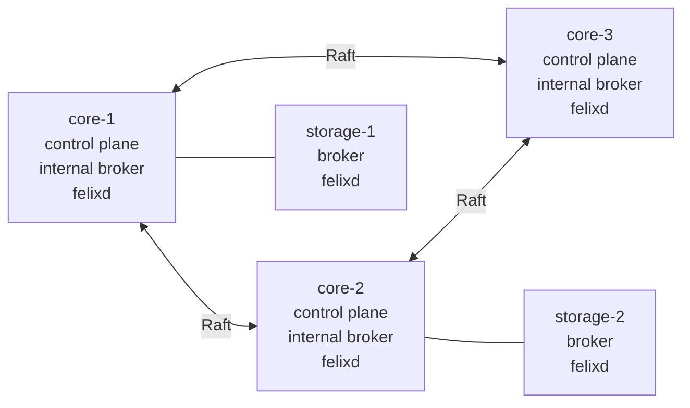
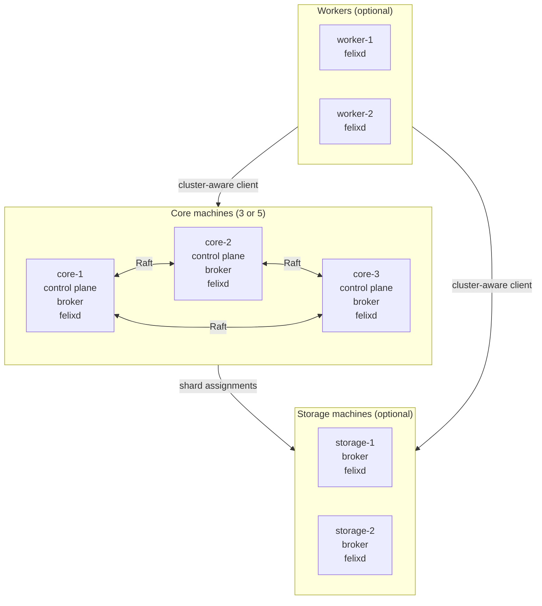
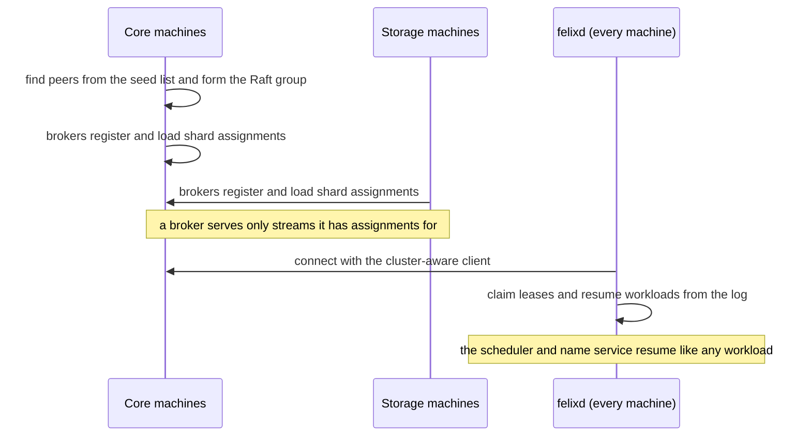

# Cluster topology

Where Felix and felixd run, and how a cluster comes up.

## Felix runs under NineLives, not on it

Everything NineLives schedules is recorded in Felix, so Felix can't be one of
the things it schedules. The control plane and brokers are system services
started by the image, like a kernel is to a single machine. The scheduler and
every other workload run on top.

## Roles

A machine gets its role from its join config on first boot. The role decides
which services the image starts.

| Role | Runs | How many |
|---|---|---|
| core | control plane, broker (internal only), felixd | 3, or 5 in larger clusters |
| storage | broker, felixd | at least 1 in a cluster that serves clients; as many as data and throughput need |
| worker | felixd | optional; the rest |
| core-dev | control plane, broker serving clients, felixd | development and test images only: 1, the whole cluster |

Decided: core machines are internal-only. Their brokers serve no tenant
clients, so every client and every felixd connects to storage brokers
([join design](components/join.md#core-machines-are-internal-only),
[#77](https://github.com/GetFelix/ninelives/issues/77)). The `core-dev` role
exists so NineLives can be tried on one machine; production issuers and
images refuse it.

- **The control plane stays at 3 or 5.** It is a Raft group and every
  metadata write waits for a majority. Three tolerates one failure and five
  tolerates two; more members only make writes slower.
- **Brokers don't need to be everywhere.** Each broker is somewhere the
  control plane can place shards. The replication factor decides how many
  copies of a shard exist, not the number of brokers.
- The control plane uses Felix's built-in Raft store. There is no Postgres.

## Cluster sizes

Workers are optional. A production cluster that serves clients needs at
least one storage machine, since core brokers serve none. A cluster starts
small and adds machines when it needs capacity.

| Cluster | Machines | What you get |
|---|---|---|
| Development | 1 `core-dev` machine, development or test image only | Everything works; nothing survives losing the machine |
| Smallest production | 1 core + 1 storage | Serves clients; survives nothing |
| Fault-tolerant production | Open. Proposal: 3 core + 2 storage | Survives losing any one machine, and serving survives losing a storage machine. The formation design and the M2 demo ([#7](https://github.com/GetFelix/ninelives/issues/7)) decide it. |
| Growing | fault-tolerant + workers | More compute; workloads off the log's machines |
| Large | 3 or 5 core + storage + workers | More log capacity and throughput |

Three is the floor for surviving a failure: Raft needs a majority, and with
two machines losing either one leaves no majority.

The proposed fault-tolerant production cluster (not decided):



A large cluster adds storage machines and workers around the same core:



## Services, not containers

Felix ships container images for people running it on Kubernetes or Compose.
NineLives does the job those would do, so it runs the release binaries as
services under its own init
([0002](decisions/0002-our-own-init.md)):

```
init (PID 1)
├── felix-controlplane   (core)
├── felix-broker         (core, storage)
└── felixd               (every machine)
```

- **Boot doesn't depend on a container runtime or a registry.** Everything
  else waits on Felix, so its start has to be the simplest step in boot.
- **The init does the isolation.** Each service runs as its own user, sees a
  read-only system, writes only to its directory on the data partition, and
  has CPU and memory reserved with cgroups. The reservation is what stops a
  busy workload from slowing the log on a shared machine.
- **Felix upgrades with the image.** The image pins a Felix release
  ([0004](decisions/0004-components-from-pinned-releases.md)), so upgrading
  Felix is an image upgrade, with the same rollback.
- Felix's data lives on the data partition, so an image upgrade never
  touches it, whatever the update mechanism turns out to be.

Podman quadlets would also work if containers are ever wanted, at the cost of
the runtime and registry dependency at boot.

## Shared or external Felix

Two ways to place the log:

| | Shared (default) | External |
|---|---|---|
| Setup | One image; Felix comes up as part of the OS | The join config names an existing Felix cluster; every machine is a worker |
| Smallest cluster | 1, or 3 to survive a failure | 3 Felix machines plus at least 1 worker |
| Risk | A workload on a core machine competes with the log, limited by the cgroup reservation | A workload can't touch the log |
| Fits | Demos, small clusters, edge sites | Larger clusters, teams already running Felix |

In bigger shared clusters the scheduler can also keep workloads off core
machines. felixd connects the same way in both modes.

## Bringing a cluster up



A cold start of the whole cluster replays this sequence.

## What NineLives doesn't do

**Moving Felix itself.** Adding or retiring a core machine changes Raft
membership and moves shards. That goes through Felix's own tools, started by
an operator. The scheduler can ask for it but not decide it, because it runs
on the layer being changed.

## Felix gaps that matter here

| Felix issue | Effect on NineLives |
|---|---|
| [#1196](https://github.com/GetFelix/felix/issues/1196): a broker can't rejoin while the control plane is down | A machine that reboots during a core outage stays out of the cluster |
| [#1009](https://github.com/GetFelix/felix/issues/1009), [#1197](https://github.com/GetFelix/felix/issues/1197): failover waits on the control plane's lease | Losing core machines slows recovery for every workload |
| Server binaries ship for `linux-x86_64` only | aarch64 images (qemu in M0, Raspberry Pi in M5) need an aarch64 broker and control plane build |
